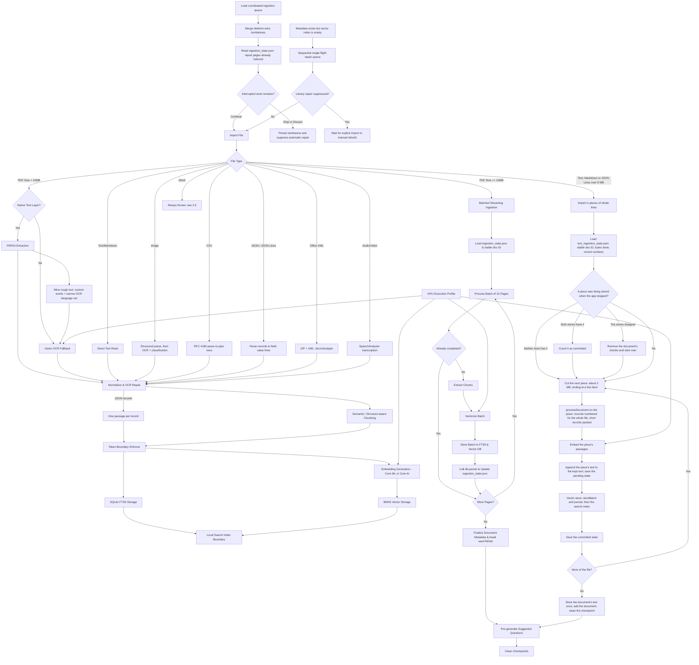

# Ingestion Pipeline — source-verified at v4.6; shipped versions in `Docs/SHIPPED_VERSION.json`

> **Read this file by section, never whole** (about 65 KB): `grep -n '^## ' Docs/INGESTION_PIPELINE.md`, then the section a task touches.

> **Documentation status:** Source-verified on 2026-07-15 against v4.6. **Not re-verified since.** `Docs/SHIPPED_VERSION.json` is the per-platform record of which version is live and which is in review; read it there, because a version number hardcoded in this header went stale with each release. Corrected 2026-09-01, having said 4.9 since July; 5.1 recorded 2026-09-02, 5.2 recorded 2026-09-11, 5.3 recorded 2026-09-20. Private Cloud Compute shipped in 5.2 on 2026-09-10 and is live on both platforms, and it still does not change ingestion: indexed content remains local until a later query explicitly selects and consents to a minimized PCC synthesis envelope.
> **Known drift as of 2026-08-05** — in the changelog under 4.9 (now `Docs/Archive/CHANGELOG_2.0_to_5.2.md`) but not yet described below: all five workspace metadata writes are now atomic read-modify-writes through `coordinatedMergeData(at:transform:)`, closing the race where an ingestion completing mid-sync-pass left a fully intact document on disk with no metadata row pointing at it. `WorkspaceSyncService` also no longer deletes an index for a library that still has documents.
> **Source of truth:** The code. The codebase audit this line cited, in `Docs/AUDIT/`, is not in the repository (`Docs/AUDIT/` is gitignored). For history, see `Docs/Archive/CHANGELOG_2.0_to_5.2.md` 4.8–4.9 for ingestion and sync (moved out of `CHANGELOG.md` on 2026-09-24).
> **Scope:** Describes shipped behavior unless explicitly labeled experimental, developer-only, or scaffolded.

This document describes the design and implementation of the import-time document ingestion pipeline, as audited at v4.6 and corrected in place since. Dated section notes carry the later changes. The tree carries work for the release being prepared as well as what shipped; `Docs/SHIPPED_VERSION.json` records what is live.

---

## 1. Overview
The ingestion pipeline converts raw files (PDFs, images, text documents) into searchable text segments with semantic metadata, storing them in parallel lexical and vector indexes. 



---

## 1.5 Import entry points *(added 2026-08-27)*

Everything above starts at `A[Import File]`. Three surfaces reach it, and all three stage files the
same way.

| Surface | Platform | Mechanism |
|---|---|---|
| Library "Add Documents" | iOS | `UIDocumentPickerViewController` with `asCopy: true`, in a sheet |
| Library "Add Documents" | macOS | `MacDocumentImportPanel` — `NSOpenPanel.beginSheetModal(for:)`, no sheet |
| Finder drag-and-drop onto the library | macOS, iPadOS | `.dropDestination(for: URL.self)` on the library area |

**All three copy into the app-managed workspace before ingesting**, through
`ImportedFileStaging.copyIntoWorkspace` in
[DocumentPicker.swift](../OpenIntelligence/Features/Documents/Components/DocumentPicker.swift).
Importing by reference was rejected: a library pointing at files outside the workspace neither syncs
across devices nor survives the original being moved. That function is also where the
modification-date touch happens, which is what keeps `WorkspaceSyncService`'s 15-minute sweep from
treating a just-imported file as stale — the behaviour §5 and the canonical source of truth both
describe. A per-file failure is logged and skipped rather than aborting the batch.
`[evidence_level: code_verified, confidence: exact]`

**macOS never uses `NSOpenPanel.runModal()`.** `runModal()` starts a nested modal loop, and AppKit
refuses to start one from inside a CATransaction commit, which is exactly where SwiftUI runs
`onAppear`. Until 2026-08-27 all three macOS pickers did precisely that, so the panel was discarded
before it appeared: a capture that day recorded three `Suppressing invocation of -[NSApplication
runModalForWindow:]` warnings, an `_NSDetectedLayoutRecursion`, and 2,064 lines of `CUICatalog`
window-chrome relayout from the orphaned sheet. `beginSheetModal(for:)` is asynchronous and has no
such restriction. `[evidence_level: device_log_proven, confidence: exact, evidence_source: macOS capture 2026-08-27]`

**Drops are filtered before staging.** Directories are excluded, because the pipeline has no concept
of a folder document and `copyItem` would copy one wholesale. Quota is checked before any copy, so a
drop that would exceed the document limit raises the paywall instead of half-importing.
`[evidence_level: code_verified, confidence: exact]`

---

### Files handed over by another app *(added 2026-10-09, for 5.7)*

Through 5.6 the app declared no document types, so Files, Mail and share sheets never offered it a file, and the main view's URL handler discarded any address that was not `openintelligence://`. `Info.plist` now declares `CFBundleDocumentTypes` for the formats the import path reads (role Viewer, rank Alternate). On iPhone and iPad `LSSupportsOpeningDocumentsInPlace` is NO, so the system hands the app a copy; that key is a build setting in `project.pbxproj`, NO for the iOS SDKs and YES for macOS, because the Mac build refuses NO (a Mac always opens a file in place, and the handler copies it into the app either way). `ContentView.importOpenedFile` copies that file into the imported-documents folder at once (`ImportedFileStaging.copyIntoWorkspace`), removes the system's copy from the app's own `Documents/Inbox` (iPhone and iPad only; on the Mac the address is the person's own file, opened in place, and is left alone), and posts `.importFiles` to `AppNavigationRequest`, where several files sent together all wait; `DocumentLibraryView.importOpenedFiles` then applies the plan's document limit and the import review exactly as it does for a picked or dropped file, and deletes the copy when the plan has no room. `[evidence_level: build_verified, confidence: high, evidence_source: Info.plist; ContentView.swift importOpenedFile; DocumentLibraryView.swift importOpenedFiles; project.pbxproj; the merged Info.plist in the simulator product of 2026-10-09]` Not exercised on a device or a Mac.

**Shown before it is added (2026-10-14).** A file "Open in" hands over is no longer imported at once. The copy goes to the Documents screen as its own request (`AppDestination.openedFiles`, kept apart from the Mac's Services menu and the document scanner, which still post `importFiles` because the person already chose to add), which runs the plan check and then shows `OpenedFilesSheet`: each file opens read-only in Quick Look, and nothing joins a library until Add to Library, which runs the usual import review; Don't Add, or closing the sheet any other way, removes the app's copies. Files handed over while the sheet is open join it. The system's document browser (`DocumentGroup`) was not used, because it would make a document window part of the app's launch for a file the person may not keep. `[evidence_level: build_verified, test_verified for the request and its link (AppLinkTests); confidence: medium; evidence_source: OpenedFilesSheet.swift; DocumentLibraryView.swift showOpenedFiles, finishOpenedFiles; ContentView.swift importOpenedFile]` Not opened from Files or AirDrop on a device.

## 2. Text Extraction Lanes

### PDF Ingestion
- **Standard Lane:** Uses PDFKit to extract the native text layer if available. [StructuredDocumentParser.swift](../OpenIntelligence/Services/Document/Processing/StructuredDocumentParser.swift) is used to resolve structures like tables, lists, and headings.
- **OCR Fallback Lane:** If the native text layer is missing or malformed, the pipeline invokes [LayoutAwareExtractor.swift](../OpenIntelligence/Services/Document/Processing/LayoutAwareExtractor.swift) to render pages as images and run local Apple Vision OCR, restoring page layout anchors.

### Image Ingestion *(corrected 2026-08-08)*
- Standalone images (png/jpg/jpeg/heic/tiff/gif) run through `StructuredDocumentParser.parsePageImage` first, the same `RecognizeDocumentsRequest` path PDFs use, and its output is prepended to the classification and AI description from `ImageUnderstandingService`. A failure falls back to the previous behaviour, so this adds structure and never removes it.
- **Until 2026-08-08 this path never saw the structured parser.** It used `VNRecognizeTextRequest`, which returns text lines in reading order and cannot express that a value belongs to a row and a column, so the same table gave cell structure inside a PDF and flat lines when photographed. `[evidence_level: code_verified, confidence: exact]`

### Camera Capture *(corrected 2026-08-08)*
- Document captures run `RecognizeDocumentsRequest` and prefer its structured output. Non-document captures skip it, since a photo of a pet or a landscape has no document structure to find. Failure or an empty parse leaves the flat OCR text untouched.
- **This path carried both defects.** `CameraManager.analyzeCapture` sorted its OCR observations into reading order and then joined them with a space, discarding every boundary that sort had just established, and it never reached the structured parser at all. Photographing a spec sheet produced flat text while importing the same page as a PDF produced cell structure. `[evidence_level: code_verified, confidence: exact]`

**API currency, verified 2026-08-08.** `RecognizeDocumentsRequest` is Apple's current document-understanding API, introduced at WWDC25 for iOS 26; it parses tables and groups cells into rows automatically. Nothing supersedes it. `VNRecognizeTextRequest` is retained deliberately as the fallback for images where no document is detected, and its continued presence in these files is correct rather than debt. Sources: [WWDC25 session 272](https://developer.apple.com/videos/play/wwdc2025/272/), [RecognizeDocumentsRequest](https://developer.apple.com/documentation/vision/recognizedocumentsrequest), [Recognizing tables within a document](https://developer.apple.com/documentation/Vision/recognize-tables-within-a-document).

### Text & Markdown Ingestion
- Text files, markdown notes, and source code are ingested directly. Markdown structures (headers, code blocks) are parsed to preserve hierarchical section paths.
- **Encoding, changed 2026-10-10 for 5.7.** `DocumentProcessor.decodeTextFile` decides how the bytes of a text, Markdown, code or JSON file are read, and the bytes of each piece of a large one. In order: UTF-16 by its byte-order mark; UTF-16 with no mark, when the file has zero bytes and is either not UTF-8 or a tenth control codes; UTF-8; Foundation's detection (`NSString.stringEncoding(for:encodingOptions:convertedString:usedLossyConversion:)`, lossless results only); Windows-1252; Latin-1. A leading byte-order mark is dropped and the log names any encoding other than UTF-8. Before this the order was UTF-8 then Latin-1, which never fails, so a file in any other encoding was imported as garbage with no error. Mac Roman is not handled (the detection names another encoding for it). `[evidence_level: measured on macOS 27 with a copy of the function, 13 cases; test_verified, confidence: medium, evidence_source: DocumentProcessor.swift, IngestionAccuracyTests]`

---

### JSON and JSON Lines *(added 2026-10-09, for 5.7)*

Through 5.6 a `.json` file took the code-file lane (`extractTextFromCode`, the file's text as written), and `.jsonl` and `.ndjson`, which `detectDocumentType` did not know, took the plain-text lane. Each was cut wherever the chunker's word window fell. `.jsonl` was not listed in either picker; `.ndjson` could be chosen, because its system type conforms to `public.text`, which both pickers list. `[evidence_level: code_verified, confidence: exact, evidence_source: DocumentProcessor.swift detectDocumentType and extractTextWithPageInfo at commit 7025657; DocumentPicker.swift and AttachmentPicker.swift type lists at the same commit]`

`JSONRecordExtractor` (`Services/Document/Processing/JSONRecordExtractor.swift`) reads these files as records, and `processDocument` gives each record its own passage:

- **What a record is.** One line of a `.jsonl` or `.ndjson` file; one element of a top-level array in a `.json` file; for a top-level object, one record holding its plain values, then one per member that is a non-empty object or list, and a list of objects gives one record per element (`messages[1]`, `messages[2]`).
- **What a record's text is.** A header line, `Record N of T`, then one `path: value` line per value. Nested objects extend the path with a dot (`owner.name`), a list of plain values shares one line, a list that holds objects or lists is numbered from 1. A string value keeps its own line breaks, and its lines after the first are indented by two spaces, so no line of a value starts in the first column, where a header does.
- **The file's own text is kept.** The extractor has its own reader, `JSONValue.parse`, because `JSONSerialization` loses three things a stored passage should keep. Members are written in the file's order. A number is written with the digits the file has: `12.50` stays `12.50` and `75.0` stays `75.0`. Members with the same name are all written. A null or empty member is written `null`, `""`, `[]` or `{}`, so its name is not lost. The reader refuses anything that is not valid JSON (a trailing comma, a comment, a leading zero, an unknown escape, a lone surrogate, text after the value) and nests no deeper than 200 levels.
- **Nothing is dropped.** A line of a JSON Lines file that does not parse is kept as a record holding the line as written, and the count is logged. A file that does not parse at all (comments in a `.jsonc`, a trailing comma) returns nil from the extractor and takes the text lane, as before; so does a JSON Lines file over 64 MB read in one go, because its records are held in memory next to the file's own text (since later on 2026-10-09 a `.jsonl` or `.ndjson` file over 8 MB is not read in one go at all: it is imported in pieces, each piece as records, section 5), and a `.json` file over 16 MB, because the whole file becomes one parsed tree several times its size (16 MB is a guess at what a phone can hold; it has not been measured on one). A leading byte-order mark is taken off first, and JSON Lines is split at line feeds only: JSON allows U+2028, U+2029 and U+0085 raw inside a string, and a general line reader would cut a record in two at them. That fallback is written to the log and is not shown to the person.
- **How the passages are cut.** The records are joined with a blank line into the document's text, which goes through the same cleanup and is stored for full-text search like any other document. `JSONRecordExtractor.passages(in:expectedCount:)` then cuts that text at the record headers, taking a header only in the first column and only as the next one due, and returns nil unless it finds exactly the number of records that were read. On nil, `processDocument` logs a warning and chunks the text as prose, so a header damaged by cleanup costs the record boundaries and no text. Each passage's `sectionTitle` is `Record N` and its positions are character offsets into the document's text.
- **A record over the embedding limit.** `JSONRecordExtractor.parts(of:maxTokens:countTokens:)` cuts it at its own lines before the general token enforcer sees it. Every part starts with `Record N of T, part K of M`, a single line longer than a part is cut between words, a run with no space longer than a part is cut by characters, and no character is retyped. A part still over the limit is logged.
- **The stored type is unchanged.** `.jsonl` and `.ndjson` map to `DocumentType.json`. The type is stored in each document record, and a new case would not decode on an older build reading the same library. `[evidence_level: inferred, confidence: medium, evidence_source: DocumentType is a String-raw Codable enum with no unknown-case fallback, Core/Models/DocumentChunk.swift]`
- **The pickers.** `.jsonl` has no system type on macOS 27 (`UTType(filenameExtension: "jsonl")` is dynamic and conforms only to `public.data`), so both pickers name it by extension; `.ndjson` is `public.ndjson` and conforms to `public.text`. `[evidence_level: measured, confidence: exact, evidence_source: a Swift script printing UTType(filenameExtension:) on macOS 27.0, 2026-10-09]` Since the same day `Info.plist` declares the type itself (`org.jsonlines.jsonl`, conforming to `public.text`), which is the supported way to make an extension the system does not know selectable. Whether a `.jsonl` file can now be chosen in the iOS document picker has not been tried on a device.
- **The import review.** `DocumentImportReadiness` lists `.json`, `.jsonl` and `.ndjson` with the formats that import without a warning. `.jsonc` keeps the "reduced-fidelity parsing" note, because comments make it take the text lane.

`[evidence_level: test_verified, confidence: high, evidence_source: JSONRecordExtractorTests (records, order, digits, empty members, escapes, cutting, oversized records) and IngestionFormatCoverageTests testJSONLines_GivesOnePassagePerLineWithItsFieldNames, testNDJSON_TakesTheSameRoute, testJSONArray_GivesOnePassagePerElement, testAJSONRecordOverTheEmbeddingLimit_KeepsItsTextAndItsHeader and testJSONThatDoesNotParse_StillImportsAsText, which drive real files through processDocument; run on an iOS 27.0 simulator on 2026-10-09]` Not seen on a device, and no question has been asked against an imported record there.

### Web pages *(added 2026-10-09, for 5.7)*

The "Ingest Webpage" action (`IngestURLIntent`) handed its web address to `enqueueDocuments` as if it were a file on disk and answered "Extracting webpage in the background". No code in the import path downloaded anything. `[evidence_level: code_verified, confidence: exact, evidence_source: ScreenAwarenessIntents.swift lines 99 to 114 at commit 7025657]`

`WebPageFetchService` (`Services/Document/Extraction/WebPageFetchService.swift`) is the download. It makes a GET to the address, following the site's own redirects (so the request can end at another host than the one typed), on an ephemeral `URLSession` that accepts no cookies and uses no cache. It accepts only `http` and `https`, and asks for an `http` address as `https`, because the app has no transport-security exception and plain `http` would be refused before reaching the site. The status is checked before the body is read, the read stops at 20 MB, a web page's markup is held to 5 MB (its text is found with regular expressions over the whole page), and the whole request is given 25 seconds, since a background action has about 30. What comes back becomes a file in the imported-documents folder, which is then queued like a picked file:

- **A web page** (`text/html` or `application/xhtml+xml`) becomes a Markdown file named by the page's title, with `Source:` and `Saved:` lines under the title. `readableText(fromHTML:)` removes comments and the `script`, `style`, `noscript`, `svg`, `template`, `iframe`, `head`, `nav`, `footer`, `button` and `select` elements, writes headings as `#` lines, list items as `- ` lines and table rows as cells joined by ` | `, strips the remaining tags (only what starts like a tag, so "p < 0.05" keeps its "<"), and decodes numeric entities and the named ones in its table (the markup five, punctuation, currency, common symbols, the Latin-1 letters and a few Greek letters; HTML defines about 2,200, and one it does not know is left as written). The page is read with the character set the response names, or the one its own `<meta>` tag names, or UTF-8; bytes that fit none are replaced and that is logged. Scripts are not run, so a page that draws its text with JavaScript yields little or nothing: under 40 characters of text the fetch fails with "The page has no readable text without running its scripts."
- **A link straight to a file** the import path reads (PDF, plain text, Markdown, CSV, JSON, JSON Lines, by the response's type) is saved as that file.
- **Anything else**, a status outside 200 to 299, or a body over 20 MB fails with a message that names the reason, and the action throws it instead of reporting success.

`[evidence_level: test_verified, confidence: high, evidence_source: WebPageFetchServiceTests, which covers reading a page, a "<" in text, self-closed elements, a title over two lines, a character set named only in a meta tag, entity decoding, a page becoming Markdown, a PDF link, an error status, a body over the limit, a script-only page, an unsupported type and a non-web address; run on an iOS 27.0 simulator on 2026-10-09]` The network call itself is not covered by a test and has not been run from the action on a device.

## 2.5 Failure modes fixed on 2026-08-08

Four defects that produced *silent* degradation, meaning ingestion reported success while the content was already damaged. Recorded because each was invisible to the benchmark and each was found by reading code rather than by a failing test.

| Defect | Effect | Fix |
|---|---|---|
| OCR lines joined with a space, twice | Every ingested image became **one unbroken line**. Line items, dates and amounts concatenated into a single sentence; the chunker saw one paragraph and the embedding averaged the page. | Both joins preserve line breaks. |
| `effectiveContent` chose instead of merging | A low-quality page that captured **one table** kept the table and discarded the recovered prose the parser had already re-OCR'd. A scanned datasheet could ship with four fifths of the page absent from chunks, FTS5 and the vector index. | Keeps structured elements *and* appends recovered text, deduplicated. |
| `usedStructuredParsing` counted tables and lists only | A PDF with figures but **no tables** discarded every structured element, including embedded-image analysis produced at Neural Engine cost moments earlier. | Flag reflects whether structured extraction produced anything. |
| Camera captures never reached the structured parser | Photographing a document gave flat reading-order text while importing the same page as a PDF gave table cells. Same content, opposite quality. | Document captures run `RecognizeDocumentsRequest` and prefer its output. |

**Coverage, corrected 2026-08-09.** All four are now exercised by automated tests in `OpenIntelligenceTests/Services/Document/Processing/`. See §2.6.

The warning this section used to carry is worth keeping in its original terms, because it is the reason §2.6 exists: the evaluation corpus was 25 markdown files against 20 advertised formats, so none of the above was exercised by any automated run. A table-chunking change on 2026-08-08 destroyed 70% of retrieved table text while the benchmark reported an unchanged 16/20; it was caught only by a human noticing character counts in the running app. `[evidence_level: measured, confidence: exact, evidence_source: BenchmarkRuns/20260808-retrieval-stages]`

## 2.5.1 Two further defects, found 2026-08-09 by the fixtures in §2.6

Both were found on the **first execution** of the new fixture set, and neither was reachable by any test that existed before it.

| Defect | Effect | Fix |
|---|---|---|
| Word table text was extracted and then discarded | `extractTextFromWordXML` lifts each `<w:tbl>` out, leaves a bare `[[TABLE_n]]` marker in its place, and re-inserts the table text at that marker afterwards. But the intervening step builds its output **only** from `<w:p>...</w:p>` matches, and in OOXML a `<w:tbl>` is a *sibling* of `<w:p>`, never nested inside one. The marker therefore sat outside every paragraph match, never entered the result, and the re-insertion had nothing to replace. **Every table in every `.docx` was parsed into rows and dropped**, while the surrounding prose came through — so extraction looked like it worked. | Marker is wrapped in a `<w:p>` so it lands in the stream that step reads. Marker numbering also moved from append order to document order in the same change, but that is readability rather than a second defect: tables are replaced back-to-front, so append order labelled the last table 0 *and* stored its text at index 0. The pairing was reversed and self-consistent, and would have resolved correctly once substitution began working. Document order is worth having because the marker number now matches the table's position on the page when this is debugged from a log. |
| A fully scanned PDF reported zero OCR pages | The primary structured path hardcoded `usedOCR: false`. It renders and recognises a page image whether or not the PDF carries a text layer, so "Vision ran" is not the signal — "there was no usable native text" is. A scan that `RecognizeDocumentsRequest` read cleanly reported **0** OCR pages while one that fell through to the rescue path reported 1, which is backwards from what "OCR: N pages scanned" tells the user in Document Details. | `usedOCR` is now `isGarbled \|\| bestAvailableText.isEmpty`. |

`[evidence_level: code_verified+test_verified, confidence: exact, evidence_source: DocumentProcessor.swift extractTextFromWordXML and the structured PageParseResult, IngestionFormatCoverageTests 12/12]`

## 2.6 Format coverage, added 2026-08-09

`StructuredPageContentTests` pins the `effectiveContent` merge with no fixture and no Vision call, so that defect has a deterministic guard independent of OCR behaviour.

`IngestionFormatCoverageTests` drives real files through `processDocument` for a text-layer PDF, an image-only (scanned) PDF, a figures-only PDF, a partially legible scan, a PNG of a table, CSV, `.docx` and `.xlsx`. It asserts on **extraction**, not on answers:

- each table row returns with its label and its value on **one line**;
- a multi-line page does not collapse to one line;
- character yield holds against the characters the fixture draws, with a per-lane floor;
- the lane under test is the lane that actually ran;
- the chunk inventory has not changed shape, including that chunking did not lose what extraction already recovered.

That last group is the point. An answer score cannot see any of it: the 2026-08-08 regression held at 16/20 while destroying 70% of retrieved table text.

**Fixtures are synthesised in Swift at test time rather than committed.** Expectations and bytes derive from one `TableSpec`, so there is no hand-transcribed ground truth to drift; no binary enters an iCloud-synced repository; and the test target's file membership does not change, so hard-boundary `project.pbxproj` stays untouched. `.docx` and `.xlsx` are built by a store-only ZIP writer, which works because the reader in `DocumentProcessor` accepts `compressionMethod == 0`. Reasoning and consequences in `Docs/ai/DECISIONS.md`.

**What this does not cover, stated plainly.** A page rasterised from vector text is cleaner than anything a scanner produces, so these fixtures catch *structural* regressions and **not OCR accuracy loss on noisy input**. That is an acceptable trade because all six defects above were structural, but a real scanned corpus is still worth acquiring and this set does not replace it.

### iWork extraction does not work for any document current iWork produces

Not a regression; it has never worked, and the reason is structural rather than a parsing bug. `extractTextFromIWorkDocument`:

1. inspects **directories only**, so a single-file `.pages` — what Pages on iOS always writes — never reaches a content read at all;
2. for the package form, looks for members with extension `xml` or `txt`, while modern iWork stores content as compressed protobuf in `Index/*.iwa`.

Both paths end at `throw DocumentProcessingError.iWorkExtractionFailed`. That is the acceptable half of the answer: it fails loudly, so nothing is indexed as a silent empty. Two tests pin both shapes so that cannot quietly change. `[evidence_level: code_verified+test_verified, confidence: exact]`

**2026-08-21: the outward claims now match this, and the escape hatches were checked before removing
them.** Five user-facing places still advertised iWork support (`README.md`, the App Store
description, `Docs/ai/PROJECT.md`, the picker caption, and the error string, which called support
"limited" when it is zero). Per the claim-audit rule the removal was evidenced in both directions,
not just by absence:

- The iOS 27 SDK on this machine exposes **no** iWork text-extraction API. Swept
  `iPhoneOS.sdk/System/Library/Frameworks` for iWork/`iwa` symbols and for Apple-declared
  `com.apple.iwork.*` type identifiers with a route to content. Nothing.
- The obvious workaround is closed as well. Rendering the file with QuickLook and running the
  existing Vision OCR over it reaches **page 1 and no further**: `QLThumbnailGenerator` takes no
  page index, and `QLPreviewController` is UI-only.

So implementing this genuinely means parsing Apple's undocumented `.iwa` protobuf, and
`ZIPArchive` being file-scoped private means a new reader cannot even see the unzip helper without
an access-level change. **The formats stay in the picker on purpose** so the failure is reachable
and explained; removing them re-creates the defect `CHANGELOG.md:162` already fixed (that line is now `Docs/Archive/CHANGELOG_2.0_to_5.2.md:48`).
`[evidence_level: code_verified+sdk_verified, confidence: exact]`

### Spatial extraction: the word-position arithmetic, and two branches that used to fail silently

`extractTextWithSpatialOrdering` is the column-aware reader for every PDF page that skips Vision.
It asks PDFKit where each word sits via `page.selection(for: NSRange)` and groups the results into
lines, then into columns.

**Until 2026-08-21 the range it asked with drifted off the word.** It was built from a
hand-maintained counter that under-counted two independent ways, and the two compounded:
`split(whereSeparator:)` omits empty subsequences, so every run of whitespace collapsed into a
single gap while the cursor advanced by exactly `+ 1` per gap; and `String.count` counts grapheme
clusters while `NSRange` addresses UTF-16 code units, so ligatures drifted it further. Both
under-count in the same direction, so the range stayed **in bounds** and PDFKit kept returning
bounds, for different text than the word being positioned. The word appended to the line was right
and its recorded coordinates were not. The range now derives from the `Substring`,
`NSRange(word.startIndex..<word.endIndex, in: pageString)`, where `in: pageString` is load-bearing.
`[evidence_level: code_verified+test_verified, confidence: exact, evidence_source: SpatialOffsetArithmeticTests]`

**Two branches returned a materially worse result and said nothing**, which is why a two-column
extraction defect had to be diagnosed by inference across three sessions rather than read off a
trace:

1. `guard spatialLines.count > 3` returns nil, sending the caller to raw `page.string`, which
   interleaves columns by construction. Both call sites read `... ?? text`, so a nil return was
   indistinguishable from a success.
2. When `detectColumnBoundaries` returns empty, the page is read as a single column, sorted by Y
   alone, and returned **non-nil**. Genuinely single-column pages and multi-column pages whose
   boundaries were missed both land here and cannot be told apart from inside the function; in the
   second case a Y-only sort interleaves the columns, because a left line and a right line at the
   same height sort adjacent.

Both now log. The selected `PageProcessingStrategy` is also logged per page, and equal-Y ties break
on X ascending, because `sorted(by:)` is not stable in Swift and the same page could previously
extract differently on two runs. **The instrumentation was the point of that change**, and it is
what made the attribution below possible.
`[evidence_level: code_verified, confidence: exact]`

#### Attribution closed 2026-08-24: the column signal was destroyed before column detection ran

The damage was upstream of every check meant to catch it, which is why branch 2 above looked like
the defect and was only a symptom of it.

Words were grouped into a `SpatialLine` on a **vertical test alone**. `page.string` on a two-column
PDF emits words row by row across the gutter, so a left-column word and a right-column word at the
same height arrive adjacent at the same Y and were merged into one line. That line's `xPosition` is
the **mean** of its words' midpoints, so it lands near the page centre.

`detectColumnBoundaries` then looks for a gap wider than 10% of the page across those means. Once
every line sits at the centre there is no gap, so it returns empty, branch 2 sorts by Y, and the
columns interleave. **Neither a smarter `detectColumnBoundaries` nor the tie-break could have fixed
this**: both operate on X positions that have already been averaged across the gutter.

`DocumentProcessor.spatialLineBreak(wordBounds:currentLineBounds:currentLineY:)` now returns
`.none`, `.verticalGap` or `.horizontalGap`, and a horizontal discontinuity starts a new line: a
move back to or past the line's own left edge, or a forward jump wider than `1.5 ×` glyph height
(floored at 8pt), which is a gutter rather than a word space. Scaling by glyph height keeps the
threshold correct at any page size. Lines then stay inside one column, `xPosition` becomes genuinely
bimodal, and the existing column grouping and per-column top-to-bottom assembly work as designed
with no further change.

It is `nonisolated static` and takes only geometry, so this is the first part of the two-column path
that can be exercised without ingesting a real journal PDF on a device. Seven cases in
`DocumentProcessorTests` cover the gutter crossing, the left-margin wrap, ordinary word spacing,
the next row, both no-line-started guards, and that the threshold scales with type size.

A page whose words arrive across a gutter now says so, so a genuinely single-column page and a
two-column page are no longer indistinguishable in a trace.

Device evidence this closes: a stored chunk read *"…in locomotors are more diverse, consisting of
Gi-coupled 5-HT, and 5-HTS. tion, reinforcement learning…"* — lines emitted out of order, with
"locomotion" severed across the join.

**Withdrawn: the non-English detections are not a scrambling signal.** This document was read as
non-English on 118 of 552 chunks, and that was proposed here as a free interleaving detector. The
corrected capture disproves it: with the ordering fixed and every page matching Vision's transcript,
the distribution barely moved (126 non-English chunks to 123). Inspecting them shows why — they are
reference-list entries such as *"Weissbourd B, Ren J, DeLoach KE, Guenthner CJ, Miyamichi K"*, which
are surnames and initials with no function words, and any language recogniser will call those
Indonesian or Dutch. The signal was reading bibliographies, not damage.
`[evidence_level: device_log_proven, confidence: exact, evidence_source: PostPostFixAgain.txt, lang distribution before and after the fix]`
`[evidence_level: code_verified+test_verified, confidence: exact, evidence_source: DocumentProcessor.spatialLineBreak; DocumentProcessorTests, 7 cases; device capture 2026-08-24, not yet device-verified]`

#### 2026-08-24, same evening: the real defect was line ordering in the Vision path, not columns

Two paired probes settled this in one device run and corrected two prior diagnoses.

`DocumentObservation.text.transcript` for page 1 reads *"…dynamics that regulate diverse aspects of
motivation-related behavior. Dopamine and serotonin transiently modulate moment-to-moment behavior at
timescales ranging from sub-second to minutes…"* — correct and continuous. **Vision's own reading
order was never the problem.**

The text that actually won for that page — `winner=layoutText` on all 8 pages — emitted those same
lines in the order **2, 1, 4, 3**. Adjacent pairs swapped. Pages 3 and 5 take the PDFKit spatial path,
carry its `speci c` ligature drops, and read correctly, which localises the defect to
`LayoutAwareExtractor`.

`groupBlocksByLine` matched a block to a line with
`groups.keys.first { abs($0 - block.topY) < lineTolerance }`. `Dictionary.keys` iterates in hash
order, so a block within tolerance of more than one line joined an **arbitrary** one. The grouping
therefore depended on Vision's block order and on the per-process hash seed, so the same page could
group differently between runs. Blocks are now consumed top-to-bottom and matched to the *nearest*
line from sorted keys.

**Nothing was read across the gutter and no text was lost.** Every word was present and correctly
recognised, in the wrong order — which is exactly why it passed a printable-ratio and entropy quality
gate, and why the repeated non-English detections were a symptom of scrambled word sequences rather
than of missing text.

**Correction, same evening.** The paragraph above attributed this to `groupBlocksByLine`'s
`Dictionary.keys.first` lookup. That is a real defect and it was **not** the cause: the capture after
fixing it was byte-identical, `layoutTextChars=5717` before and after, with the same transposition.

The cause is one level up, in `buildReadingOrderText`:

```swift
if abs(lhs.topY - rhs.topY) > 0.02 { return lhs.topY > rhs.topY }
return lhs.minX < rhs.minX
```

**The threshold is larger than the quantity it compares.** A journal page carries roughly 55 lines,
so consecutive lines sit about 0.015 apart in normalised coordinates — under 0.02. The vertical test
therefore never fired between neighbouring lines, and `minX` decided their order: body text sorted by
left edge, so an indented or hyphenated line jumps ahead of the line above it.

**And it is not a strict weak ordering.** Lines at 0.500, 0.485 and 0.470 make both inner pairs
compare equal while the outer pair compares ordered. `sorted(by:)` is documented as producing an
unspecified result when given such a predicate, which is why the output was scrambled rather than
merely imprecise.

`readingOrderPrecedes(lhsTopY:lhsMinX:rhsTopY:rhsMinX:)` replaces it: strictly by position down the
page, left edge only for an exact tie. No epsilon is required, because `groupBlocksByLine` has
already collapsed a physical line into one element using a tolerance derived from real glyph height.
Applied to all three call sites in the file rather than the one that was proven, and the same
non-transitive shape in `detectAndSeparateTables` is now row-bucket quantisation, which keeps its
legitimate row-then-left-to-right intent while being transitive. Three unit tests pin the ordering,
the transitivity, and that the left edge never overrides a real vertical difference.

**Device-verified 2026-08-24.** After the comparator fix, all eight pages' stored text matches
Vision's transcript order. Page 1 now reads *"dynamics that regulate diverse aspects of
motivation-related / behavior. Dopamine and serotonin transiently modulate / moment-to-moment
behavior at timescales ranging from / sub-second to minutes…"* against the previous *2, 1, 4, 3*.
`layoutTextChars` is unchanged at 5,717, confirming the text was only ever misordered and never lost.
The paired probes were removed once they had done their job; the three comparator unit tests replace
them, and unlike a log line they fail against the old predicate.

Correcting the entry above it: the `952d85f` note described this as gutter interleaving. It is not.
That commit stands on its own — `extractTextWithSpatialOrdering` genuinely did merge across a gutter
and now has 7 tests where it had none — but that path handles 2 of 8 pages here and found nothing to
correct on either, and the language-detection distribution was byte-identical before and after it.
`[evidence_level: device_log_proven+build_verified+test_verified, confidence: exact, evidence_source: PostFix.txt TRANSCRIPT PROBE vs PAGE TEXT PROBE across all 8 pages]`

### Audio and video: the failure mode is verified, transcription itself is not

`say` fails from an agent shell (`-241`), so no *speech* fixture can be authored there. A silent WAV was used to check the failure mode instead, and that part is settled: ingesting audio with nothing to transcribe **throws in about 76 ms** rather than yielding an empty document that gets indexed as a success. `[evidence_level: test_verified, confidence: exact, evidence_source: IngestionFormatCoverageTests testSilentAudio, 0.076s]`

One cold-start caveat, recorded because it cost a run. On the **first** attempt of the session `SpeechAnalyzerService` logged `Starting analysis: silence.wav (1s)` and had not returned when that run was terminated for unrelated reasons; the elapsed time was never measured, so "it hung" is an inference and not an observation. Every subsequent attempt threw immediately. The plausible reading is one-time framework or model preparation. The test caps the wait at 60 s and reports a timeout as a distinct outcome so a genuine stall would be visible rather than taking the suite down.

**Still uncovered: whether transcription of real speech works at all.** No automated test exercises `.mp3`, `.wav`, `.mp4`, `.mov` or `.m4a` with actual speech in it. That needs a committed sample or a human with an audio session.

**5.7: recordings go to `SpeechTranscriber` first (written 2026-10-09).** `SpeechAnalyzerService` kept its use of `SpeechAnalyzer` behind `#if canImport(SpeechAnalyzer)`. No module has that name (the type is in `Speech`), so the condition was never true, the code under it never compiled, and every recording was transcribed by `AudioTranscriptionService` with `SFSpeechRecognizer`. The code under the condition also called methods the framework does not have. From 5.7 `analyze` tries `SpeechAnalyzer` with a `SpeechTranscriber` module (both iOS 26 and macOS 26, on device) and uses the older recognizer when that path returns nothing to use: Speech Recognition is not already allowed for the app (the framework asks no permission to transcribe a file, but the app keeps to the answer the person gave; the older path is the one that asks), the transcriber is not on the device, the language is not supported, the language's model would have to be downloaded (the import does not start a download), the file does not open as an `AVAudioFile`, or the attempt throws. `[evidence_level: build_verified, confidence: high, evidence_source: SpeechAnalyzerService.swift performSpeechAnalysis and analyze; the Speech interface in the Xcode 27.0 SDK]`

The same code shape was run as a command-line probe on a Mac (macOS 27.0) that day, on files written by `say -o` (which did work from an agent shell when writing to a file): 13.2 s of AIFF speech came back in 0.4 s as three utterances with their times and a confidence of 0.94 to 0.97 ("Rent is due on the 1st day of each month, a late charge of $75 applies after the 5th day."), an AAC `.m4a` came back in 0.1 s, and two seconds of silence came back in 0.05 s with no utterances, which `DocumentProcessor` turns into the same thrown error as before. `AssetInventory.status` read `supported`, not `installed`, on that Mac while the model was installed and working, so the test for a missing model is `assetInstallationRequest` returning a request. `[evidence_level: measured, confidence: medium, evidence_source: a swiftc probe on macOS 27.0, 2026-10-09; one machine, English only]` Not run: the app itself on a recording, an iPhone, a video container (`.mp4`, `.mov`), a language other than English, a recording of more than a few seconds. The transcriber writes numbers as digits ("60 days", "$75"), which the older recognizer may not; that changes what a transcript's passages contain.

**5.7 on iOS 27 and macOS 27: the asset input, a track at a time (written 2026-10-14).** `performSpeechAnalysis` reads the recording through `AssetInputSequenceProvider` (new in the 27 SDK), which takes any audio track AVFoundation decodes, and tries the audio tracks in order until one holds speech (`transcribeEachTrack`). A track that fails is passed over, and what it had transcribed is cleared from the live transcript the import screen shows; when no track held speech and one failed, that failure decides, and the file is opened as an `AVAudioFile` and its first track read, which is also the path before 27. Each track gets a transcriber of its own. `[evidence_level: build_verified, confidence: high, evidence_source: SpeechAnalyzerService.swift performSpeechAnalysis, transcribeEachTrack, transcribe]`

Why, measured with a probe of the same calls on macOS 27.0 that day, on `say` output made into seven files (`BenchmarkRuns/2026-10-14-asset-transcriber-probe`): an MP4 with Opus audio opened as an `AVAudioFile` and then failed to read with OSStatus -1, which in the app would have sent it to the older recognizer, and the asset input transcribed it; a MOV with a silent first audio track and the speech on the second came back with no utterances from both single-track inputs and with all three from reading each track (0.22 s); AIFF, AAC `.m4a`, MP3, MP4 and MOV with one track gave the same three utterances either way in about 0.14 s for 7 s of speech. `[evidence_level: measured, confidence: medium, evidence_source: assetprobe.swift and results.txt in that folder; one machine, English only, synthetic speech]` Not run: the app on a recording, an iPhone, a recording made by a phone or a screen recorder, a long file with a silent first track (the silent track is transcribed in full before the next is tried).

### Pictures: from 5.7 the model is shown the image it describes (written 2026-10-09)

`ImageUnderstandingService.generateAIDescription` writes the sentence or two that makes a figure, a chart or a photo findable by search. It is called for every image `analyzeDocumentImages` finds in a document and for an imported image file. Through 5.6 it never sent the image: the prompt held the labels Vision's classifier gave the image, any caption, the text recognised in it and the text around it, and the model was asked to describe a picture it had not been shown (the code carried the note "For now, we use text context since image attachment API may vary"). On iOS 27 and macOS 27, when `SystemLanguageModel.default.capabilities` contains `.vision`, a request in a session of its own attaches the image (`Attachment`, moved to the origin and scaled so its longest side is at most 1,024 pixels) with a prompt that asks for what is visible and offers the page's notes "only where they agree with the image"; the answer is capped at 256 tokens. A logo, an image whose shorter side is under 96 pixels after scaling, a moment when the system has asked apps to scale back, and a failed request all fall through to the text-only request, which is unchanged and runs in its own session. A failed image request therefore costs that image two generations. `[evidence_level: test_verified for the sizing and the prompt, build_verified for the request; confidence: high; evidence_source: AttachedImageDescriptionTests; ImageUnderstandingService.swift describeAttachedImage; the FoundationModels interface in the Xcode 27.0 SDK]`

Measured as a command-line probe on a Mac (macOS 27.0) on 2026-10-09: the on-device model reported the vision capability, and a 640 by 420 bar chart drawn for the test came back in 3.0 s (293 input tokens, 77 output) as "The figure is titled "Units shipped per year" and shows the number of units shipped per year from 2023 to 2025. The values shown are 120 units in 2023, 200 units in 2024, and 290 units in 2025.", which is what the chart showed. `[evidence_level: measured, confidence: medium, evidence_source: a swiftc probe, 2026-10-09; one image, one machine]` Not measured: the app importing a document with figures, an iPhone, what a large image costs in tokens, how much longer an import with many figures takes. There is no cap on how many of a document's images are described, as before.

---

## 2.7 Entity detection: Vision already did the work, and it was discarded

*Corrected 2026-09-11.*

`RecognizeDocumentsRequest` runs data detection during the same pass that produces the transcript
and returns the results on `DocumentObservation.Container.Text.detectedData`, as
`[DataDetectorMatch]`. Each match carries a `boundingRegion` and a
`DataDetector.Match.SemanticDetails` value, which is a ten-case enum of **parsed** results.

`StructuredDocumentParser.extractDetectedData` read none of it. It took the `Text` value, used only
`.transcript`, and re-derived entities from five hand-written regexes, under a comment saying that
full integration "requires additional API verification". The results of the work Vision had already
done were dropped on the floor.

**What the regexes could and could not see.** They matched email addresses, US-format phone numbers,
`http(s)` URLs, three currency symbols, and two numeric date shapes. So a European invoice produced
no amounts, an international phone number produced nothing, and a postal address was invisible.

**What Apple's detector returns**, verified against `DataDetection.swiftinterface` in the iOS 27 SDK
on 2026-09-11: `link`, `emailAddress`, `phoneNumber`, `postalAddress` (with street, city, state,
postal code and region split out), `calendarEvent` (`Date` values plus time zones and an all-day
flag), `moneyAmount` (`Decimal` plus a `Locale.Currency`), `measurement` (value plus candidate
dimensions), `flightNumber`, `shipmentTrackingNumber`, and `paymentIdentifier`.

The difference is not only breadth. Apple returns parsed values rather than matched substrings, so
an amount arrives as a number and a currency instead of as whatever characters sat between two
separators. `DetectedEntity` now keeps both: `value` is the normalised form, `rawText` is the text as
printed on the page, because a reader may later search for either.

**The regexes are kept, not deleted**, and run only for the entity types Apple returned nothing for.
`detectedData` is empty whenever the structured parse degraded to plain-text recognition, and that
is exactly the low-quality scan where one email address may be the only thing on the page worth
extracting.

**A limit worth stating.** `extractDetectedData` is called from `parseTable` only, so entities are
still harvested from **table cells and not from paragraphs**. Most documents are not tables. Closing
that gap means carrying a page-level entity list through `StructuredPageContent` into
`DocumentProcessor`'s chunk metadata, which touches several element-construction paths including the
markdown-table and PDF-text lanes. It is tracked separately rather than bundled in here.

`[evidence_level: code_verified, confidence: exact, evidence_source: StructuredDocumentParser.swift extractDetectedData/entity(from:in:)/patternEntities; iPhoneOS27.0.sdk DataDetection.swiftinterface SemanticDetails; Vision.swiftinterface DocumentObservation.Container.Text.detectedData]`

## 2.8 Object detection: the model it looked for was never in the bundle

*Corrected 2026-09-11.*

`YOLODetectionService` was written against Apple's downloadable YOLOv3 CoreML model. `loadModel()`
searched the resource bundle for `YOLOv3Tiny`, `YOLOv3`, `YOLOv3TinyInt8LUT` and `YOLOv3Int8LUT` as
`.mlmodelc`. **None of those files exist in this repository and none ever did.** `isModelLoaded` was
therefore permanently false, the 80-entry COCO class list the service carried was read by no code
path, and every call fell through to a fallback of `VNClassifyImageRequest` plus
`VNRecognizeAnimalsRequest`.

Image classification returns labels with **no spatial extent**. The fallback gave each one
`CGRect(x: 0, y: 0, width: 1, height: 1)` so it would satisfy the overlay's box-drawing code. A
feature described as object detection with bounding boxes could, at best, box an animal, and would
otherwise have drawn five rectangles around the entire frame stacked on one another.

`LiveObjectDetectionService` replaces it with detectors that ship in the OS and need no download:

| Request | Returns | Box |
|---|---|---|
| `DetectHumanRectanglesRequest` | people, with an upper-body flag | yes |
| `DetectFaceRectanglesRequest` | faces | yes |
| `RecognizeAnimalsRequest` | species label | yes |
| `DetectBarcodesRequest` | decoded payload, symbology | yes |
| `ClassifyImageRequest` | scene and object labels | **no** |

Scene labels now carry `isSceneLevel` instead of a fabricated full-frame rectangle, so a caller
renders them as text. Each detector runs through `VisionOCRThrottle` separately, so one failing does
not lose the rest of the frame's results. A CoreML detector is still supported through
`configure(withModelNamed:)` and merges with the built-ins rather than replacing them; nothing
searches for a model that is not there.

**This does not make the camera reachable.** `ChatScreen` still passes `onVisionCapture: nil` and
the presenting `fullScreenCover` is still commented out, so the detector is correct and still
unreached. That is tracked separately as a product decision, not a defect.

`[evidence_level: build_verified, confidence: high, evidence_source: LiveObjectDetectionService.swift; request and observation shapes read from iPhoneOS27.0.sdk Vision.swiftinterface 2026-09-11]`

## 3. Chunking & Token Gating

### Semantic Chunking
- Raw text is chunked using [SemanticChunker.swift](../OpenIntelligence/Services/Document/Chunking/SemanticChunker.swift). It runs adaptive windows (default size $\le 310$ words) with an overlap counted in words. `[evidence_level: code_verified, confidence: high, evidence_source: SemanticChunker.swift advancePosition, which steps back `overlap` words from the end of a chunk; corrected 2026-10-09, this line said "character overlap"]`

**Where it runs, what it costs and where it stops, corrected 2026-10-09 for 5.7.** An 88.50 MB `.jsonl` (92,730,215 characters) imported on an iPhone 16 Pro Max froze the app and iOS ended it: termination 0x8BADF00D, the scene-update watchdog, with the main thread inside `findOptimalChunkRange`. The file's pipeline trace gives the time each step held: text cleanup 57 s, the full-text store 16 s, the chunker's heading pass 30 s, its topic-word pass 17 s, its table pass 4.6 s, and 2.2 s for the first chunk. `[evidence_level: measured, confidence: high, evidence_source: the device's crash report and pipeline trace of 2026-10-09 16:31 to 16:34 PT; copies of the two reports are in BenchmarkRuns/2026-10-09-chunker-large-text, which git ignores]` Three things were wrong, and each is changed:

1. **Cost.** For every chunk the chunker split the whole rest of the text into words, measured the distance to the end of the text twice, and measured the chunk's two offsets from the start of the text, so the time grew with the square of the document. The split now stops after `targetSize` words, the distances are bounded walks, and the loop keeps the offsets as it moves. The chunks are unchanged: 75 runs of the code before and after (15 texts, four configurations each, and one run each with page ranges; 7,719 chunks) gave the same SHA-256 over every chunk's text, parent window and metadata, with Swift's hashing fixed on both sides (`SWIFT_DETERMINISTIC_HASHING=1`; without it the top-keyword list of a chunk varies from run to run of the same code, and nothing else did on the text that was checked field by field). On an Apple M3 Pro, generated JSON Lines text, before and after: 5.08 s and 3.22 s at 0.5 million characters, 13.94 s and 6.47 s at 1 million, 42.41 s and 13.30 s at 2 million, 148.52 s and 26.38 s at 4 million. `[evidence_level: measured, confidence: high, evidence_source: the harness and its outputs in BenchmarkRuns/2026-10-09-chunker-large-text]` What is left is about 8 ms a chunk on that Mac, nearly all of it the per-chunk language work (entities, keywords), and the three whole-text passes above, which were not made faster.
2. **Thread.** `SemanticChunker` is `nonisolated`, and `processDocument` calls `SemanticChunker.chunkTextOffMainActor` and `normalizeOffMainActor`, which run chunking and text cleanup on the concurrent pool. The chunker reports every 25 chunks, the status line reads "Chunking 42% (1,250 passages)", and a cancelled task stops it at the next chunk; `processDocument` then removes the full text it had stored. A report reaches the import queue only when the percentage changes, and through the rich handler alone, because a status sent to both handlers moves the queue item between the Extracting and Chunking stages, and each stage change is a haptic, a saved queue and a Live Activity update. `[evidence_level: test_verified for the off-main run cutting the same chunks, the progress order and cancellation, build_verified for the processor's calls, confidence: medium, evidence_source: SemanticChunkerLargeTextTests; DocumentProcessor.swift processDocument]` Not seen on a device. Still on the main actor, each one pass over the document, with a yield between the ones before the chunker: the whole-text counts, the category check, `enforceTokenLimitOnChunks` and the coverage check. `createStructureAwareChunks`, the path for PDFs and Office files whose structure survived, calls the chunker for long paragraphs and still does so on the main actor.
3. **Limit.** One document may have 50,000 chunks (`SemanticChunker.maxChunks`). Through 5.6 the loop stopped there and said nothing, so the rest of a longer text was never indexed. The chunker now records and logs it (only when words are left after the furthest chunk), and on the import path the document is refused: `DocumentProcessingError.tooManyPassages`, with the stored full text removed. When there are more words than 50,000 chunks of `maxSize` words can hold (`exceedsChunkLimit`), that is known from the word count, before the whole-text passes; and for a text over about 31 MB that this chunker will take, `processDocument` counts the words before the cleanup pass and before anything is stored, so the refusal comes first. `[evidence_level: test_verified for the chunker and the rule, build_verified for the processor's early count, confidence: medium, evidence_source: SemanticChunkerLargeTextTests; SemanticChunker.swift chunkText; DocumentProcessor.swift processDocument]` A text file that large is refused; it is not split into several documents and it is not streamed.
4. **Memory, added later on 2026-10-09.** With the cost fixed, the same file got far enough to show a fourth thing. Cutting a chunk hands its text to Foundation and NaturalLanguage several times, and what those calls leave behind is released only when an autorelease pool drains. Neither chunk loop had a pool, so about 123 KB a chunk stayed until the loop ended. On an Apple M3 Pro, generated JSON Lines text, peak footprint before and after a pool for each chunk: 107 MB and 22 MB at 1 million characters, 203 MB and 31 MB at 2 million, 392 MB and 47 MB at 4 million. On the iPhone two imports of the file ended at chunk 19,734 and chunk 19,755, with no crash report and no expiry in the trace. The chunks are unchanged (the same 75 digests). The trace now gets the first 40 chunks line by line and after that one line a thousand chunks; four lines a chunk had turned the file over about every ten seconds. `[evidence_level: measured for the footprints and the equality of output, inferred for memory being what ended the device runs, confidence: high for the measurement and medium for the device cause, evidence_source: the harness in BenchmarkRuns/2026-10-09-chunker-large-text; SemanticChunker.swift, both chunk loops; the device's pipeline traces of 2026-10-09 18:50 and 20:16 PT]`

### Structure-Aware Chunking
- When structured tables or lists survive the parsing phase, they are preserved as atomic chunks to prevent layout breakage, ensuring that data cells are not separated from their column headers during retrieval.

### Token Limit Enforcement
- Before indexing, `DocumentProcessor.enforceTokenLimitOnChunks` counts each chunk with the embedding model's own tokenizer (`embeddingTokenizer`, loaded by `AutoTokenizer.from(directory:)` from the `swift-tokenizers` package) and splits any chunk over `safeTokenLimit`: 430 tokens, the model's 510-token limit less 80 reserved for the contextual prefix. Without the tokenizer it estimates 3 characters per token. `[evidence_level: code_verified, confidence: exact, evidence_source: DocumentProcessor.swift:416,486,6434-6440,6450-6462; corrected 2026-09-28, the line named BertTokenizer, which left the code on 2026-07-01 in 8bc68d3]`

---

**A cut passage keeps its own text, corrected 2026-10-09 for 5.7.** `splitOversizedChunkByTokens` split a passage over the limit at every ".", "!", "?" and line break and joined the pieces with ". ". The stored passage then read "$75. 50" for "$75.50" and "Lease. pdf" for "Lease.pdf", every "?" and "!" became ".", and every line break became ". ", in every format. `OversizedChunkSplitter` (`Services/Document/Chunking/OversizedChunkSplitter.swift`) now builds each part from the passage's own lines, cuts a line that is too long at its sentence ends with `AnswerSentenceSplitter`, a sentence that is still too long between words, and a run with no space that is too long by itself (Chinese or Japanese prose, a base64 block) by characters. The one change to the text is that the whitespace between two sentences of a line that had to be cut becomes one space. Parts are still marked `[Part N]`. A document imported before this keeps its stored text until it is imported again. `[evidence_level: test_verified, confidence: high, evidence_source: OversizedChunkSplitterTests on an iOS 27.0 simulator, 2026-10-09; DocumentProcessor.swift splitOversizedChunkByTokens]` How often a chunk exceeds the limit in real documents has not been counted.

## 3.5 Stage conservation, added 2026-08-28

Three guards now sit on this path, and they answer different questions. Confusing them is how the
third one came to exist.

| Guard | Asks | Blind to |
|---|---|---|
| `verifyTokenizerCounts` | does the token counter vary with its input? | anything after tokenisation |
| `verifyContentCoverage` | did the finished chunks keep the extracted text? | **which stage** lost it |
| `IngestionStageLedger` | did each transition conserve its input? | anything outside `DocumentProcessor` |

### The metric that was computed and never compared

`verifyContentCoverage` measured two things and asserted on one. `coverage` is a set intersection of
unique words and had a `< 90` threshold. `charRatio` — the same comparison by character volume — was
computed, formatted into the **healthy-path debug line**, and never compared against anything.

Those two metrics fail differently, and the difference is the whole point. Unique vocabulary
saturates long before content does: truncate the back half of a real document and nearly every
distinct three-letter-or-longer word still appears in the front half, so `coverage` stays above 90
and the function stays silent while half the document is gone. `charRatio` is the number that moves
in that case, and it was the number with no threshold.

It now has two bounds. Below 90% means text was dropped between extraction and the finished chunks.
Above 200% means chunks are duplicating content beyond what overlap explains; configured overlap puts
a healthy document around 115–125%, so the ceiling has wide margin and still catches the
duplicate-import shape. Both numbers are reported on every warning whichever bound trips, because
high word coverage beside low volume is the truncation signature specifically, and is a different
fault from both being low.

`[evidence_level: code_verified, confidence: exact, evidence_source: DocumentProcessor.verifyContentCoverage before 2026-08-28 — charRatio assigned once, interpolated into one Log.debug, no comparison anywhere in the file]`

### Localising a loss to its stage

`verifyContentCoverage` is a single end-to-end comparison across four stages: the structure-aware
path or the semantic fallback, then `sanitizeProcessedChunkMetadata`, then
`enforceTokenLimitOnChunks`. It can say text was lost and cannot say where, which leaves a bisect by
hand.

[IngestionStageLedger.swift](../OpenIntelligence/Services/Document/Processing/IngestionStageLedger.swift)
records each transition separately and gives each one a band, so a loss names its own stage:

| Transition | Band | Why |
|---|---|---|
| extraction → chunked | ≥ 0.98 | overlap repeats text so the ratio may exceed 1.0; normalisation trims a little |
| chunked → sanitized | exactly 1.0 of characters | that pass rebuilds `ChunkMetadata` and never reads or writes `chunk.text` |
| sanitized → token-limited | at least 0.99 of **words** | that pass splits rather than truncates, but it is not character-preserving |

The last row is the sharp one, and it is checked in the wrong unit if you are not careful. A split
raises the chunk count while conserving content, so a count alone cannot tell a healthy split from a
truncation — both move the number and only one keeps the text.

But `splitOversizedChunkByTokens` separates on `.!?\n` using `components(separatedBy:)`, which
**discards every separator**, then rejoins with `". "`, injects `[Part N]` markers, and drops
blank-line runs entirely. No word is lost — both flush paths are present — but the character count
moves in both directions. This band was written as exact-characters on 2026-08-28 and corrected the
same day, before it ever ran on a real document: it would have fired on the first document
containing an oversized chunk, which is a false alarm inside the instrument built to stop false
confidence. Words are what the stage conserves, so words are what is checked.

**Noted and not changed:** that the splitter rewrites `!` and `?` to `.` and collapses blank lines is
a real property of the text that reaches embedding. Changing it changes chunk content and therefore
every vector, so it is a separate decision with its own blast radius, not a drive-by fix.

The ledger also flags a run where every chunk came out the same length past three chunks. A stage
that has stopped varying with its input can still conserve characters in aggregate, so no ratio sees
it; this is the same argument `verifyTokenizerCounts` makes one layer down, applied to the chunker.

Every reading counts `chunk.text` directly and never `chunk.metadata.characterCount`. A defect in a
counter is one of the things being hunted, and auditing a stage with the count that stage recorded
makes the audit agree with the bug.

**Not covered:** chunking → embedding and embedding → index. Both live in `RAGService.swift`, outside
the `Services/Document/**` edit boundary the RepoOS router sets for ingestion work. They are the
natural next pass.

`[evidence_level: code_verified + test_verified, confidence: exact, evidence_source: IngestionStageLedgerTests, 10 cases]`

## 4. Dual Index Storage

Once chunks are generated and validated, they are written to two separate storage engines:
1. **Lexical Index:** Stored in SQLite FTS5 via [SQLiteFullTextService.swift](../OpenIntelligence/Services/Storage/SQLiteFullTextService.swift). BM25 column weights prioritize section titles and entity tags.
2. **Vector Index:** Dense query vectors (384-dimensions) are generated on the device by the bundled MiniLM model, through its Core ML copy (`EmbeddingModel.mlpackage`) or its Core AI copy (from 5.7 a new library uses Core ML on iPhone and iPad and Core AI on macOS 27), and stored in [BNNSVectorDatabase.swift](../OpenIntelligence/Services/VectorStore/BNNSVectorDatabase.swift) using Cosine Similarity.
Both indexes are isolated by `container_id` to enforce library boundaries.

---

## 5. Performance Optimizations & Checkpointing

### Zero-Copy CGImage Processing
- To reduce memory allocations and CPU overhead during structure-aware parsing and OCR fallbacks:
- Bypasses raw pixel drawing and PNG serialization passes.
- Converts preprocessed `CIImage` instances directly to raw `CGImage` pointers utilizing `CIContext`.
- Vision's `RecognizeDocumentsRequest` and `RecognizeTextRequest` perform analysis directly on the raw `CGImage` memory block, accelerating extraction by 30%+ and avoiding OOM memory spikes.

### macOS page rendering, corrected 2026-08-29

- **The page classifier draws the page on the Mac, changed 2026-10-14 for 5.7.** `PageComplexityAnalyzer.renderPageForAnalysis` returned nil outside UIKit, so on the Mac its Vision pass (images, tables, charts, figures that the text layer does not show) never ran, and a page could be classed simple on the Mac and not on an iPhone. The Mac branch now draws the page into a Core Graphics bitmap at the same 2x scale, without the flip UIKit needs. `[evidence_level: build_verified for the Mac, confidence: medium, evidence_source: PageComplexityAnalyzer.swift renderPageForAnalysis; the same PDF has not been compared on both platforms, which is what closes backlog row 3cb49a74d54f81fbb47cec6d8ed526d8]`
- **Import summaries are written without tools, changed 2026-10-14 for 5.7.** `DocumentSummaryService` built its model configuration without `disableTools`, so each summary written during an import was handed the six library tools; it now sets `disableTools`. `[evidence_level: code_verified, confidence: high, evidence_source: DocumentSummaryService.swift]`

The zero-copy claim above was true of the iOS branch and false of the macOS one. `renderPDFPageAsImage`
has always had two implementations, and only the UIKit half did what this section describes.

**What the macOS branch used to do.** `NSImage(size:)` + `lockFocus()`, then `tiffRepresentation` ->
`NSBitmapImageRep(data:)` -> `.cgImage`. Two costs, both macOS-only and both invisible in the logs:

- `lockFocus` is deprecated, and `AppKit/NSImage.h` gives the reason: it "is incompatible with
  resolution-independent drawing". It sizes its backing store from the display's scale factor.
- `tiffRepresentation` then encoded that whole raster to uncompressed TIFF in memory and
  `NSBitmapImageRep(data:)` decoded it straight back. A full CPU serialize/deserialize round-trip,
  per page. Exactly the "PNG serialization pass" the section above says the pipeline avoids.

**Measured, not estimated.** A standalone AppKit probe on this host (`NSScreen.main.backingScaleFactor`
= 2.0) reproducing the old code path at the default `scale = 5.0`:

| | requested | actual raster | per-page bytes |
|---|---|---|---|
| `NSImage.lockFocus` + TIFF | 3060x3960 | **6120x7920** (4.0x the pixels, 16 bits per component) | **370 MB**, encoded then decoded |
| `CGBitmapContext` (now) | 3060x3960 | 3060x3960 (1.0x) | 46 MB, no serialization |

Eight times less raster, and roughly 740 MB of per-page memory traffic removed. The wall-clock effect
on a real document has **not** been measured yet; do that on device before quoting a speedup.

**What it does now.** A `CGBitmapContext` at explicit pixel dimensions, opaque, drawn into directly
and read out with `makeImage()`. No oversize, no serialization, and no mutation of
`NSGraphicsContext.current`, which `lockFocus` touches and which is process-global state shared with
every concurrent Vision operation. A `CGBitmapContext` has the same bottom-left origin as the
`lockFocus` context it replaces, so the existing transform and page orientation are unchanged.

`[evidence_level: measured, confidence: exact, evidence_source: standalone AppKit probe on this host 2026-08-29; DocumentProcessor.swift renderPDFPageAsImage; MacOSX27.0.sdk AppKit/NSImage.h:294; macOS Debug build succeeded 2026-08-29]`

**Per-page render timing is now logged.** The line reads
`Rendered PDF page at WxHpx (N DPI) in X.Xms via <backend>, CPU raster[, post-process attached]`.
Two things about it matter:

- The old line ended in `[GPU-accelerated]`, which was a **string literal selected by the
  `useGPUForPDFRendering` flag**, not a measurement. The raster is CPU work on both platforms, and
  the Core Image chain that flag selects is lazy, so no GPU work has run when the line is emitted. A
  tester reading `[ANE]` and `[GPU metal]` in the logs while Activity Monitor showed only CPU was
  reading a claim about a setting, and it pointed the investigation away from the real bottleneck.
- Paired with the existing `Page N: OCR extracted ... (Y.YYs)` line, it splits render cost from OCR
  cost per page, which is the measurement that did not exist when a 210-page PDF took five hours on
  a Mac and nothing in the log said which stage owned the time.

  Measured since on a live trace: rendering costs 12 to 16 ms a page at 360 DPI, so a multi-hour
  ingest is Vision recognition. Look for OCR speed in recognition, not in rasterisation.
  `[evidence_level: doc_claim_only, confidence: medium, evidence_source: Docs/EdgeToEdge/02_File_extraction_and_document_understanding.md:15 and HANDOFF.md at d5cc916; not re-run]`

**Known remaining gap, not fixed here.** `PageComplexityAnalyzer.renderPageForAnalysis` is
`#if canImport(UIKit) ... #else return nil #endif`, and both production call sites reach it through
`analyzeBatch`, which passes no `pageImage`. So Phase 4 of the complexity analysis — the Vision
refinement that merges `imagePresence`, `tablePresence`, `chartPresence` and `figurePresence` — never
runs on macOS, and `isMixedModeScanned` is permanently false there. Vision merges with `max(...)`, so
absent it macOS scores pages as *less* visual than iOS would, never more. Tracked separately; it is a
classification-accuracy defect rather than a performance one.

`[evidence_level: code_verified, confidence: exact, evidence_source: PageComplexityAnalyzer.swift:1045-1072 and :294-307; DocumentProcessor.swift:3323 and :4049]`

### The live OCR request, corrected 2026-08-30

**The primary OCR path uses `RecognizeDocumentsRequest`, not `VNRecognizeTextRequest`.** An audit on
2026-08-29 asserted the opposite and was wrong. `extractStructuredPDFContent` routes every OS 26+
device — which is every shipping device — through `extractWithStructuredParsing` and on to
`StructuredDocumentParser`, which builds `RecognizeDocumentsRequest` directly and never calls
`OCRConfiguration.configureRequest`. The older `VNRecognizeTextRequest` survives in six places: the
text-layer validation sample, camera capture, `LayoutAwareExtractor`, and pre-26 fallbacks.

Two consequences, both fixed here.

**The language narrowing added on 2026-08-29 never executed.** It was placed in
`extractTextFromPDFWithPages`, the pre-26 fallback branch, and it configured `OCRConfiguration`,
which the live request does not use. Verified against a live trace: `OCR languages narrowed`
appeared zero times across every capture. Detection is now hoisted into
`extractStructuredPDFContent` above the version branch, made idempotent, and threaded through
`parsePageImage(_:pageNumber:customWords:recognitionLanguages:...)` into
`request.textRecognitionOptions`. `automaticallyDetectLanguage` is now derived —
`(recognitionLanguages == nil)` — rather than hardcoded `true` beside an explicit thirteen-language
list, which asserted both halves of a contradiction.

**`minimumTextHeightFraction` was `0.0` on the live request too**, with the comment "Detect all text
sizes". It is now `0.004`.

The value is a fraction of **image height**, so it is invariant to render scale: a 6 pt glyph on a
792 pt page is 0.0076 of the image whether rasterised at 144 or 432 DPI. One constant is therefore
safe across every render setting. `0.004` corresponds to roughly **3 pt** text on US Letter and
**2.4 pt** on A5 — below the smallest legible print in any real document.

Apple's header for the identically-named property on `VNRecognizeTextRequest` is the primary source
for what `0.0` costs: "the image gets processed at the highest possible resolution with no
downscaling. With that the processing time will be the longest and the memory usage the highest."
The new API's property carries the same name, type and documented meaning.

`[evidence_level: code_verified, confidence: exact, evidence_source: StructuredDocumentParser.swift RecognizeDocumentsRequest configuration; DocumentProcessor.extractStructuredPDFContent branch; iPhoneOS27.0.sdk VNRecognizeTextRequest.h:77 for the 0.0 semantics; live pipeline_trace.log showing zero narrowing lines before this change]`

**Direction of caution.** Text below the floor is not recognised at all and no later stage can tell
it was there. This is a number to lower if it proves wrong, never to raise casually. **No wall-clock
figure is claimed**; the per-page render timing already logged is what will measure it.

### OCR language narrowing, added 2026-08-29

`OCRConfiguration.recognitionLanguages` carries thirteen languages — including `ja-JP`, `ko-KR`,
`zh-Hans` and `zh-Hant` — and until now every `VNRecognizeTextRequest` in the codebase received all
of them, alongside `automaticallyDetectsLanguage = true`.

**The documented reason to narrow is accuracy, not speed**, and an earlier draft of this section had
that backwards. Apple's header describes what the flag does:

> "Language detection will try to automatically identify the script/langauge during the detection and
> use the appropiate model for recognition and language correction… it will for instance determine if
> text is latin vs chinese **so you don't have to pick the language model in the first case**. But as
> the language correction cannot always guarantee the correct detection, it is advisable to set the
> languages, if you have domain knowledge of what language to expect. The default value is NO."

Two things follow. Vision was already identifying the script and selecting a model, so "thirteen
models were being loaded" was never established and should not be claimed. What Apple *does* state is
that the auto-detection **can be wrong**, and a wrong detection applies language correction against
the wrong lexicon — which corrupts text rather than merely slowing it down. Setting the languages is
the documented remedy.

A speed benefit is likely as well: fewer candidates to correct against, and the per-request script
detection no longer runs at all. Apple does not quantify it, and neither does this document.

During PDF ingestion that knowledge is already available. Phase 1.5 of
`extractTextFromPDFWithPages` already joins the first 50 pages of PDFKit text to mine
document-specific vocabulary; phase 1.6 now runs `LanguageDetectionService.analyzeDocument` over
that same string, once per document, and `OCRConfiguration.narrowedRecognitionLanguages(matching:)`
turns the result into a subset of the curated list. `configureRequest` takes it as an optional
`languages:` parameter and disables `automaticallyDetectsLanguage` when it is present.

**The function is deliberately reluctant.** It returns `nil` — meaning *keep all thirteen* — whenever
narrowing is not clearly safe: a primary detection at or below `0.8` confidence, an undetermined
language, an empty rough text layer (which is what a garbled-text-layer document produces), or a
detected language the curated list does not cover at all. The asymmetry is the whole design.
Narrowing wrongly costs recognition accuracy on text that is never recovered; keeping the full list
only costs time. A future edit that makes this eager would look like an optimisation and be a
regression.

Chinese narrows to **both** scripts. Coarse detection cannot separate Hans from Hant, and choosing
wrong there loses the text outright, so the prefix match keeps both. Eleven models dropped, not
twelve.

Both outcomes log at `info`, not `debug`:

```
[DocumentProcessor] OCR languages narrowed 13 -> 2 [en-US, en-GB] (detected English @ 0.98)
[DocumentProcessor] OCR languages NOT narrowed, keeping all 13 (detected Unknown @ 0.00)
```

The second line matters more than the first. A silent fallback to the most expensive setting is the
failure shape this repository keeps rediscovering, so the expensive path has to say so.

Call sites outside PDF ingestion — the camera capture path, `IntelligentDocumentProcessor` — pass no
`languages:` argument and are unchanged, because there is no prior text layer there to detect from.

`[evidence_level: code_verified, confidence: exact, evidence_source: iPhoneOS27.0.sdk VNRecognizeTextRequest.h:72; OCRConfiguration.narrowedRecognitionLanguages; DocumentProcessor phase 1.6; OCRLanguageNarrowingTests, 12 cases]`

**No performance figure is claimed.** The correctness argument stands on Apple's own text; the
speed argument is a plausible prior that only a device trace can settle, and the log line above
exists so that trace can attribute it.

### Page-Level JSON Checkpointing & State Persistence
- **Scope, clarified 2026-08-29: this applies only to `importLargePDFStreamed`, which is entered when
  `documentType == .pdf && fileSizeMB > 10` (`RAGService.swift:5666`).** Every PDF at or under 10 MB,
  and (until 2026-10-09) every non-PDF of any size, takes the non-streamed path and has no
  checkpoint at all. From 5.7 a text, Markdown or JSON Lines file over 8 MB has checkpoints of
  its own; see "Large text and JSON Lines, imported in pieces" below. Batch
  granularity is 15 pages, so a resume can redo up to 14 pages.
- **A restored item now reports the progress it kept, fixed 2026-08-29.** Queue restoration used to
  set `resumedItem.progress = nil` alongside `stage = .paused`, so a document that had already
  indexed 150 of 210 pages came back displaying nothing. The work was never lost, but the UI gave a
  user every reason to believe it was — and cancelling is the one action that genuinely destroys it,
  because discarding a queue item deletes the checkpoint directory while a restart does not.
  `DocumentProcessor.restoredIngestionProgress(for:knownPageCount:)` reads the state file during
  restore and supplies both the detail line and the progress fraction.

  Two properties of that reader are deliberate and worth keeping. **It never parses the document:**
  `restorePersistedIngestionQueueIfNeeded()` is `@MainActor` and runs during launch, so the page
  total is taken from the interrupted run's own persisted `metrics.pageCount` rather than from
  reopening a potentially very large PDF on the main actor. Its only I/O is one `stat` and one small
  JSON read. And **it distinguishes a corrupt state file from an absent one**: no checkpoint, a
  not-yet-started checkpoint (`lastCompletedPage == -1`), and a fingerprint that no longer matches
  all return `nil` silently because all three genuinely mean "nothing preserved", but a state file
  that exists and will not decode logs a warning, because that means a resume is about to redo work
  it did not have to. When the page total is unknown the fraction stays `nil` and the bar stays
  indeterminate rather than showing a fabricated 0%.

  `[evidence_level: code_verified, confidence: exact, evidence_source: RAGService.swift restorePersistedIngestionQueueIfNeeded; DocumentProcessor.swift restoredIngestionProgress; RestoredIngestionProgressTests, 14 cases]`
- To prevent data loss and avoid reprocessing from page 1 during large document ingestion:
- Each page's intermediate `PageParseResult` is serialized to a Codable JSON format.
- Ingestion state and progress are tracked in a session-level `ingestion_state.json` file inside the checkpoints folder:
  `localCacheDir()/IngestionCheckpoints/<docFingerprint>/ingestion_state.json`
- This state file persists a stable `documentId` (ensuring chunks are indexed under the same ID on resume), `lastCompletedPage` index, and accumulated counts (chunks, words, chars).
- If the queue is paused or the app restarts mid-ingest:
  1. The engine restores the stable `documentId` and counts from `ingestion_state.json`.
  2. The loop skips rendering, parsing, embedding, and storage tasks for any page batch where `endPage <= lastCompletedPage`.
- After successfully committing each page batch to the FTS5 index and vector DB, `db.persist()` is called to flush vector changes, and `ingestion_state.json` is updated atomically.
- Upon successful document indexing completion or user queue item discard, the temporary checkpoint directory (containing page checkpoints and the state JSON) is deleted.

### Authoritative Queue Dismissal & Automatic Repair
- Stop/X and paused-item discard add a bounded tombstone for each removed queue ID to the coordinated `ingestion_queue.json` state. The field is optional while decoding, so older queue files remain readable.
- `WorkspaceSyncService` merges tombstones before queue items. A matching stale local or shared item is filtered out, and a tombstone-only file is retained so an empty local queue can still defeat a stale iCloud snapshot.
- Empty-vector self-healing requests enter one sequential in-process scheduler. Stop/Discard persists per-library suppression in local preferences and the rebuild checks it before each safe document stage.
- A rebuild that has already removed a document completes the matching re-add before yielding, preventing cancellation from leaving catalog metadata partially deleted. A later explicit import or manual rebuild clears the suppression.
- The tombstone history is capped at 512 newest IDs; a future explicit import receives a new ID and is not blocked by an older dismissal. `[evidence_level: code_verified, confidence: high_pending_runtime_validation, evidence_source: RAGService.swift, WorkspaceSyncService.swift, IngestionQueueOverlay.swift]`

### Streamed Ingestion Append Support
- To support progressive SQLite indexing during batch-based streaming ingestion:
- `SQLiteFullTextService.swift` implements optional `append` parameters on `store`, `storePages`, and `storeChunks` to bypass default UPSERT deletes.
- Document FTS5 text is combined iteratively with existing content, pages are inserted sequentially, and all batch chunks are appended.
- Page index numbers are aligned dynamically using the batch `pageRange` bounds offset to prevent page mapping collisions.
- **Every batch keeps its page rows, changed 2026-10-14 for 5.7.** `store(append: true)` clears the document's rows with `delete(for:)`, which removes its `document_pages` rows as well, and through 5.6 `storePages(append: true)` then added only the current batch's pages, so a PDF over 10 MB kept page rows for its last fifteen pages only. `DocumentProcessor.storeText` now reads the earlier rows (`retrieveAllPages`) before the text store and stores them again with the batch's own (`pageRows(keeping:adding:)`: a page the batch brings replaces the earlier row, so a batch stored again by a resumed import leaves one row per page). The fix is in the caller because `SQLiteFullTextService.swift` is a protected file; nothing in it changed. Its cost grows with the square of the page count. `[evidence_level: test_verified (PageRowsAcrossBatchesTests: three batches keep nine pages, a batch stored again keeps nine), confidence: high, evidence_source: DocumentProcessor.swift storeText, pageRows; not seen on a device]` A PDF imported before this keeps its last batch's pages until it is imported again. The appended text itself is still read whole and written back at every batch, so its cost also grows with the square of the document's length; that is not changed here.
- **Each page row carries its own page number, changed 2026-10-14 for 5.7.** Both PDF extractors insert the page-break sentinel only before a page that has text, so the pieces between breaks are the pages with text, in order. Through 5.6 `processDocument` numbered them by their place, so after a blank page every later row and `--- Page N ---` marker carried the number of the page before it, and corrective retrieval, which cites a page hit by its row's number, named that page. `DocumentProcessor.numberedPages(splitting:separator:pagesWithText:firstPageIndex:)` takes each piece's number from `PageInfo.pageTextRanges` (the pages with text, counted from 1 within a batch) plus the batch's first page, and falls back to the place only when the counts differ. A batch of one page is numbered too, so the last batch of a PDF whose page count leaves one page over keeps its row. `[evidence_level: test_verified (PageRowsAcrossBatchesTests.testPagesAreNumberedByThePagesThatHaveText), confidence: high, evidence_source: DocumentProcessor.swift numberedPages and the two page assembly loops; not seen on a device]`

- **Passage numbers carry on across batches, changed 2026-10-10 for 5.7.** `processDocument(pageRange:)` numbers each batch from zero, and the keyword index names a row `<document>_<number>`, so through 5.6 a later batch's rows that reused a number were not stored (the insert's result is not read). `importLargePDFStreamed` now renumbers each batch with `RAGService.documentNumbered` before it stores vectors or keyword rows. `[evidence_level: code_verified for the lost rows; test_verified for the premise, confidence: medium, evidence_source: RAGService+Streaming.swift, SQLiteFullTextService.swift, IngestionAccuracyTests]`

### Large text and JSON Lines, imported in pieces *(added 2026-10-09, for 5.7)*

**Why.** An 88.50 MB `.jsonl` with 189,579 records could not be imported on an iPhone 16 Pro Max. Read in one go it became a string of 92,730,215 characters, the app's footprint reached 2,830.73 MB during cleanup, and the import ended for memory with about a fifth of the text chunked. `[evidence_level: measured, confidence: high, evidence_source: the device's CPU report of 2026-10-09 18:47 PT and its pipeline traces; the record count is from a copy of the file taken for counting and not kept]`

**Which files.** `DocumentProcessor.importsInPieces`: over 8 MB (`piecewiseTextBytes`) and a `.jsonl` or `.ndjson` file by extension, a text file, or a Markdown file; a `.json` file only above 64 MB, the size at which it is read as text already. The file must also be one whose line feeds are single bytes (`TextPieceReader.canBeCutAtLineFeeds`: no UTF-16 or UTF-32 byte-order mark and no zero byte in its first 4,096). Anything else takes the one-go path as before, a CSV, HTML, RTF or Office file of any size included.

**The loop** (`RAGService.importLargeTextStreamed`, in `RAGService+TextStreaming.swift`):

1. `TextPieceReader` memory-maps the file. A piece is about 2 MB and ends just after the last line feed inside that, or after the first one beyond it when a line is longer, so no line is split. A single line of plain text over 16 MB is cut at a UTF-8 character boundary; a JSON Lines record is kept whole up to the 64 MB the record reader takes, because a record cut in two is two lines that are not JSON, and every record after them would be numbered one too high.
2. The piece is written to `IngestionCheckpoints/<fingerprint>/piece/<the file's own name>` and given to `processDocument(textPiece:)`. With a piece, the processor numbers JSON Lines records for the whole file (`JSONRecordExtractor.Numbering`), packs short records into shared passages (`JSONRecordExtractor.packedRanges`, from one token count for each record; every passage is checked against the limit afterwards by the token enforcer, as for any import), and stores no document text: it hands the piece's cleaned text back.
3. The passages are embedded with the same prefix and token check as the streamed PDF import, through the embedder's progress path: sixteen at a time, with a cancellation check between, and the queue item updated every 96 ("Part 3 of 45: embedding 960 of 3,850 passages"). As one call, a piece of 3,850 passages took over two minutes on an iPhone and reported nothing; the system expired the background task thirty seconds after the app left the front, and the cancel was not seen until the call returned. Since later that night the slices are of 96 passages and the import makes them itself: each slice's vectors are appended to `piece_vectors.bin` in the checkpoint folder (`TextPieceVectors`, with `piece_vectors.bin.key` saying which piece, passages, vector size and embedder they belong to), so a piece that is stopped part-way reads them back and embeds only the rest. Progress reports inside a piece do not save the queue file (`savesQueue: false`), which is a coordinated write to a file iCloud may be syncing. Since 2026-10-10 the token check is `RAGService.embeddingText` in both paths: a passage that fits the embedder's window (`maxSafeTokens`, 512 for the bundled model) is embedded whole and one that does not is cut at the last character that fits, where before any passage over 500 tokens was cut to its first 1,500 characters with no log; each piece logs how many passages reach the window. While the import runs, iCloud sync skips this library's vector store (`WorkspaceSyncService.librariesWithUnfinishedImports`), which it used to decode whole after every piece. `[evidence_level: test_verified, confidence: medium, evidence_source: IngestionAccuracyTests, WorkspaceSyncImportGuardTests]`
4. The piece's text is appended to `document_text.txt` in the checkpoint folder, and the state file is saved with `pending` set to what the committed state will be.
5. The chunks go to the vector store (`storeBatch`, then `persist()`), then to the search index (`storeChunks(append: true)`), with chunk indexes and positions moved to the document's own (`ChunkMetadata.moved`).
6. The state file is saved with the piece committed and `pending` cleared.

When the last piece is in, the kept text is stored once (`SQLiteFullTextService.store`), the document is added to the catalog and saved, the checkpoint folder is deleted, and the suggested questions are generated from the document's first 60 chunks.

**State.** `IngestionCheckpoints/<fingerprint>/text_ingestion_state.json` (`TextStreamingIngestionState`): the document id, the library the pieces are in (an import picks its library when it starts and a resumed one starts again; if the library changed in between, the earlier pieces are removed from the other library and the file starts over), the file's size and the piece size (a different value of either starts a new import), the longest line kept whole, the pieces and records in the file, and the committed progress: bytes, pieces, records, chunks, words, characters, and the bytes and characters of kept text. A restart cuts the kept text back to the committed length.

**A piece that was being stored when the app stopped.** `TextStreamingIngestionState.recovery` compares the document's chunk count in each store with the committed and the pending counts. Neither store has the piece: it is imported again. Both have it: it counts as committed. The piece is all in the vector store and none of it is in the search index, which is the app stopping between the two saves: the piece's index rows are written from the chunks the vector store holds and it counts as committed (`Recovery.finishIndex`, since 2026-10-10; through the first two device runs this state started the document over, and on 2026-10-10 it threw away 16 parts). The stores disagree in any other way: the document's chunks are removed from both and it starts over, because neither store can remove one piece's chunks.

**A cancellation is not a failure.** `EmbeddingService` used to wrap a `CancellationError` as a provider failure, and the queue then marked the import Failed and dropped it (an iPhone, 2026-10-09, 22:41 PT). The embedder now rethrows a cancellation as one, and the queue's loop and this import treat any error thrown once the task is cancelled as the cancellation. When the system ends its background task while the app is in front, the import goes on. An item the system stopped in the background keeps its checkpoint's progress, and the Live Activity reads "Paused. Open to continue".

**Stopping.** A cancel by the person removes the document's chunks and its checkpoint: the running import removes its own, and a queued or paused item's committed pieces are removed by `purgeStreamedTextImport`, which all five cancel functions of the queue call, before the imported file is deleted (the checkpoint folder is found from the file's path, size and date). A cancel because background time ran out keeps both, and the queue starts again by itself when the app is in front (`resumeIngestionStoppedInBackgroundIfNeeded`). A cancelled queue task is set aside and the next one waits for it to end, so two loops are never on one file.

**The vector store under a cut-off save.** A piece is saved with `persist()`, which rewrites the store's files. From 5.7 the vectors are written before the metadata, and a load trims vectors the metadata does not list, so an app ended in the middle of a save leaves the library's store as it was before the save instead of deleted (`BNNSVectorDatabasePersistenceTests`). The import then finds neither store has the piece and imports it again.

`[evidence_level: test_verified for the cutting, the file rule, one piece through the processor, the numbering and packing, the moved metadata, the recovery decision and the saved state; build_verified for the loop, which no test runs; confidence: medium; evidence_source: TextPieceImportTests; RAGService+TextStreaming.swift; TextPieceReader.swift; DocumentProcessor.swift; JSONRecordExtractor.swift]`

**The main actor.** `processDocument` is main-actor code. On a 2 MB piece of the file above (4,610 records, 3,019 passages) the first version took 21 s and held the main actor for 14 s in one stretch, which is the kind of hold iOS ends an app for. A sample of the run showed all 14 s in the cleanup of chunk titles (`sanitizeProcessedChunkMetadata`), which built a new `NLLanguageRecognizer` for every label of every chunk, about 2.4 ms each. Three changes: `OCRConfiguration.detectDocumentLanguage` keeps one recognizer and resets it (under a lock, since it is called from the main actor and from the concurrent pool); the cleanup remembers each label it has cleaned, lets the main actor go every 50 chunks, and is skipped for JSON record chunks, whose titles the app writes itself; and a record's tokens are counted once and a passage's once, where they were counted up to four and three times, with the main actor let go every 100 calls. The same piece after: 5.4 s, longest hold 0.39 s. `[evidence_level: measured, confidence: high, evidence_source: a one-off test that ran the piece through processDocument on the iOS 27 simulator (Debug, Apple M3 Pro) with a 10 ms heartbeat task on the main actor, and `sample` on the test host; 2026-10-09; the test is not in the suite]` The first change was made after the tokenizer calls alone were cut and the hold did not move, which is how the cause was found; the earlier guess was wrong.

**Not done, and known.** The other whole-piece passes in `processDocument` still run on the main actor, a piece at a time. The vector store rewrites its metadata and vectors whole at every `persist()`, which is once a piece, and holds every chunk's text in memory, so the app's memory still grows with what a library holds; what no longer happens is the whole file being held at once. The kept text is read whole when it is stored at the end. The text chunker counts a passage's size in tokenizer words and its overlap in space-separated words, so on text with few spaces (JSON, code) consecutive passages overlap far more than the configured figure; that is what made the 88.50 MB file project to about 88,000 chunks as plain text, and it is not changed here.

---

## 5b. Token counting, and the invariant that guards it

**The token counter must be asked whether it counts.** `DocumentProcessor.countTokens` returns
`try tokenizer.encode(text:addSpecialTokens:).count`. If the bundled tokenizer carries a `padding`
block, that call returns the **pad width for every input**, so the counter becomes a constant while
still looking like a measurement.

That is not hypothetical. Until 2026-08-17 both `embedding_tokenizer.bundle` and
`reranker_tokenizer.bundle` carried `"padding": {"strategy": {"Fixed": 128}}` alongside
`"truncation": {"max_length": 128}`, and three defects followed from that one block:

1. **55% of all library content never reached the embedder.** Both compiled models declare input
   shape `[1, 512]` and both Swift providers pad to 512 themselves, so the tokenizers were the only
   component capped at 128. Measured with the real WordPiece vocab over 139 live chunks: median
   chunk **273 tokens**, and **125 of 139 (90%)** truncated.
2. **The `safeTokenLimit` guard at 430 could never fire**, because `countTokens` always returned 128.
   The chunker had no working measure of its own output for the entire life of the feature.
3. **Mean pooling averaged `[PAD]` into every vector**, because the provider builds
   `attentionMask = Array(repeating: 1, count: inputIds.count)` over already-padded ids, so the mask
   marks padding as real content.

Deleting the `padding` block fixes all three, because every consumer already pads to its own fixed
width. Truncation is now 512, matching the models.

**Why it survived so long, and what now guards it.** The logs read
`maxTokens=128/430` on **3,910 of 3,910** recorded ingestions. A constant that sits inside a
plausible range looks exactly like a working measurement, and nothing asked whether it should vary.
`DocumentProcessor.verifyTokenizerCounts` now asks at load: it encodes a one-word string and a
180-word string and logs an error if they measure the same. The check is **behavioural rather than
configuration-based**, so it holds however a future tokenizer expresses padding and does not require
parsing `tokenizer.json`. It logs rather than traps, because a wrong token count degrades retrieval
silently but does not corrupt data, and refusing to ingest would be the worse failure.

**Existing libraries do not benefit until re-embedded.** Old vectors remain valid 384-dimensional
MiniLM embeddings of a truncated, padding-diluted input. Nothing detects the change, because
`KnowledgeContainer` persists only `embeddingProviderId` and `embeddingDim` and neither moves. See
the Notion row "Existing libraries keep truncated vectors because nothing detects the embedding
change".

`[evidence_level: measured, confidence: high, evidence_source: real WordPiece tokenization of 139
live chunks; 3910 constant log lines; BenchmarkRuns/tokfix showing 386 to 430 after the fix]`

## 6. Predictive Self-Tuning & Dynamic Config Optimization

To prevent wasteful document rebuild loops (re-extraction and re-embedding), the pipeline implements **Predictive Self-Tuning** and **Non-Destructive Adjustments** to optimize the RAG parameters *before* ingestion starts:

### Predictive Document Pre-Scan
When a document is selected for import and the container's `autoAdaptDimension` flag is enabled:
1. **Sample Extraction**: The system extracts a raw text preview from the first 10 pages of the document (or the first 10,000 characters).
2. **Feature Analysis**: The `LibraryIntelligenceCenter` analyzes the preview for structural, linguistic, and content signals:
   - **Code/Math Content**: Regex and keyword patterns scan for syntax or equations.
   - **Layout Structure**: Measures list patterns, table structures, and multi-column density.
   - **Language Properties**: Classifies vocabulary richness, multilingual complexity, and technical jargon density.
3. **Pre-Ingestion Adaptation**: Based on these signals, the engine resolves the optimal `ChunkingPlan` (e.g. `densePrecision` strategy, `300` word window for structured text/code) *before* processing page 1.
4. **Dynamic Container Tuning**: The container’s active `chunkingDirective` is updated to `.auto` with these parameters. The ingestion pipeline processes the current document and all subsequent imports using this custom-tuned configuration immediately, eliminating the need to re-process the file.

### Non-Destructive Configuration Shifting
- **Chunking Strategy & Window Shifts**: Since chunk size variations do not break vector math, changes to the chunking strategy, window window size, or overlap are applied **instantly and silently** to the container configuration. The database continues to perform cosine similarity searches over existing mixed chunks, avoiding the CPU/battery drain of full database rebuilds.
- **Embedding Provider Shifts**: Changes to the embedding provider or vector dimension (e.g., from 384D Core ML to 512D Contextual) change the mathematical vector space. Mixing dimensions will crash similarity search; therefore, embedding shifts are blocked during active ingestion and require a full database rebuild to guarantee consistency.

> **Changed 2026-10-13 for 5.7.** The corpus-level analysis that follows an import (`RAGService.refreshIntelligence`) reads at most 4,000 passages of a library past that size. A report made from such a sample shifts the chunking settings as any report does and never proposes another embedding model. An import in pieces (a large text, JSON Lines or PDF file) now ends with that refresh, as an import read whole does; through 5.6 it ended without one. Nothing queues a rebuild on its own for any report: `IngestionContext.allowsSelfTuningScheduling` is false for every kind of import. `[evidence_level: test_verified for the rule about a sample (LibraryAnalysisSampleTests), code_verified for the refresh and the switch, confidence: high, evidence_source: RAGService.swift resolveAutoAdjustments, generateIntelligenceSnapshot, addDocument]`
