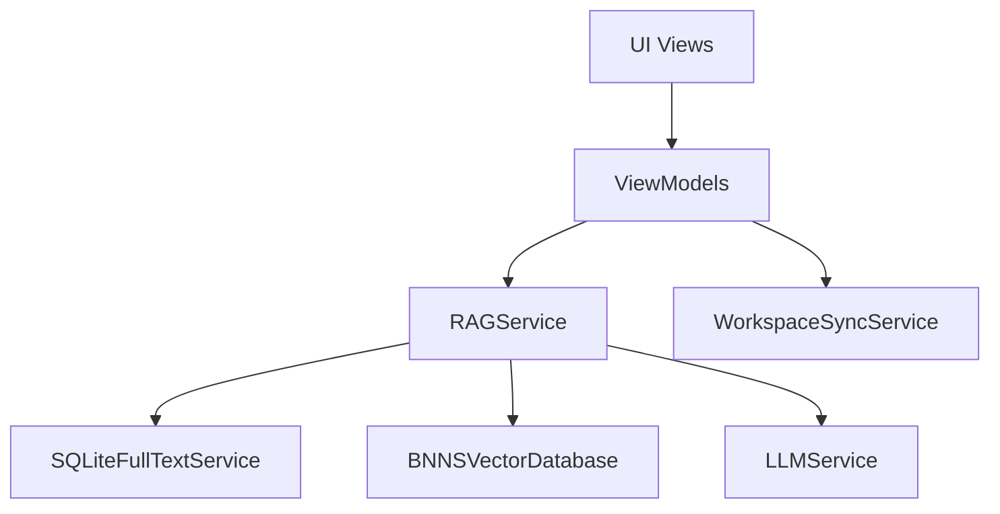
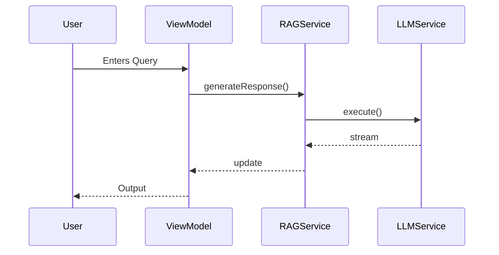
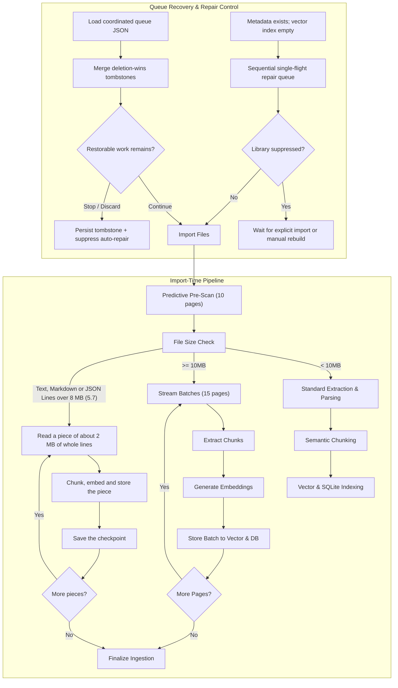
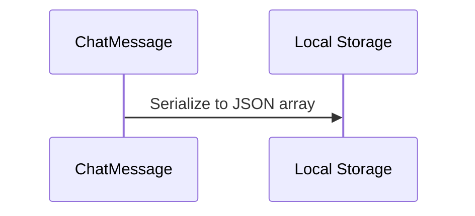
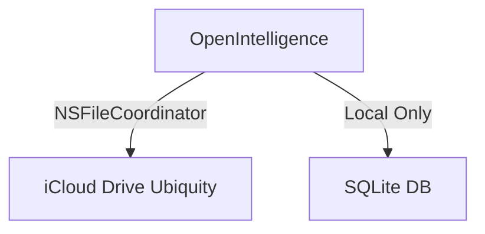
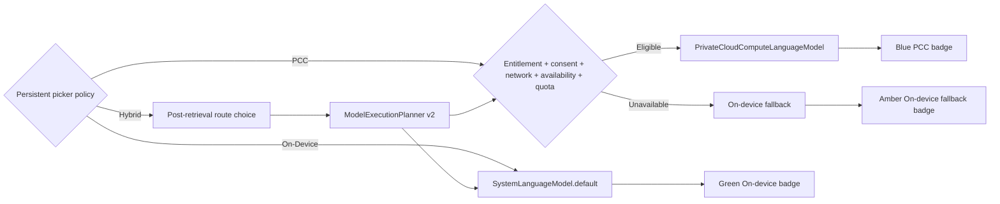
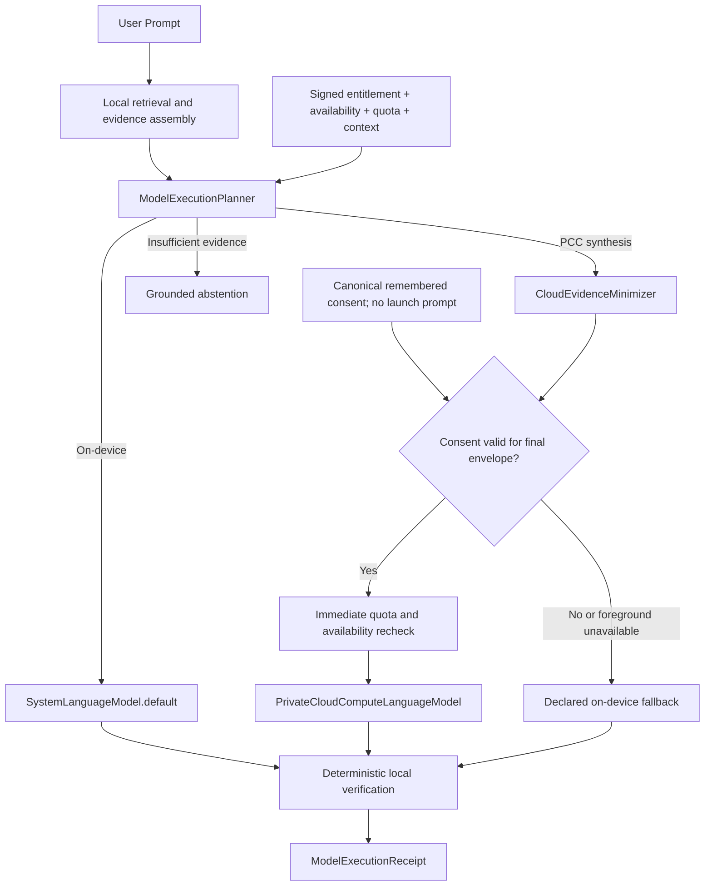
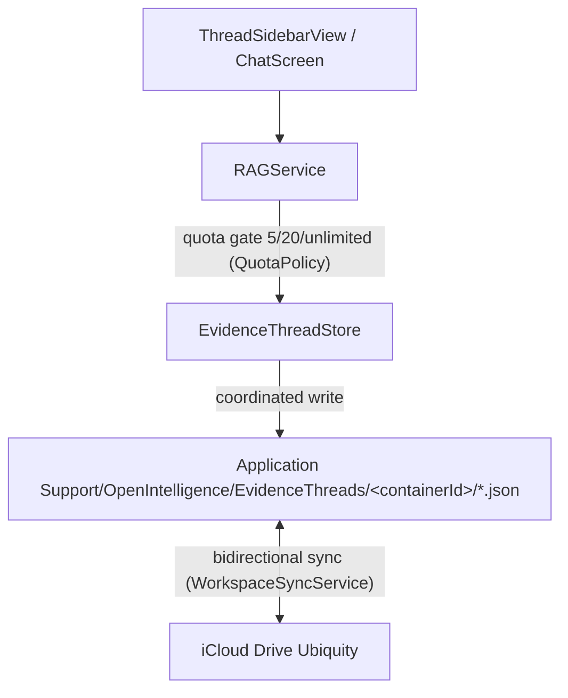

# OpenIntelligence Architecture Atlas

> **Read this file by section, never whole** (about 55 KB): `grep -n '^## ' Docs/OPENINTELLIGENCE_ARCHITECTURE_ATLAS.md`, then the section a task touches. Routes in `Docs/AuditArtifacts/RepoOS/change_impact_matrix.csv` name the section.

> **Documentation status:** Generated from the July 2026 audit, whose artifacts are in `Docs/AuditArtifacts/ArchitectureAtlas/` (this file is registered there as the Phase 8 map in `ARTIFACT_REGISTRY.csv`); **not regenerated since**, so the code wins where a section here disagrees with it. This file does not track the shipped version: read `Docs/SHIPPED_VERSION.json` (`app_store` for what is live, `in_review` for what is submitted). `Docs/CANONICAL_OPENINTELLIGENCE_SOURCE_OF_TRUTH.md` outranks this file where the two disagree (canonical §1).
> **Component count is drifting.** The 270 figure below came from the audit's component definition at generation time. As of 2026-08-05 the tree holds **278 first-party Swift files** (301 including vendored `swift-transformers`). Those are not necessarily the same metric, so treat 270 as the audit's number rather than a current count, and re-run the audit before quoting either figure publicly. `[evidence_level: code_verified_for_the_file_count, confidence: exact_for_files_unverified_for_component_parity]`

## 1. Executive Overview
The OpenIntelligence Architecture Atlas is the canonical representation of the repository's components, execution flows, and system boundaries. It was generated via a strict evidence-based static analysis protocol. The system is composed of 270 Swift components divided into 30 subsystems, with high-risk boundaries located in iCloud sync, StoreKit entitlements, and Private Cloud Compute (PCC) routing.

## 2. Subsystem Map
- **App Intents/Siri/Shortcuts**: 9 components
- **Apple Foundation Models**: 8 components
- **OCR/extraction**: 13 components
- **PCC routing/consent**: 3 components
- **SQLite/FTS storage**: 1 component
- **StoreKit**: 8 components
- **app lifecycle**: 6 components
- **background tasks**: 2 components
- **billing/entitlements**: 4 components
- **chat UI**: 19 components
- **chat persistence**: 3 components
- **citations/source rendering**: 20 components
- **context packing**: 1 component
- **diagnostics/telemetry**: 27 components
- **document import**: 11 components
- **embeddings**: 13 components
- **export/reporting**: 1 component
- **generation**: 7 components
- **iCloud/workspace sync**: 13 components
- **ingestion queue**: 10 components
- **library/container management**: 15 components
- **onboarding**: 5 components
- **reranking/fusion**: 5 components
- **retrieval**: 38 components
- **semantic chunking**: 4 components
- **settings**: 13 components
- **tests**: 6 components
- **vector storage**: 3 components
- **verification gates**: 3 components
- **docs/audits**: 0 components (Markdown/CSV files)

## 3. Component Dependency Map
- **UI Views** depend on **ViewModels**.
- **ViewModels** inject **Services** (e.g., `RAGService`, `WorkspaceSyncService`).
- **Services** interface with **Storage** (`SQLiteFullTextService`, `BNNSVectorDatabase`).
- **Storage** interfaces with **File System** (`Application Support`).

## 4. Service Map
- `RAGService`: Core retrieval-augmented generation orchestrator. Since 5.4 it also owns the end of an answer: `finishAnswerNow()` ends the stages that run after an answer's text is complete (the source-only check, and every stage wrapped in `runFinishableStage`) so the response returns with its sources, and Standard skips the source-only check when the verification gates passed (`standardSkipsSourceOnlyCheck`). `[evidence_level: code_verified, confidence: exact, evidence_source: RAGService.swift, SourceOnlyStandardGateTests]`
- `AgenticOrchestrator`: Deep Think and Maximum. `execute` parks the chat's stream handler in `LLMStreamingContext.finalAnswerHandler` for the whole run, so only the calls that write the final answer stream (through `LLMStreamingContext.answerHandler`); research, the verification loop and Maximum's refinement run as finishable stages. `[evidence_level: code_verified, confidence: high, evidence_source: AgenticOrchestrator.swift, LLMService.swift]`
- `WorkspaceSyncService`: Manages iCloud Drive ubiquity sync. Since 5.7 a pass skips a library's vector store while an import into it is unfinished on this device (`librariesWithUnfinishedImports`), and the digests of the stores it has reconciled are kept across launches. `[evidence_level: test_verified, confidence: high, evidence_source: WorkspaceSyncService.swift; WorkspaceSyncImportGuardTests]`
- `PassageFileIndex` and `PassageSlot` *(added 2026-10-12, 5.7)*: the walk over the vector store's metadata file that finds each passage's bytes and reads its id, document, number, page and level without decoding it; described under Sync Boundaries, section 9, with the store. `[evidence_level: test_verified, confidence: high, evidence_source: PassageFileIndex.swift; VectorStorePassageIndexTests]`
- `LibraryIntelligenceCenter` and `LibraryIntelligenceCache` *(changed 2026-10-13, 5.7)*: the library analysis (language, vocabulary, code and math, sentence shape) that recommends chunking and embedding settings and fills the dashboards. It reads every passage of a library up to 4,000 (`analysisPassageLimit`) and at most that many of a larger one, picked from the store's records and read by id (`samplePositions`). A report from a sample is marked (`CorpusSignals.isEstimate`); `RAGService.resolveAutoAdjustments` lets the chunking settings follow it as they follow any report and never takes another embedding model from one, unless the library has no documents yet. (No report starts a rebuild today: `scheduleSelfTuningRebuild` is behind `IngestionContext.allowsSelfTuningScheduling`, false for every kind of import.) The report and the first question's `CorpusVocabulary` are kept in the local cache folder (`LocalCache/LibraryIntelligence`), each under a name that carries a hash of the library's documents and the store's passage count, and are used only under the name the library has now. `removeStale` (every refresh and after every write), `remove` (a library's deletion) and `sweep` (every load of the documents) remove what no longer matches, and a vocabulary is kept only when it was built from every passage in the store and each belongs to a listed document (`RAGService.vocabularyMayBeKept`). The vocabulary build, the picking of the sample and the files' reads and writes run on the concurrent pool; `RAGService` itself is on the main actor. `RAGService.libraryVocabulary` holds a vocabulary in memory for later questions only when it is of the whole library as it is when the build ends. Through 5.6 the analysis ran over every passage at every load of the documents: 199 s and 1,054 MB over what the process held, for 144,247 passages on a Mac. `[evidence_level: test_verified (LibraryAnalysisSampleTests), measured on the Mac (LibraryAnalysisScaleBenchmarkTests), not run on a device, confidence: high, evidence_source: AdaptiveEmbeddingOptimizer.swift; RAGService.swift refreshIntelligence, generateIntelligenceSnapshot, libraryAnalysisInput, libraryVocabulary, applyLoadedDocuments]`
- `EmbeddingProviderDefaults` *(added 2026-10-10, 5.7)*: the one place that says which copy of the bundled sentence model a new library uses, Core ML on iPhone and iPad and Core AI on macOS 27, and that the two are copies of one model (`areCopiesOfOneModel`), so auto-tuning does not move a library between them. Asked by `SettingsStore`, `ContainerService.defaultContainer`, `AdaptiveEmbeddingOptimizer` and `RAGService.evaluateEmbeddingShift`. `[evidence_level: test_verified (LargeLibraryCostTests); code_verified for the callers, confidence: high, evidence_source: EmbeddingService.swift]`
- `DocumentProcessor.decodeTextFile` *(added 2026-10-10, 5.7)*: decides how a text file's bytes are read (UTF-16 by its mark or by its zero bytes, UTF-8, Foundation's lossless detection, Windows-1252, Latin-1). Detail in `Docs/INGESTION_PIPELINE.md`. `[evidence_level: test_verified, confidence: high, evidence_source: DocumentProcessor.swift; IngestionAccuracyTests]`
- `AtlasLabeling`, `MetricDiagnostics` and `SystemModelTools` *(added 2026-10-10, 5.7)*: the Knowledge Atlas's naming rule, the MetricKit subscriber and the two system model tools. They are described in section 9 below, where the notes of that day were added.
- `SQLiteFullTextService`: Manages shared relational storage.
- `EntitlementStore`: Manages UserDefaults-backed billing logic.
- `LLMService`: Handles prompt compilation and PCC execution.
- `EvidenceThreadDebugService`: Diagnostics-only service to test `EvidenceThreadStore` without touching production pathways.
- `JSONRecordExtractor` *(added 2026-10-09, 5.7)*: reads `.json`, `.jsonl` and `.ndjson` as records with its own order-keeping reader (`JSONValue`), cuts one passage per record and cuts an oversized record at its own lines; called only by `DocumentProcessor.processDocument`. Detail in `Docs/INGESTION_PIPELINE.md`. `[evidence_level: code_verified, confidence: exact, evidence_source: JSONRecordExtractor.swift; DocumentProcessor.swift extractJSONRecords and makeJSONRecordChunks]`
- `OversizedChunkSplitter` *(added 2026-10-09, 5.7)*: cuts a passage over the embedding limit into parts made of its own text; called by `DocumentProcessor.splitOversizedChunkByTokens`, which used to retype the passage. `[evidence_level: code_verified, confidence: exact, evidence_source: OversizedChunkSplitter.swift; DocumentProcessor.swift]`
- `WebPageFetchService` *(added 2026-10-09, 5.7)*: a GET to an address the person gave, following redirects, turned into a Markdown or original-type file for the import queue; called by `IngestURLIntent` and `AddToLibraryIntent`. `[evidence_level: code_verified, confidence: exact, evidence_source: WebPageFetchService.swift]` A grep of `OpenIntelligence` for `URLSession` on 2026-10-09 finds it here and in three places outside the import path (the App Store rating snapshot, the adapter download and the local-server model client). `[evidence_level: code_verified, confidence: high, evidence_source: that grep; it does not rule out a download made another way]`
- `EvidenceLineSplitter` *(added 2026-10-09, 5.7)*: the line and sentence cuts of `RAGService.extractRelevantSentences`, moved out so they can be tested; it keeps a wrapped sentence whole and uses `AnswerSentenceSplitter` for sentences. `[evidence_level: code_verified, confidence: exact, evidence_source: EvidenceLineSplitter.swift; RAGService.swift extractRelevantSentencesOffMain]`
- `RAGQueryScope` *(added 2026-10-09, 5.7)*: a task-local set of document ids that limits one `RAGService.query` call to those documents' passages. Set only by `AskActionRunner` for the three Shortcuts actions that name a document. Read in `HybridSearchService.search` (which then scores the named documents' passages directly and returns nothing else), in `queryInternal` after retrieval (narrowing the result and the later stages' candidate lists, skipping the query cache, and throwing when nothing is left), and where Deep Think, Maximum and the raw search build their candidate lists. `[evidence_level: code_verified, confidence: medium, evidence_source: RAGQueryScope.swift; HybridSearchService.swift searchInsideScope; RAGService.swift; RAGAppIntents.swift AskActionRunner]` No scoped question has been run; the action's own last check on the returned passages is what guarantees the limit until one has.
- `AppLink` and `AppNavigationRequest` *(added 2026-10-09, 5.7)*: one address form for places in the app, and the queue that carries destinations from an action, a link, a Spotlight result or a handed-over file to the screen that shows them, delivering after each change. `ContentView.route` handles the tab and the library for the oldest request; `DocumentLibraryView` and `ChatScreen` take the last step. `[evidence_level: code_verified, confidence: exact, evidence_source: AppNavigationRequest.swift; ContentView.swift; DocumentLibraryView.swift; ChatScreen.swift]` Since 2026-10-14: a document request opens the document's page (`DocumentLibraryView.takeDocumentRequest`, which waits up to three seconds for the documents to load and then lets the request go, so it holds the queue back for at most that long); `.ask(String)` puts text in the chat's field unsent and has no link form; `AppActivity`, in the same file, names the activity types the app advertises for Handoff, Spotlight and Siri and maps a continued activity to destinations, and `Info.plist` declares them (`NSUserActivityTypes`). `[evidence_level: code_verified for the paths, test_verified for AppActivity (AppActivityTests); confidence: high; evidence_source: AppNavigationRequest.swift; DocumentLibraryView.swift; ContentView.swift continueActivity]`
- `LibraryFocusFilterIntent` and `ContainerService+Focus` *(added 2026-10-14, 5.7)*: a Focus filter (`SetFocusFilterIntent`) that names libraries; while its Focus is on, the two library pickers list `ContainerService.pickableContainers` and the open library moves to the first allowed one. The allowed set is a `UserDefaults` key beside the open library's, so the system can apply it with no screen open; launch applies the filter in force. `[evidence_level: test_verified for the pickers' list and the filter's tile (LibraryFocusFilterTests), code_verified for the rest, confidence: medium, evidence_source: LibraryFocusFilterIntent.swift; ContainerService+Focus.swift]`
- `MacServicesProvider` *(added 2026-10-14, 5.7, Mac only, app only)*: the three `NSServices` entries in `Info.plist` (ask about selected text, add selected text, add files from Finder), set as `NSApplication.servicesProvider` by `OpenIntelligenceMacAppDelegate` at launch; it posts `.ask` or `.importFiles` to the router. `[evidence_level: build_verified, confidence: high, evidence_source: MacServicesProvider.swift; OpenIntelligenceApp.swift]`
- `QueryLiveActivityService` *(added 2026-10-14, 5.7, iPhone and iPad)*: starts a Live Activity for a question still running ten seconds after it began, while the app is in front, or as the app leaves the front with a question running (`willResignActiveNotification`), because ActivityKit refuses a start from the background; it ends one left by an earlier launch, and follows the begin, progress and complete closures of `QueryRuntimeBridge` (set in `OpenIntelligenceApp.configureQueryRuntimeBridge`, beside the background task and the completion notice); its views are in the widget extension's `IngestionLiveActivityWidget.swift`. `[evidence_level: build_verified, test_verified for its state; confidence: high; evidence_source: QueryLiveActivityService.swift]`
- `CheckClaimIntent` and `ClaimCheck` *(added 2026-10-14, 5.7)*: "Check a Claim", which finds six passages with `searchDocumentsRaw` and runs `VerificationGateService.verify` with the sentence as its one claim and an empty question, returning the coverage gate's verdict as a label, lowered from Supported when the claim and the passage's best-matching sentence differ on a negation (`ClaimCheck.matchingSentence`, `hasNegation`), and naming the passage the gate's evidence starts with. `[evidence_level: test_verified (ClaimCheckTests), build_verified; confidence: medium; evidence_source: Services/Agentic/CheckClaimIntent.swift]`
- `ExportConversationIntent` *(added 2026-10-14, 5.7, app only, Features/Chat/Pipeline)*: "Export Conversation", which returns a saved conversation from any library as an `IntentFile` in Markdown, JSON Lines or PDF, the bytes the chat menu writes (`ConversationExporter.data`); `ConversationExporter.pdf` sets the export as text with Core Text and breaks it into pages. `[evidence_level: test_verified (ConversationExporterTests, ShortcutsActionTests), build_verified; confidence: high; evidence_source: ExportConversationIntent.swift; ConversationExporter.swift]`
- `UITestSupport` and `UITestRemoveDocumentsIntent` *(added 2026-10-14, 5.7, Debug builds only, App)*: with the launch argument `--uitest-stand-in-model` the ask actions' engine gets a stand-in model that answers with the `UITEST_STAND_IN_ANSWER` environment value (`AskActionRunner.makeEngine`), and an action that Shortcuts does not list removes documents by the start of their names, eight characters or more. The `OpenIntelligenceUITests` target, with its own scheme, uses them to run actions through the system with Apple's AppIntentsTesting (iOS 27). A release build compiles none of it. `[evidence_level: test_verified (ShortcutsSystemTests, 2 tests, iOS 27 simulator, 2026-10-14), confidence: high, evidence_source: OpenIntelligence/App/UITestSupport.swift]`
- `CloudConsentRelay` *(added 2026-10-14, 5.7)*: carries a Private Cloud Compute consent request from the engine an action builds for its question (`RAGService.asksThroughRelay`; never the chat's own) to `ContentView`, keeping it before announcing it so a window can claim it from the announcement, never taking a sheet on screen away, which shows `CloudConsentPromptView` in the first window to claim it; a request no window shows within 15 s is given up and nothing is remembered (`RAGService.abandonCloudConsentRequest`). `[evidence_level: test_verified (CloudConsentRelayTests), confidence: high for the relay; the action's side waits on a device, evidence_source: CloudConsentRelay.swift]`
- `CrashReports` *(added 2026-10-14, 5.7, app only)*: saves a crash diagnostic MetricKit delivers (`MetricDiagnostics`) as a file of its own in the local cache's `CrashReports` folder, newest ten kept, a crash delivered twice kept once, without an exception's message text or arguments or the memory region description; `ContentView` offers the newest one once, in the first window to ask (`takePending`), Email Report opens a mail to the feedback address with its summary, and `AboutView` shares the whole file. `[evidence_level: test_verified (CrashReportsTests), confidence: high for saving and offering; no diagnostic delivered on a device yet, evidence_source: CrashReports.swift]`
- `EmbeddingVectorCheck` *(added 2026-10-14, 5.7)*: runs after the embedding call of every import path (an import, a rebuild, a PDF over 10 MB, a large text file) and stops the import when more than half of a batch's vectors are unusable (all zero, empty or not finite), with a message naming the file; fewer are logged and stored. `RAGService.evaluateSemanticIndexHealth`, on a library switch, also samples 64 of a store's vectors and re-embeds a library whose sample is nine-tenths empty, and rebuilds by itself a listed document that had passages and has none in the store (`reembedDocuments(onlyDocumentIds:)`), each once a launch. Gate E reports nothing to ground against for empty vectors. `[evidence_level: test_verified (LibraryVectorHealthTests), confidence: medium, not run against a failing model on a device, evidence_source: EmbeddingVectorCheck.swift, RAGService.swift]`
- `QuickActionsWidget` *(added 2026-10-14, 5.7, the Live Activities extension, iPhone and iPad)*: a Home Screen and Lock Screen widget whose sizes open the app's own links (`openintelligence://chat`, `documents/add`, `chat/scan`), as the controls beside it do. It reads nothing from the app, so it needs no app group. `[evidence_level: build_verified, confidence: medium, evidence_source: IngestionLiveActivityWidget.swift, OpenIntelligenceLiveActivitiesBundle.swift]`
- `LibraryWidget` and `WidgetSnapshot` *(added 2026-10-15, 5.7, the Live Activities extension and the app, iPhone and iPad; not in the widget bundle until the App ID carries the app group)*: "Your Library" shows the open library, its document count and, on the medium size, the last question in that library with the start of its answer (`privacySensitive`). The app writes `WidgetSnapshot` (`widget_snapshot.json`) to the app group `group.Gunndamental.OpenIntelligence` from `ContentView` (library and count, once an import ends), `ContainerService.applyFocusFilter` (a Focus that moves the open library) and `ChatScreen.recordForLibraryWidget` (an answer, which is a message with metadata, after the conversation is saved, with its conversation and message ids). The answer leaves the widget when another library opens, when `ChatScreen.clearChat` or `ThreadSidebarView` removes its conversation, when `MessageBubbleV2` hides it, and when sync removes its conversation (`ContentView.refreshSharedWorkspaceIfNeeded`). Nothing is written on the Mac, where no widget extension is built. `OpenIntelligenceLiveActivitiesBundle` does not list the widget yet: without the app group a device build has no container, so it is added in the same commit as the entitlement. The widget's code sits in `IngestionLiveActivityWidget.swift` because the extension target lists its files in `project.pbxproj`. `[evidence_level: code_verified+test_verified (WidgetSnapshotTests), build_verified, measured in the iOS 27 Simulator with the group in a scratch build on 2026-10-15; confidence: medium, not on a device; evidence_source: WidgetSnapshot.swift, IngestionLiveActivityWidget.swift, ContentView.swift, ChatScreen.swift, ThreadSidebarView.swift, MessageBubbleV2.swift, ContainerService+Focus.swift]`
- `FoundationModelToolRegistry` *(changed 2026-10-14, 5.7)*: holds only the tools `createTools` returns. Six declared tools that it never returned were removed, and a missing handler logs that the session gets no tools. `[evidence_level: build_verified, confidence: high, evidence_source: FoundationModelToolRegistry.swift]`
- `AnswerUsageTally` *(added 2026-10-15, 5.7)*: `RAGService.query` sets one per answer as a task-local, `LLMService` adds each generation's `GenerationUsage`, and `finalizeResponse` saves the total as `ResponseMetadata.appleUsage`. `[evidence_level: test_verified (AnswerUsageTallyTests), confidence: high]`
- `RAGService.passagesFromKnownDocuments` and `removePassages` *(added 2026-10-15, 5.7)*: searches (`queryInternal`, `searchDocumentsRaw`) leave out a passage whose document is in no library, keeping one the pipeline made itself, and `removeTextOfUnfinishedImports` removes such passages from Local Only libraries at launch. Detail: `Docs/RETRIEVAL_PIPELINE.md`, "Passages whose document is in no library". `[evidence_level: test_verified (PassagesFromKnownDocumentsTests), confidence: high]`
- `DayOrdinals` *(added 2026-10-15, 5.7)*: `RAGService.queryInternal` reads a day written as an ordinal beside a month ("September 30th") as its number before anything else uses the question, and `executeFullRetrievalPipeline` does the same for Deep Think's and Maximum's own searches, because the keyword index keeps "30th" as one word. Details in `Docs/RETRIEVAL_PIPELINE.md`, "A day written as an ordinal". `[evidence_level: test_verified (DayOrdinalsTests), confidence: high for what the code does]`
- The query cache *(corrected 2026-10-14, 5.7)*: `RAGService.queryInternal` keys `semantic_query_cache` (`SQLiteFullTextService`) with the question and a digest of every library's documents, their passage counts, the embedding model and the app's version (`queryCacheKey`), uses a hit only when every document in it is still there (`cachedResultsAreCurrent`), and no longer looks searches up by similarity. Through 5.6 a question asked again after an import or a deletion got the old passages. Rows no question can reach any more are deleted after the documents are saved and at launch (`deleteUnreachableCachedSearches`, `SQLiteFullTextService.deleteAllCachedQueries`; added 2026-10-15). Detail: `Docs/RETRIEVAL_PIPELINE.md`, "The query cache". `[evidence_level: test_verified (QueryCacheKeyTests, QueryCacheClearingTests), confidence: high, evidence_source: RAGService.swift]`
- `AnswerCardSnippetIntent` *(added 2026-10-14, 5.7, app only)*: the `SnippetIntent` the five ask actions return (`AskActionRunner.card`), whose card shows the question, the answer and a button per document the answer's evidence list names, up to three, each running `OpenDocumentIntent` (`AskActionRunner.sourceDocumentIds`; the retrieved passages' documents when there is no evidence list; made from the engine's lists in memory), for a question asked of a whole library an Ask a Follow-up button running `AskFollowUpIntent`, which opens the chat on that library in a new conversation that starts with the question and the card's answer (`AppDestination.continueAnswer`), and for a Standard answer from a whole library a Think Deeper button running `ThinkDeeperIntent`, which opens the chat on that library in Deep Think with the question (`AppDestination.ask(_:sendsAtOnce:inDeepThink:libraryId:)`); when each is offered is `AskActionRunner.offersFollowUp` and `offersThinkDeeper`, and both intents are in OpenItemIntents.swift, run in the foreground (`supportedModes`) and are not listed in Shortcuts. It replaced `RAGResponseSnippetView`. `[evidence_level: test_verified (AskControlTests), build_verified; confidence: medium; evidence_source: Services/Agentic/RAGAppIntents.swift]`
- `ContainerService.move(_:before:)` and `orderedContainers` *(added 2026-10-14, 5.7)*: a library chip dragged in `ContainerPickerStrip` (SwiftUI 27's `reorderable()` and `reorderContainer(for:)`) sets this device's library order (`libraryDisplayOrder` in `UserDefaults`), which `pickableContainers` follows; the stored list keeps creation order, which sync restores and whose first library is the home of documents with no library id. `[evidence_level: test_verified (LibraryOrderTests), build_verified; confidence: medium; evidence_source: ContainerService.swift; ContainerPicker.swift]`
- `AppStateReporting` *(added 2026-10-14, 5.7, app only, iOS and macOS 27)*: reports two StateReporting domains, an import running and the answer mode of a question running, from the begin and complete closures `OpenIntelligenceApp` sets on `IngestionRuntimeBridge` and `QueryRuntimeBridge`; `MetricDiagnostics` enables both domains in its `MetricManager` and names the active states in its log line. `[evidence_level: test_verified (AppStateReportingTests), build_verified; confidence: medium; evidence_source: App/AppStateReporting.swift; App/MetricDiagnostics.swift]`
- `VisualDocumentSearch` *(added 2026-10-14, 5.7, app only, iOS 26 and macOS 27)*: the app's one Visual Intelligence query (`VisualDocumentSearchQuery`, an `IntentValueQuery` over `SemanticContentDescriptor`) and its "More results" intent (`.visualIntelligence.semanticContentSearch`). It reads the picture's text with Vision, adds the system's labels, and returns at most 100 `OIDocumentEntity`, names first, then keyword-index matches across every library. `[evidence_level: test_verified (VisualDocumentSearchTests), build_verified; confidence: medium; evidence_source: Features/Camera/VisualDocumentSearch.swift]`
- `DeleteDocumentsIntent` and `DocumentDeletion` *(added 2026-10-14, 5.7)*: a `DeleteIntent` that asks first and removes through `RAGService.removeDocument`, only once the engine's document list holds every document asked for, because that call works from the engine's own record of each document; a save leaves out documents recorded as deleted (`saveDocumentsToDisk`), so another engine cannot write one back. Run in the open app with the app's own engine, it schedules the removal with undo instead (`UndoableIntent`, `RAGService.scheduleRemoval`; corrected 2026-10-15). `[evidence_level: test_verified (DocumentDeletionTests), build_verified; confidence: medium; evidence_source: Services/Agentic/DeleteIntents.swift]`
- `RAGService.scheduleRemoval`, `undoRemoval`, `commitRemoval`, `commitPendingRemovals` and `removeDocumentsLeftPending`, with `PendingDocumentRemoval` and `PendingDocumentRemovalLedger` *(added 2026-10-15, 5.7)*: a deletion in the app (`ModernDocumentCard`), or by "Delete Documents" on the app's own engine (`isTheAppsEngine`), takes the documents out of `documents` at once and runs `removeDocument` six seconds later unless it is undone, from the library's Undo bar or the undo manager the screen or the system hands it. Until then nothing is removed; a reload leaves the documents out (`applyLoadedDocuments`), searches leave their passages out (`passagesFromKnownDocuments`), Shortcuts and Siri don't list them (`OIDocumentEntityQuery.loadDocumentRecords`), Spotlight still finds them, a rebuild skips them, and the ids are kept per run of the app in `pending_document_removals.json`, so a removal the app did not live to run runs at its next launch. Pending removals also run when the app goes to the background (after the vector flush, then flushed again), and before a library is deleted or emptied and before Clear All, which wait for one already running. `[evidence_level: test_verified (PendingDocumentRemovalTests), code_verified and build_verified for the background order, Clear All, the rebuild skip and the action; confidence: medium; not run on a device; evidence_source: Services/RAG/Orchestration/PendingDocumentRemoval.swift; RAGService.swift]`
- `MenuBarAsk` *(added 2026-10-14, 5.7, Mac only, app only)*: the `MenuBarExtra` in `OpenIntelligenceApp`, with a field that posts `.ask(_:sendsAtOnce: true)` and buttons for Add Documents and Search; `showMenuBarItem` in `UserDefaults`, shared with Settings, Appearance. `[evidence_level: build_verified; confidence: medium; evidence_source: App/MenuBarAsk.swift]`
- `SiriDonations` *(added 2026-10-14, 5.7, app only)*: donates Open Library through `IntentDonationManager` when the person picks a library or asks in one; called from the screens, never from `ContainerService` or `RAGService`. `[evidence_level: code_verified, confidence: high, evidence_source: SiriDonations.swift and its three call sites]`
- `RAGService` launch and import figures *(changed 2026-10-15, 5.7)*: an engine started without Apple's model leaves `lastError` empty, because the Documents screen, its only reader, shows it as "Error Processing Document"; the empty chat's notice and the mode chip say why the model is unavailable (`AppleIntelligenceCopy`). An ordinary import's Words and characters figures are the document's own counts (`ProcessingMetadata`), not a sum over its overlapping passages. An import goes to the library its queue item names (`addDocument(containerId:)`), not the one open when the queue reaches it. `[evidence_level: test_verified (LaunchNoticeTests, WordCountTests, ImportTargetLibraryTests), confidence: medium]`
- `RAGService.enrichImportedDocument`, `deferEnrichment` and `runDeferredEnrichmentsIfNeeded` *(added 2026-10-15, 5.7)*: the overview, tags and suggested questions an import asks Apple's model for, made after the document is saved, and in the background left on a list that the app works through when it is in front (`ContentView`'s scene phase, and the import queue's end). Detail in `Docs/INGESTION_PIPELINE.md`. `[evidence_level: test_verified (DeferredEnrichmentTests), confidence: medium]`
- `RAGService.leadingWithTopRanked` and `extractRelevantSentences(leadingCandidateWhole:)` *(added 2026-10-15, 5.7)*: the answer path's invariant that the passage the reranker ranks first reaches the model whole, as [S1], ahead of the sentences the extractive path chooses by the question's words. Detail in `Docs/RETRIEVAL_PIPELINE.md`. `[evidence_level: test_verified (LeadingEvidenceTests), confidence: medium]`
- `RAGService.extractedValueAnswersQuestion` and `lookupWords(in:)` *(added 2026-10-15, 5.7)*: the check `highPrecisionLookupOverrideAnswer` makes before a value `SpecificationExtractor` read from a passage replaces or pre-empts the model's answer, at the one function all five such places go through: the value's label, or the sentence of the line that holds it (`valueLine`), has to share a word with the question's subject (the question's words without `genericValueWords`, with `SpecificationExtractor.subjectSynonyms` added). A value that fails is not used and the model answers. `[evidence_level: test_verified (ExtractedValueRelevanceTests), confidence: medium; the false-lock rate on real libraries is not measured]`
- `NumericValueExtractor` *(added 2026-10-09, 5.7)*: reads the numbers in a sentence as values (a scale word, thousands separators, a number that is part of a name or code) and says whether a passage states them; `isCountedByGate` keeps the gate to the numbers it counted before 5.7. Called by `VerificationGateService.runGateC` and `evaluateClaim` (Standard) and by `SourceOnlyAnswerService` (the check Deep Think and Maximum run afterwards). `[evidence_level: test_verified, confidence: high, evidence_source: NumericSanityGateTests, 2026-10-09; NumericValueExtractor.swift]`
- `DetectedValueCheck` *(added 2026-10-15, 5.7)*: reads amounts of money, dates (written with a year) and measurements in an answer and its passages with `dataDetectorMatches`, and reports one the passages contradict: the same amount only in other currencies, another day of the same month, the same value only with other units. Gate C fails on one, `runGateB` marks the claim Partial, and the source-only check marks it unsupported. `[evidence_level: test_verified (DetectedValueCheckTests), measured on macOS 27 for the detector's readings; confidence: medium; evidence_source: Services/RAG/Safety/DetectedValueCheck.swift]`
- `DomainIsolationService` and Gate I *(changed 2026-10-15, 5.7)*: keywords count as whole words (`normalize` pads a lowercased word list), the two-letter abbreviations "um", "ip", "po" and "iv" are gone, and the gate engages only when the question scores two or more keywords. Matching inside words had failed right answers about everyday documents ("um" in "number", "ip" in "trip"). `RAGService`'s verification event now names the failed gates, and `VerificationGatesOverlayView` marks its step failed with them. `[evidence_level: measured for the demo failures, test_verified (DomainIsolationTests); confidence: medium; evidence_source: Services/RAG/Safety/DomainIsolationService.swift; RAGService.swift, the `.verification` event]`
- `ModelErrorClassifier` *(added 2026-10-09, 5.7)*: says what kind of failure a generation error is (context overflow, rate limit, unreadable response, filtered, other) from its type, and from phrases for an unknown type or a passed-along message. Read by `AgenticOrchestrator.executeReasoningChain` and by `RAGService.generateWithFallback` and `isContextOverflowError`. `[evidence_level: test_verified, confidence: high, evidence_source: ModelErrorClassifierTests, 2026-10-09]`
- `SystemResourceAdvice` *(added 2026-10-09, 5.7)*: a thread-safe copy of iOS 27's `UIApplication.systemPrefersReducedResourceUsage`, written by `SystemStateMonitor` (started at launch by `OpenIntelligenceApp`) and read at the boundaries of the embedding batch loop (`EmbeddingService.generateEmbeddings`) and of the two reasoning loops in `AgenticOrchestrator`, which wait between steps while it is set. `[evidence_level: test_verified for the helper, build_verified for the readers; confidence: high; evidence_source: SystemResourceAdviceTests; SystemStateMonitor.swift]`
- `CompletionNotificationService` and `CompletionNotificationPolicy` *(added 2026-10-09, 5.7, app only)*: a local notification when an import batch or a question of 20 seconds or more finishes while the app is not in front, off until the Settings switch is turned on. Fed from the two completion closures in `OpenIntelligenceApp`; a tap is routed through `AppNavigationRequest`. `[evidence_level: test_verified for the policy, build_verified for the service; confidence: high; evidence_source: CompletionNotificationPolicyTests]`
- `OpenedFilesSheet` *(added 2026-10-14, 5.7, app only, Features/Documents/Components)*: files "Open in" hands over (`AppDestination.openedFiles`), listed with their kind and size, each read-only in Quick Look, with Add to Library (copies them into the library's folder, then the usual import review) and Don't Add (removes the copies), the only ways to close it; the copies wait in the local cache's `OpenedFiles` folder, which iCloud sync never sweeps (`ImportedFileStaging.copyForViewingOffMainActor`); shown by `DocumentLibraryView.showOpenedFiles`. `[evidence_level: build_verified, confidence: medium; evidence_source: OpenedFilesSheet.swift]`
- `PastedContentStaging` and `LibraryPasteButton` *(added 2026-10-09, 5.7, app only)*: turn a pasted file, web address or text into files in the imported-documents folder, which `DocumentLibraryView.importOpenedFiles` then takes through the plan check and the import review. The control is a plain button that takes the Documents screen's own chip as its label and reads the clipboard through `PastedContentStaging.clipboardProviders`; it is not the system's `PasteButton`, so iOS asks to allow a paste of content copied in another app. `[evidence_level: test_verified for the classification, build_verified for the control; confidence: medium; evidence_source: PastedContentStagingTests; PastedContentStaging.swift]`
- `SemanticChunker` *(changed 2026-10-09, 5.7)*: `nonisolated`, so the fallback chunking of `DocumentProcessor.processDocument` runs on the concurrent pool through `chunkTextOffMainActor`, with progress every 25 chunks, a stop on cancellation, and an error at `maxChunks` (50,000) in place of a silent stop. Its per-chunk cost no longer grows with the document (three whole-text measurements per chunk removed, the chunks unchanged). `createStructureAwareChunks` still calls it on the main actor. Detail and measurements in `Docs/INGESTION_PIPELINE.md` section 3. `[evidence_level: test_verified for progress, cancellation, the limit and the offsets, measured for cost and for unchanged output; confidence: high; evidence_source: SemanticChunkerLargeTextTests; BenchmarkRuns/2026-10-09-chunker-large-text]`
- `RAGService.importLargeTextStreamed`, `TextPieceReader` and `TextStreamingIngestionState` *(added 2026-10-09, 5.7)*: a text, Markdown or JSON Lines file over 8 MB is imported a piece of about 2 MB at a time, each piece through `DocumentProcessor.processDocument(textPiece:)`, with a checkpoint after each piece and the document's text stored once at the end. JSON Lines records keep their numbers across pieces and short records share a passage. An import that background time stopped continues when the app is in front (`RAGService.resumeIngestionStoppedInBackgroundIfNeeded`). `SemanticChunker`'s two chunk loops also drain an autorelease pool for each chunk, which took its peak footprint on 4 million characters from 392 MB to 47 MB. Detail and what is not done: `Docs/INGESTION_PIPELINE.md`, sections 3 and 5. `[evidence_level: test_verified for the parts TextPieceImportTests runs, build_verified for the import loop, measured for the footprint; confidence: medium; evidence_source: RAGService+TextStreaming.swift, TextPieceReader.swift, DocumentProcessor.swift, SemanticChunker.swift]`

## 5. View/ViewModel Map
- SwiftUI Views use `@EnvironmentObject` and `@AppStorage` heavily for dependency injection and state sharing.
- `EvidenceThreadDebugView`: Standalone SwiftUI view for Evidence Threads local store diagnostics.
- **User-facing vocabulary is single-sourced in `UI/Components/Glossary.swift`.** 24 terms, each defined in a
  `plain` and a `technical` register, keyed by `GlossaryTermID` with definitions returned from one exhaustive
  `switch`, so lookup is compile-time total and returns no optional. Consumers attach a definition rather than
  restating one: `.definedTerm(_:)` on any view, `GlossaryInfoButton` on list rows, and `GlossaryView` as the
  searchable index. Wired at `OnboardingChecklistView` (pipeline capsules, metric strip, device chips),
  `HowItWorksView` (the four pipeline stages), and `SettingsView` (Hardware Envelope rows, Silicon RAG batch
  pills, the Neural Engine TOPS line, and the `Plain English` entry). The technical register's expansion state
  is one shared `AppStorage` key, so it is a per-user preference rather than per-popover state.
  `GlossaryTests` enforces that a plain definition contains no code identifier, model name, framework name or
  backtick, and pins the two hedges that must not be edited out: TOPS as a per-chip lookup rather than a
  measurement, and Core ML rather than the app deciding whether the Neural Engine runs.
  `[evidence_level: code_verified+test_verified, confidence: exact, evidence_source: Glossary.swift, GlossaryTests.swift]`
- `HowItWorksView` narrates the pipeline in order; `GlossaryView` defines single words out of order. They are
  deliberately not copies of each other, and each stage in the former links to the latter rather than
  restating a definition.
- **Deleting a library goes through one function, `LibraryDeletion.delete` in
  `Features/Documents/Library/LibraryDeletion.swift`.** It removes the container, its documents,
  chunks, vectors, Spotlight entries and entity-index rows, and its iCloud copy where it has one, and
  it **aborts before touching anything local if the iCloud delete fails**, because deleting locally
  while the shared copy survives means the next sync restores the library. `DocumentLibraryView` and
  `ContainerSettingsSheet` both call it; the latter defers its `dismiss()` until the outcome is
  `.deleted` so a refusal has somewhere to report. Two lookalikes are deliberately outside it:
  `deleteConflictedLocalLibraries` handles libraries iCloud has already dropped and ends with a
  `reconfigureIfNeeded` pass, and `OpenIntelligenceEngine.deleteLibrary` calls
  `containerService.deleteContainer` alone, leaving documents behind, because it is `public` and
  synchronous and cannot adopt an async path without breaking the SDK.
  `[evidence_level: code_verified+build_verified, confidence: exact, evidence_source: LibraryDeletion.swift]`
- **File placement under `OpenIntelligence/Services/` is a target decision, not just organisation.**
  The `OpenIntelligenceEngine` framework synchronises eighteen folders, including
  `Services/Infrastructure/Integration`, and excludes `Services/Infrastructure/Presentation` and all
  of `Features/`. A new file in an included folder is compiled into the SDK as well, so one that
  references a `Presentation` or `Features` type builds fine in the app and fails **only** the test
  build, with a scope error indistinguishable from stale DerivedData. `LibraryDeletion.swift` lives
  under `Features/` for this reason. `[evidence_level: code_verified, confidence: exact, evidence_source: project.pbxproj fileSystemSynchronizedGroups per target]`

## 6. Model/Persistence Map
- `ChatMessage`: JSON serialized and stored locally.
- `EvidenceThread` (active): Isolated JSON files per thread.

## 7. Major User Flows
1. App Launch & Container Restore
2. Library Container Context Switching
3. Document Import & Vector Extraction Pipeline
4. End-to-End RAG Query & Inference Pipeline
5. Maximum Mode & PCC Route Policy Evaluation
6. iCloud Workspace Sync & Entitlements
7. StoreKit Purchasing & Quota Resolution
8. App Intent Siri Shortcuts integration
9. Telemetry Trace Generation

## 8. Background/System Flows
- `BGTaskScheduler` used for indexing sweeps. An import or a long answer the person started also runs under a `BGContinuedProcessingTask` (`BackgroundTaskService`), which asks for the GPU (`requiredResources = .gpu`) when the system offers it. Since 2026-10-10 (5.7) the app carries the Background GPU Access entitlement, `com.apple.developer.background-tasks.continued-processing.gpu`, without which the system does not offer it. A background import keeping the GPU has not been observed on a device. `[evidence_level: code_verified; build_verified for the signed entitlement on a development build, confidence: high for the code, evidence_source: BackgroundTaskService.swift, OpenIntelligence.entitlements]`
- `NSMetadataQuery` background updates for iCloud Drive.
- The floating iOS Silicon HUD owns a dedicated `UIWindow` and derives all frame bounds from that window's non-optional `UIWindowScene.screen`; it does not use the deprecated process-global `UIScreen.main`. `[evidence_level: build_verified+code_verified, confidence: exact_for_build, evidence_source: MotherboardHUDView.swift and generic iOS 27 simulator build 2026-07-16]`

## 9. Sync Boundaries
- **iCloud Drive (Ubiquity)**: Used for sync via `WorkspaceSyncService.swift`. `[evidence: code_verified, exact, WorkspaceSyncService.swift]`
- **NO CloudKit**: No explicit CloudKit database APIs are in use. `[evidence: code_verified, exact, WorkspaceSyncService.swift]`
- **NO SQLite Sync**: The `SQLiteFullTextService.swift` is completely local-only. `[evidence: code_verified, exact, SQLiteFullTextService.swift]`
- **Conversations and their deletions sync (5.7, 2026-10-14)**: `EvidenceThreadStore` saves in `<Application Support>/OpenIntelligence/EvidenceThreads/`, the folder `WorkspaceSyncService.synchronizeEvidenceThreads` merges, and records a deleted conversation's id in `deleted_threads.json` beside it; the merge joins that list across devices (`mergeDeletedThreads`) and removes those conversations on both sides, as `deleted_documents.json` does for documents. A conversation is one file and the newest copy wins. `[evidence_level: code_verified+test_verified (EvidenceThreadStoreTests), confidence: medium until two devices, evidence_source: EvidenceThreadStore.swift, WorkspaceSyncService.swift]`
- **How sync writes into iCloud (5.7, 2026-10-14)**: a library's chat history, transcript and conversation memory are copied only when their bytes differ, and replaced in place (`WorkspaceSyncService.replaceItemIfDifferent`) keeping the source's modification date, so the newest-wins choices read the same dates as before. Through 5.6 each was deleted and copied again on every pass from every device, which is how the owner's container came to hold 500 conflict copies ("<name> 2.json") in the six per-library file families on 2026-10-14. A library's vector store goes into iCloud by being written in a replacement folder and having its three files replace the iCloud ones under one coordinated claim (`persistVectorChunksIntoICloud`, `coordinatedReplaceItems`); through 5.6 it was cleared and rewritten in place with no coordination. Each pass logs the folder's conflict-copy count (`conflictCopyCount`); the app reads none of those copies and removes none. `[evidence_level: test_verified (WorkspaceSyncFileWriteTests), confidence: medium until two devices write at once, evidence_source: WorkspaceSyncService.swift]`
- **How the Knowledge Atlas names things, changed 2026-10-10 for 5.7**: `AtlasLabeling` (app target,
  `Services/Infrastructure/Presentation/`) holds the whole rule as pure functions: deterministic k-means over the
  sampled embeddings for cluster membership, names from the words over-represented in a cluster against the
  sample, and two-ended axis labels from the lowest and highest tenth of passages on an axis. There is no list of
  subjects and nothing specific to a language. The map views and `LibraryVisualizationEngine` both call it.
  `[evidence: test_verified, AtlasLabelingTests; not yet seen on a device]`
- **Where the Atlas does its work, changed 2026-10-15 for 5.7**: `LibraryVisualizationEngine.buildProfile` hands
  plain arrays (vectors, texts, keywords) to `analyzePassages`, which runs detached: k-means, the words of each
  passage, the cluster names and each passage's content category (`ContentCategory.of(terms:keywords:)`, whole words
  from `AtlasLabeling.terms(in:)`, plurals and longer forms listed). The main actor only assembles `LibraryProfile`.
  `ProjectionService` (PCA, random projection, t-SNE, UMAP) is `nonisolated` and `Sendable`, and the three map
  loaders (`AdaptiveVisualizationsView` twice, `Embedding3DView` once) run `project3D` detached; each loader checks
  before drawing that no load for another method or library replaced it. On 6,000 vectors of 512 dimensions, built
  -O on this Mac, PCA took 227 ms, UMAP 13.4 s and t-SNE 30.8 s, and the substring category search it replaced took
  3.5 s for 6,000 passages (`BenchmarkRuns/2026-10-15-atlas-main-thread/`). Still on the main thread: the axis
  labels and `Embedding3DView`'s word counts, estimated at well under a second each, not timed. A replaced
  projection still runs to its end. `[evidence_level: code_verified for where each step runs, measured for the
  timings (this Mac, synthetic inputs, not a phone), test_verified (AtlasContentCategoryTests); confidence: high;
  evidence_source: LibraryVisualizationEngine.swift, ProjectionService.swift, AdaptiveVisualizationsView.swift]`
- **On-device diagnostics and two system model tools, added 2026-10-10 for 5.7**: `MetricDiagnostics`
  (app target, `OpenIntelligence/App/`) writes MetricKit's hang, launch and termination reports to the pipeline log
  and to `metric_reports.jsonl` in the local cache; nothing is sent anywhere. `SystemModelTools` in
  `FoundationModelToolRegistry.swift` can add the system's `OCRTool` and `SpotlightSearchTool` (the app's own
  Spotlight index only) to a session's tools; both are off unless a `UserDefaults` switch is set, and
  `createTools` is still the only place a tool reaches a session.
  `[evidence: build_verified; test_verified for the switches and helpers; no MetricKit report received and neither tool called on a device yet]`
- **The keyword index's term and phrase statistics read a sample, changed 2026-10-10**:
  `SQLiteFullTextService.getTopTermsForContainer` and `getKeyPhrasesForContainer` (what the Atlas map shows as
  terms and phrases) read every character of every document and ran inside the index's actor, so on a library
  with one 88-million-character document the map never finished and keyword searches waited behind them. They now
  read a short document whole and eight evenly spaced slices of a long one, about 2,000,000 characters for the
  library (`statisticsText`, `evenSlices`). No table or column changed.
  `[evidence: test_verified, LargeLibraryCostTests; code_verified, SQLiteFullTextService.swift; not seen on a device]`
- **A batch of a large PDF keeps the earlier batches' page rows, changed 2026-10-14 for 5.7**:
  `SQLiteFullTextService.store(append: true)` still clears the document's `document_pages` rows, so
  `DocumentProcessor.storeText` reads them first (`retrieveAllPages`) and stores them again with the batch's own.
  Through 5.6 a PDF imported in batches kept the last batch's pages. `SQLiteFullTextService.swift` did not change.
  Each page's number comes from the extractor's pages with text (`DocumentProcessor.numberedPages`), not from its
  place among the pieces, and a batch of one page is numbered too; through 5.6 a blank page shifted every later row.
  `[evidence: test_verified, PageRowsAcrossBatchesTests; not seen on a device]`
- **Spotlight entries are app items, changed 2026-10-14 for 5.7**: `SpotlightIndexService` associates each library
  and document entry with its `IndexedEntity`, gives documents and passages no expiry, names a passage
  `passage-<document>-<passage>`, removes a deleted document's passage domain, and rebuilds library and document
  entries from the record files (`reindexFromStoredRecords`, with each document's first 500 characters read again
  from the full-text store) for the first launch of 5.7, the background task and, on 27, `IndexedEntityQuery`.
  Since entries no longer expire, `documentsLoaded` (called from `RAGService.applyLoadedDocuments`) removes the
  entries of documents that left, a list of document and library identifiers kept in `localCacheDir()` saying
  which this device knows; the Settings switch's off removes every entry (`indexingSwitched(on:)`).
  `[evidence: test_verified, SpotlightItemsTests and AppLinkTests; build_verified; not searched on a device]`
- **Ingestion Checkpoints**: Saved under `localCacheDir()/IngestionCheckpoints/` to guarantee they are strictly local-only and excluded from iCloud syncing paths. `[evidence: code_verified, exact, DocumentProcessor.swift]`
- **Vector store refresh is change-gated, added 2026-08-29**: `VectorStoreRouter.clearAll()` is
  called by `reloadWorkspaceData()` to pick up sync-driven file changes. It compares each container's
  on-disk signature (size + modification date across `BNNSVectorDatabase.binaryFileURLs`) and reloads
  only the stores that actually changed. **It never evicts**: `BNNSVectorDatabase` is memory-mapped,
  so dropping an instance while a caller holds a reference would permit two live mappings of one
  file — the reason the method reloads in place. Measured on 2026-08-29, an idle Mac produced
  **2,848 vector loads in 164 seconds**, the same store re-read 288 times, because the refresh was
  unconditional and its caller fires every 1.68 s. The gate makes the idle case free; a genuine
  change still reloads immediately. It bounds the symptom only — the 1.68 s trigger is a workspace
  timer meeting a container whose orphaned state never resolves, and that lives in
  `WorkspaceSyncService`. `[evidence: measured, exact, pipeline_trace.log 19:45:24-19:48:08 on the maintainer's Mac; VectorStoreRouter.clearAll]`
- **The record that two copies of a store match is kept across launches, changed 2026-10-10**:
  `synchronizeVectorStore` skips a library whose files, documents, aliases and strategy are what they
  were when a pass last proved the device copy and the iCloud copy identical. That record was in memory
  only, so each launch decoded and compared both copies of every synced library. It is now a digest in
  `UserDefaults` (`workspaceSync.vectorStoreSignatureDigests.v1`). `VectorStoreRouter.db(for:)` also
  records a store's disk signature when it creates the store, so the first `clearAll()` after launch
  no longer reads it a second time. `[evidence: test_verified for the record's round trip, LargeLibraryCostTests; code_verified; not timed on a device]`
- **A pass skips the vector store of a library with an unfinished import, added 2026-10-10**: the
  import queue is read before the documents and again before the vector step
  (`WorkspaceSyncService.librariesWithUnfinishedImports`: an item this device holds whose stage is
  not complete, cancelled or failed), and `synchronizeVectorStore` is not called for a library named
  in either reading. An import's passages are in the store before its document record exists, so the
  pass used to decode the whole store to conclude nothing (135 reads of one store in one device
  trace) and, in a library with another document, would write the store back without them. The store
  syncs on the first pass after the import ends, which still decodes both copies whole.
  `[evidence: test_verified for the rule, WorkspaceSyncImportGuardTests; measured for the reads, device trace 2026-10-10; not seen on a device since]`
- **Benchmark runs stand down from queue merging**: `mergeIngestionQueueIfNeeded` returns early while
  `OpenIntelligenceRuntimePaths.areOverridesPinned` is set. `localRoot` there resolves through
  `applicationSupportRoot()`, which does not consult the storage override, so every benchmark run
  merged its fixture documents into the owner's real ingestion queue; the symptom was a "Resume
  interrupted upload?" prompt listing fixture files on every launch, which survived being discarded
  because the next run rewrote it. Fixed at the caller rather than in `applicationSupportRoot()` on
  purpose: that function is also resolved by four `coordinated*` iCloud primitives and by
  `BNNSVectorDatabase`, so making it honour the override would silently redirect live iCloud sync
  into a temporary directory. The pin is only ever engaged by `DebugRAGValidationHarness`, so this
  cannot fire in a shipping app. `[evidence: code_verified, exact, WorkspaceSyncService.swift
  mergeIngestionQueueIfNeeded, OpenIntelligenceRuntimePaths.areOverridesPinned]`
- **The library list is written in order, and a library's embedding fingerprint is also kept on the device, from 5.6**:
  `ContainerService.saveContainers` used to start one detached task a save, so an older list could be
  written after a newer one, and `reloadFromDisk` (called before every `reloadWorkspaceData()`) then
  replaced the libraries in memory with it. Saves now go through one serial queue. The fingerprint,
  which says which pipeline wrote this device's vectors, is recorded in `UserDefaults` on every save and
  restored when a list read from disk lacks it and the provider and dimension still match. The sync
  merge (`WorkspaceSyncService.mergeContainer`) does not carry the fingerprint and was not changed.
  `[evidence: code_verified for the mechanism, test_verified for the record, measured on one device for the loss it answers (owner's trace log 2026-10-07); not yet re-run on a device]`
- **BNNS Vector Store**: Persisted vector database files (`_meta.json`, `_vectors.bin`, `_norms.bin`) are stored locally. Loading new or empty databases is gated to skip memory-mapping operations on 0-byte vectors files, resolving startup POSIX/Cocoa Code 260 errors. `[evidence: code_verified, exact, BNNSVectorDatabase.swift]`
- **BNNS Vector Store, how passages are held** *(changed 2026-10-12, 5.7; reviewed and corrected 2026-10-13)*: a load memory-maps `_meta.json` and walks it once (`PassageFileIndex.scan`) for a 72-byte `PassageSlot` per passage: id, document, number, page, level and the byte range of its JSON object. No passage is decoded at load, and a load writes nothing: vectors the metadata does not list are ignored in memory, and fewer vectors than passages loads the store empty with the files left in place. `chunk(at:)` decodes one passage from its bytes and checks its id against the slot; `search` decodes only its top results. `readableChunks()` and `allChunks()` decode every passage on several threads the first time and the store keeps them (`everyChunkCache`), which is the state every load reached through 5.6, until memory pressure empties them (`releaseDecodedPassages`). A passage whose bytes do not decode is counted by `count()`, `passageRecords()` and `chunkCount(forDocument:)`, left out by `search`, `chunks(forDocument:limit:)`, `chunks(withIDs:)` and `readableChunks()`, and makes `allChunks()` throw, because sync pairs that array with the vectors by position. Passages not yet saved sit in `pendingChunks` and are always the last slots. A save writes the metadata file by copying the bytes of passages already in the file and encoding only the new ones, and streams the vectors the same way; each file goes to a uniquely named file in the system's replacement directory, is synchronised, and is renamed over the old one, vectors first. A delete or an update saves anything unsaved before it starts, so a delete that is cut off leaves fewer vectors than passages and never the same number in another order. `passageRecords()`, `chunks(forDocument:limit:)`, `chunkCount(forDocument:)` and `chunks(withIDs:)` answer from the slots, and the other stores answer them from `allChunks()`. `similarities(to:forChunkIDs:)` *(added 2026-10-13)* scores the passages with those ids against a vector where their vectors are, the mapped file or the unsaved buffer, and copies none out; the search inside named documents uses it. On iPhone and iPad, when the app goes to the background and after everything is saved, every open store releases the passages it has decoded (`VectorStoreRouter.releaseDecodedPassages`), and a decode under way at that moment is not kept. The file format is untouched: a 5.6 build decodes a file this code writes. Eleven callers still read every passage's text (the question path, the library analysis, the pre-import analysis, the audit screen, the index rebuild and lexical recall through `readableChunks()`, the sync merge through `allChunks()`), so the decode still happens at least once per launch; it no longer happens inside the load. `[evidence_level: test_verified (VectorStorePassageIndexTests, BNNSVectorDatabasePersistenceTests); measured on the Mac (VectorStoreScaleBenchmarkTests: load 1.97 s to 0.68 to 0.73 s and 276 MB to 10 to 12 MB for 144,247 passages); not run on a device, confidence: high, evidence_source: BNNSVectorDatabase.swift, PassageFileIndex.swift, VectorDatabase.swift]`
- **BNNS Vector Store, what a cut-off save leaves** *(changed 2026-10-09, 5.7)*: `saveToDisk` writes new vectors before the metadata that lists them, and `loadFromDisk` trims a vectors file that holds more whole vectors than the metadata lists. A save ended between the two writes used to leave metadata for more chunks than there were vectors, which the loader answered by deleting the library's whole store; it now loads as it was before that save. Fewer vectors than the metadata lists still clears the store. The three files' stored form is unchanged. `[evidence_level: test_verified, confidence: high for the cases tested, evidence_source: BNNSVectorDatabasePersistenceTests; BNNSVectorDatabase.swift saveToDisk and loadFromDisk]`

## 10. Routing/PCC Boundaries

> **5.6, 2026-10-07.** A "Just Once" consent grant now ends with the question it was given for in every mode. `RAGService.queryInternal` clears `transientConsentGrants` before `executeAgenticQuery`, as it already did for Standard further down. Detail and evidence: `Docs/PRIVACY_AND_ROUTING.md`, "Evidence minimization and consent". `[evidence_level: code_verified, confidence: high, evidence_source: RAGService.swift, read 2026-10-07]`
> **5.7, 2026-10-14.** An ask action may come forward to ask for Private Cloud Compute consent (`AskActionRunner.foregroundRequest`, `RAGService.bringAppForwardForConsent`), and the planner counts its question as one a person can be asked about. A request from an engine the chat does not show reaches `ContentView` through `CloudConsentRelay`; one no window shows within 15 s is given up without being remembered. Detail: `Docs/PRIVACY_AND_ROUTING.md`, "Evidence minimization and consent". `[evidence_level: test_verified for the relay (CloudConsentRelayTests); code_verified for the action's side, confidence: medium until a device run]`
- **Public Model Targets**: On-device execution uses `SystemLanguageModel.default`. Native PCC uses `PrivateCloudComputeLanguageModel` on iOS/macOS 27+ only. The app makes no 3B, 20B, Advanced, or server parameter-count claim because the public SDK does not expose those identities. iOS/macOS 26 stays local; it is never labeled simulated PCC. `[evidence_level: compile_verified+code_verified, confidence: exact, evidence_source: FoundationModelSessionFactory.swift, LLMModel.swift]`
- **Post-Retrieval Plan**: Local retrieval produces `PostRetrievalEvidence`; `ModelExecutionPlanner` combines it with user/privacy/network/foreground constraints, exact-or-labeled-fallback token budgets, signed entitlement, live PCC availability, and quota. Only the synthesis stage may target PCC; verification stays deterministic/local. `[evidence_level: code_verified, confidence: high, evidence_source: ModelExecutionPlanner.swift, RAGService.swift]`
- **Picker Policy vs. Actual Route**: `SettingsStore.fmPreference` persists the user policy independently of runtime notifications. Chat captures Hybrid as post-retrieval choice, On-Device as `onDeviceOnly`, and PCC as `cloudOnly`; the picker label always renders that policy. `ModelExecutionReceipt.completedTarget` drives a separate per-answer route badge, including planner-time and runtime PCC-to-local fallback. `[evidence_level: build_verified+code_verified, confidence: high_pending_ui_runtime_validation, evidence_source: ChatScreen.swift, ModelStatusIndicator.swift, ModelExecutionPlan.swift, LLMService.swift, MessageBubbleV2.swift and generic iOS 27 simulator build 2026-07-16]`
- **Entitlement and Quota**: `EntitlementChecker` uses native macOS `SecTask` declarations, parses the embedded signed provisioning profile for iOS/Catalyst development and ad-hoc builds, and permits only the approved PCC key to proceed to Apple's documented availability/quota checks when a distribution build omits that profile. `LiveFoundationModelCapabilityProvider` snapshots quota/context state, maps unknown future quota cases to fail-closed `.unknown`, and `FoundationModelSessionFactory` rechecks availability and quota immediately before construction. Source enablement and generic arm64 iPhoneOS compilation are complete; signed installation/distribution verification is pending. `[evidence_level: build_verified+sdk_verified+user_confirmed, confidence: high_for_source_unverified_for_distribution, evidence_source: EngineSDKCompatibility.swift, FoundationModelCapabilityProvider.swift, FoundationModelSessionFactory.swift, OpenIntelligence.entitlements]` An engine with no store, which an action builds while the app is closed, reads the saved plan and document packs for its document check (`EntitlementStore.savedDocumentAllowance`, 5.7; until then it used the free plan's limit).
- **Quota fail-closed, and where it was not**: `PCCQuotaState.authorizesCloudExecution` is the single rule deciding whether a quota state permits a cloud attempt; `.belowLimit` and `.approachingLimit` do, `.limitReached`, `.unsupported` and `.unknown` do not. Both `canUsePCC` and `ModelExecutionReceipt.nonAuthorizingQuotaStates` derive from it. Before 2026-08-11 they were two hardcoded copies and had diverged: the planner tested only `!= .limitReached`, so `.unknown` authorized an attempt the route gate scores as `unauthorizedCloudAttempts`. Reachable in production because `FoundationModelCapabilityProvider` maps `pcc.quotaUsage.status` through an `@unknown default`. `[evidence_level: code_verified+test_verified, confidence: exact, evidence_source: ModelExecutionPlan.swift, RouteEvalMetrics.swift, PCCQuotaAuthorizationTests.swift]`
- **Foreground gate covers macOS**: `ModelExecutionPlanner` permits cloud only when `isForegroundInteractive || consentGranted`. That input was computed under `#if canImport(UIKit)` with the `#else` branch hardcoding `true`, so the Mac had no foreground check and a backgrounded Shortcut could reach PCC unattended. macOS now reads `NSApplication.shared.isActive`; a platform with neither UIKit nor AppKit falls closed. `[evidence_level: code_verified+build_verified, confidence: exact, evidence_source: RAGService.swift, ModelExecutionPlanner.swift]`
- **PCC Fallback UI & Subsystem Diagnostics**: A dedicated iCloud execution consent fallback panel is integrated in `ContainerSettingsSheet+Sections.swift` using `self.settings` scope visibility. An AI Subsystem Diagnostics card in the library settings displays real-time readiness status of the sentence embedding model, acceleration targets, Rust-backed tokenizer parser, vocabulary metrics, and exact citation byte offsets. `[evidence: code_verified, exact, ContainerSettingsSheet+Sections.swift]`
- **Consent and Fallback**: Consent is requested only after the minimized envelope is final. Background/App Intent execution with no remembered consent selects the declared local fallback for Hybrid and explicit PCC policy unless the action can come forward, in which case it asks in the app first (5.7); nothing waits on a sheet no window shows. Fallback occurs only before meaningful streaming; `ModelExecutionReceipt` persists intended/attempted/actual/fallback/completed targets. `[evidence_level: code_verified, confidence: high, evidence_source: RAGService.swift, AgenticOrchestrator.swift, ModelExecutionReceipt.swift]`
- **Consent Persistence**: `cloudConsent.applePCC` is the canonical remembered decision and wins over stale `pcc.setting` compatibility state. Startup loads/migrates consent but never creates a consent record or opens the sheet; only a finalized post-retrieval transmission record can populate `pendingCloudConsent`. `[evidence_level: code_verified+test_verified, confidence: high_pending_physical_device_validation, evidence_source: SettingsStore.swift, RAGService.swift, PCCConsentPreferenceMigrationTests.swift]`
- **GPU Execution Policy**: `GPUExecutionProfile` migrates the old numeric preference into four discrete profiles. `DeviceCapabilityService` is the shared policy source for Core ML preferences, PDF rendering, large Metal vector/MMR gates, and background GPU eligibility. The UI reports policy rather than claiming exact utilization. `[evidence_level: code_verified+test_verified, confidence: high_pending_device_thermal_validation, evidence_source: DeviceCapabilityService.swift, SettingsView.swift, RAGEngine.swift, BNNSVectorDatabase.swift]`

### `DeviceCapabilities.supportsPrivateCloudCompute` means "this build can route to PCC" (2026-09-02)

Until 5.1 the flag was set from the operating system alone in `RAGService.checkDeviceCapabilities`
("iOS 18.1+ has Apple Intelligence, so it has PCC"), which is true of every device that can run the
app and says nothing about whether the binary contains the routing. Four screens read it as the
latter: `HowItWorksView.leavingExplanation`, the About capability list, `ModelInfoCard`, and the
Settings PCC window row, so every 5.0 and 5.1 build on iOS 26 told users the app would ask before
sending a request, while all twelve `#if compiler(>=6.4)` sites were compiled out. The flag is now
`DeviceCapabilities.pccRoutingCompiledIn && iOSMajor >= 27`, where `pccRoutingCompiledIn` is a
static resolved by the same compiler condition; entitlement and quota stay in
`FoundationModelRoutePolicy.isPCCAvailable`. The metrics bar footer, the Settings capability list,
the Glossary and the sample guides (`SamplePCCCopy`) choose their wording on the same static, so one
binary cannot describe two builds.
`[evidence_level: code_verified, confidence: high, evidence_source: RAGService.swift DeviceCapabilities.pccRoutingCompiledIn and the four assignments in checkDeviceCapabilities; ci_scripts/ci_post_xcodebuild.sh Gate 1]`

## 11. Billing/Entitlement Boundaries
- **UserDefaults**: `EntitlementStore.swift` relies on UserDefaults for limits. `[evidence: code_verified, exact, EntitlementStore.swift]`
- **Keychain**: Strictly used for API keys, not entitlements. `[evidence: code_verified, exact]`
- **Offer codes (5.7)**: the plans sheet presents Apple's redemption sheet (`RedeemCodeEntry.swift`). No billing file changed: a redeemed transaction reaches `EntitlementStore` through the `Transaction.updates` listener in `StoreKitBillingService`, and on iOS 27 and macOS 27 the sheet also calls `reconcileEntitlementsOnLaunch()` two seconds after a redemption Apple handed back. `[evidence_level: build_verified, confidence: high, evidence_source: PlanUpgradeSheet.swift managementControls; RedeemCodeEntry.swift; StoreKitBillingService.listenForTransactions]` No code has been redeemed with it.

## 12. App Intents Boundaries
- **Limit Reached**: 10 out of 10 available shortcut slots are consumed since 5.7 (9 through 5.6; "Find Passages" took the tenth). An eleventh makes the whole set stop registering with no error, and `AppShortcutsProviderTests` fails the suite at eleven. `[evidence_level: test_verified, confidence: exact, evidence_source: AppShortcutsProviderTests, 2026-10-09; RAGAppIntents.swift RAGAppShortcutsProvider]`
- App Intents bypass normal UI and directly hit `RAGService`.
- **5.7, written 2026-10-09 (`RAGAppIntents.swift` was named by the owner that day).** Twenty-two actions in the built metadata. Actions that change or list what the app shows obtain the engine from `IntentSupport.engine()`: the presented engine when the app has one (`RAGService.activePresentedInstance`), a new one only otherwise. The ask actions build an engine of their own for each question, so they cannot cancel an answer the chat is generating. Through 5.6 each action in `RAGAppIntents.swift` built `RAGService()` and every new engine re-pointed that weak reference at itself; the engine's initializer (`RAGService.swift`) now registers only when none is registered, and `ContentView` registers the app's. The ask actions share `AskActionRunner`: the engine's default generation settings, an `OIAnswerEntity` as the returned value, a thrown `OIIntentError` on failure, and for the two with a mode menu (`OIAnswerMode` on "Ask My Documents" and "Ask a Library") the free plan's daily Maximum allowance (`ShortcutsPlanGate`). The three that name a document run in Standard under a `RAGQueryScope`, and the runner refuses an answer whose passages are not all from those documents. Seventeen of the twenty-two return a value (`ReturnsValue` on 17 of the 22 `perform()` functions under `Services/Agentic`, counted 2026-10-12; fifteen before the two image actions did). "Add a Document", "Scan a Document" (iPhone and iPad only), "Start a Conversation", "Open Library" and "Open Document" open the app through `AppNavigationRequest` and return nothing; "Ask About an Image" and "Search with a Photo" (`VisualIntelligenceIntents.swift`) return their text as a value and throw `OIIntentError` on failure since 2026-10-09 (through 5.6 they returned nothing and reported a failure as a successful result). Items: `OIDocumentEntity` and `OILibraryEntity` carry properties and a document transfers as its file; `OIPassageEntity` and `OIAnswerEntity` are transient and transfer as text with their source; `OIThreadEntity` lists saved conversations. An engine built while the app is closed has no entitlement store: `createNewThread` reads the plan from UserDefaults in that case, and the document limit at import still falls back to the free limit. `[evidence_level: code_verified, confidence: high, evidence_source: RAGAppIntents.swift, SearchPassagesIntent.swift, AddToLibraryIntent.swift, LibraryIntents.swift, IntentSupport.swift, ScreenAwarenessIntents.swift, VisualIntelligenceIntents.swift, Services/Agentic/Entities/; a grep of Services/Agentic for "RAGService()" on 2026-10-09]` None of it has been run from Shortcuts or Siri on a device.

## 13. Documentation Cross-Reference
All documentation cross-references have been moved to `DOCUMENTATION_CONSISTENCY_AUDIT.md`.

## 14. High-Risk Modification Zones
1. **PCC routing/consent**
2. **Apple Foundation Models**
3. **iCloud/workspace sync**
4. **StoreKit / Billing**
5. **App Intents/Siri/Shortcuts**

## 15. Evidence Threads Implication Section
- **Design B**: Saved in `<Application Support>/OpenIntelligence/EvidenceThreads/<containerId>/` (`OpenIntelligenceRuntimePaths.baseDirectory()`), the folder iCloud sync reads, since 5.7. **Corrected 2026-10-14:** through 5.6 the store saved one level up, in `<Application Support>/EvidenceThreads/<containerId>/`, which sync never read, so threads stayed on the device that made them; the first store made after the update moves them. `[evidence_level: code_verified+test_verified (EvidenceThreadStoreTests), confidence: high for the location; a thread reaching a second device is not yet observed, evidence_source: EvidenceThreadStore.swift, WorkspaceSyncService.swift synchronizeEvidenceThreads]`
- **Integration**: Complete. Persistent history is integrated into `RAGService.swift` and presented through `ThreadSidebarView.swift` inside `ChatScreen.swift`. Clearing the conversation (`ChatScreen.clearChat`) or deleting one in `ThreadSidebarView` also drops that library's last answer from the "Your Library" widget (`WidgetSnapshot.forgetAnswer`, 5.7), and so does sync removing a conversation deleted on another device (`ContentView.refreshSharedWorkspaceIfNeeded`). `[evidence_level: code_verified+test_verified (WidgetSnapshotTests), confidence: medium, evidence_source: ChatScreen.swift, ThreadSidebarView.swift, ContentView.swift, WidgetSnapshot.swift]`
- **Constraint**: Synchronization is performed bidirectionally on changes via `WorkspaceSyncService.swift` using coordinated file writes. `[evidence: code_verified, exact, WorkspaceSyncService.swift]`
  **Resolved in 5.7 (2026-10-14):** the store saved in `<Application Support>/EvidenceThreads/` while sync reads `localRoot/EvidenceThreads/` under `<Application Support>/OpenIntelligence`, so threads never reached iCloud, and a thread save never started a sync pass. The store now saves in the folder sync reads and moves earlier threads there (`EvidenceThreadStore`), and `coordinatedWriteData` posts `.localWorkspaceDidChange` for its saves. **Verify on devices:** create a conversation in an iCloud library on one device and confirm it appears on a second. `[evidence_level: code_verified+test_verified (EvidenceThreadStoreTests), confidence: medium until that two-device check, evidence_source: EvidenceThreadStore.swift, WorkspaceSyncService.swift]`
- **Quota Gating**: Thread creation is gated by monetization tier quotas (5 for Free, 20 for Pro, unlimited for Lifetime) via `QuotaPolicy.swift`. `[evidence: code_verified, exact, QuotaPolicy.swift]`
- **App Intents**: Registered `ListEvidenceThreadsIntent` and `CreateNewEvidenceThreadIntent` App Intents for Siri/Shortcuts, utilizing `ThreadListSnippetView` snippets. Resolved in-process on the presented `RAGService.activePresentedInstance` to reload and populate presented UI screens instantly, accepting optional `OILibraryEntity` parameter inputs. `[evidence: code_verified, exact, RAGAppIntents.swift]`

## 16. Mermaid Diagrams

### High-level Module Graph

### Query Answering Flow

> **5.6, 2026-10-07: three changes after generation.** (1) The answer cleanup in `LLMService` (`deduplicateProseBlock`, `collapseFuzzySimilarSentences`, `collapseRepetitiveTemplates`) splits with `AnswerSentenceSplitter` and returns the text untouched unless it removes a repeat; sentences whose numbers or codes differ are never repeats. (2) `VerificationGateService.runGateE` passes on Gate B's claims when its similarity ratio is the only condition that failed and every claim is supported. (3) The bubble and the response details read the gating string through one classifier, `VerificationOutcome`, with a Not Checked state; inline citations are linked by chunk id through `CitationLinker`. Entries and evidence: `CHANGELOG.md`, 5.6. `[evidence_level: code_verified, confidence: high for what the code does, unverified on device]`

> **5.7, 2026-10-15: the badge reads Fact Check's claims.** `VerificationOutcome.from(gatingDecision:claims:)` reads a passing gate outcome against the claims Gate B checked: with none supported it is `partial` when any claim is partial and `notSupported` otherwise. The bubble, the response details and the rating and plan prompts (`ReviewPromptService.isVerified`) all read it. Entries and evidence: `CHANGELOG.md`, 5.7. `[evidence_level: test_verified (VerificationOutcomeTests, ReviewPromptServiceTests), confidence: high for what the code does, unverified on device]`

### Document Ingestion Flow

Queue tombstones are part of the existing iCloud Drive-coordinated `ingestion_queue.json` record. A tombstone removes the matching item before duplicate reconciliation, including when the queue otherwise has no active items. Automatic empty-vector repairs are globally serialized in-process and check persistent per-library device-local suppression before each document-safe stage; explicit user imports and manual rebuilds clear that local suppression. `[evidence_level: build_verified, confidence: high_pending_runtime_validation, evidence_source: WorkspaceSyncService.swift, RAGService.swift, IngestionQueueOverlay.swift]`

### Chat Persistence Flow

### Sync Boundary Diagram

### PCC Routing Diagram

`[evidence_level: code_verified, confidence: high_pending_physical_device_validation, evidence_source: ModelExecutionPlanner.swift, LLMService.swift, ModelStatusIndicator.swift, MessageBubbleV2.swift]`

### Evidence Threads Placement Diagram (Implemented — Design B)

Resolved 2026-10-14 (5.7): through 5.6 the store wrote one level above the folder `WorkspaceSyncService.synchronizeEvidenceThreads` reads, so the sync edge above moved nothing; the store now writes `<Application Support>/OpenIntelligence/EvidenceThreads/<containerId>/`, the folder that edge reads. A conversation reaching a second device is still to be observed. `[evidence_level: code_verified+test_verified, confidence: medium, evidence_source: EvidenceThreadStore.swift; WorkspaceSyncService.swift]`

Historical note: earlier planning artifacts proposed `LocalCache/EvidenceThreads/` with no sync (Phase 1A local-only design). Phase 1B relocated threads to `Application Support/EvidenceThreads/<containerId>/` with bidirectional iCloud Drive sync. `[evidence: code_verified, exact, Docs/AuditArtifacts/Implementation/phase_1b_1c_1d_post_implementation_verification.md, WorkspaceSyncService.swift]`

## 17. Core AI Embedding Subsystem Boundary

> **Which copy of the model a new library uses, changed 2026-10-10 for 5.7.** iPhone and iPad: the Core ML provider. Mac (macOS 27): the Core AI provider. The choice is `EmbeddingProviderDefaults.preferredSentenceProviderId` in `EmbeddingService.swift`. Reason: on an iPhone 16 Pro Max the Core AI copy ran at 88 passages a second on the GPU (it fails the Neural Engine's validation at its attention-mask step) and 5 on the CPU, and the Core ML copy at 116 to 121 on the Neural Engine and 84 to 104 on the CPU alone. A library keeps the copy it was built with; auto-tuning no longer moves a library between the two (`EmbeddingProviderDefaults.areCopiesOfOneModel`). The statements below about Core AI being the iOS 27 default describe 5.0 to 5.6. `[evidence: measured, device benchmark 2026-10-10; test_verified, LargeLibraryCostTests; not yet seen in a real import]`

**The tokenizer is part of this boundary, and it disagreed with the model for the life of the
feature.** Both compiled models declare input shape `[1, 512]` (`scripts/compile_core_ai_model.py`
exports `torch.ones((1, 512))`), and both Swift providers pad to `maxSequenceLength` 512 themselves.
Until 2026-08-17 the bundled `tokenizer.json` files capped `truncation.max_length` at 128 and also
carried `"padding": {"strategy": {"Fixed": 128}}`.

Three consequences, all from the padding block:

- **55% of library content never reached the embedder.** Median chunk measures 273 tokens against a
  128 cap; 125 of 139 live chunks were truncated.
- **`DocumentProcessor.countTokens` returned a constant**, since it reads `encode().count` and a
  padded encode is always the pad width. Logged `maxTokens=128/430` on 3,910 of 3,910 ingestions.
- **Mean pooling averaged `[PAD]` into every vector**, because the provider builds its attention mask
  over already-padded ids.

**The boundary rule this establishes:** three artifacts must agree, and only one of them is Swift.
The model's declared input shape, the provider's `maxSequenceLength`, and the tokenizer's
`truncation`/`padding` are a single contract. Changing any one without the others is silent. Read the
artifact rather than the code that consumes it: the shape lives in the `.mlpackage` protobuf, the
tokenizer limits in `tokenizer.json`, and neither is visible from Swift.

`DocumentProcessor.verifyTokenizerCounts` now guards the counting half at load. Nothing yet guards
the shape half; a startup comparison of `MLModel.modelDescription` input shape against the
tokenizer's limit would close it.

**Dimensionality is unaffected by any of the above.** Vectors remain 384-wide and
`BNNSVectorDatabase`'s fixed-stride format is untouched. Sequence length and embedding dimension are
independent, and conflating them would turn a re-embed into a format migration.

- **Core AI Integration**: Silicon-native zero-copy sentence embeddings are generated via `CoreAISentenceEmbeddingProvider.swift` using dynamic `NDArray` and `InferenceFunction.run(inputs:)` graph execution on iOS 27 / macOS 27+ Apple Intelligence SDK. Access and selector selection availability are stabilized via shared instance caching and an awaitable readiness gate in `ContainerSettingsSheet`. The exported PyTorch graph output is explicitly bound to "embeddings" in `compile_core_ai_model.py` and correctly parsed from the MLFeatureProvider dictionary in Swift. `[evidence: code_verified, exact, CoreAISentenceEmbeddingProvider.swift, compile_core_ai_model.py]`
- **The two providers now compute the same thing, and did not until 2026-08-18.** Core AI runs
  `main.mlirb` and Core ML runs the `.mlpackage`, both over the same `all-MiniLM-L6-v2` weights.
  Until the mean-pooling re-export, Core AI took `input_ids` only and returned
  `last_hidden_state[:, 0, :]` — the CLS position — while Core ML took `attention_mask` and
  mean-pooled in Swift. `all-MiniLM-L6-v2` is trained for mean pooling, so the two paths produced
  genuinely different vectors from identical weights, and **every retrieval figure measured before
  2026-08-17 came from the CLS path** without anyone knowing which had run. The export now averages
  over a real attention mask and the provider passes one; `strings` on the new `main.mlirb` lists
  `input_ids`, `attention_mask` and `embeddings`, where the previous artifact listed only the first
  and last. `EmbeddingProviderAgreementTests` pins the two providers to cosine > 0.99 on identical
  text, but **skips in the simulator** — Core AI resolves no model resource there and sets
  `isModelLoadingFailed` before attempting a load, so this invariant is device-only and the vectors
  themselves remain unverified. A benchmark-only override in
  `EmbeddingService.forProvider`, keyed on the `benchmarkEmbeddingProvider` user default and set
  only by `DebugRAGValidationHarness` from a launch argument, makes the two comparable in one run;
  it is absent in a shipping app. Paired over 21 comparable cases the swap moved `vector r@1` from
  0.000 to 0.571, 12 better and 0 worse, exact two-sided sign test p = 0.0005.
  `[evidence: measured+code_verified, exact, BenchmarkRuns/coreml-provider vs tokfix via
  scripts/compare_benchmark_runs.py; EmbeddingService.swift forProvider]`
- **Resource Packaging**: The compiled model is bundled as `EmbeddingModel.bundle` (a raw folder structure bypassing Xcode's build-time `mlassetc` version-gate checks that otherwise block minimum deployment targets below 27.0) and dynamically loaded at runtime. `[evidence: code_verified, exact, Package.swift, CoreAISentenceEmbeddingProvider.swift]`
- **Provider routing is no longer a quality decision.** Through 5.6 `EmbeddingService` routed iOS/macOS 27+ to
  Core AI and older systems to Core ML. **From 5.7 the default follows the platform:**
  `EmbeddingProviderDefaults.preferredSentenceProviderId` answers Core AI on macOS 27 and Core ML on
  iPhone, iPad and older systems, and an existing library keeps the provider it was built with
  (`Docs/ai/DECISIONS.md`, 2026-10-10). Until 2026-08-18 that meant the newer OS got the worse path
  while the correct one was labelled a fallback, so upgrading degraded retrieval. With both
  providers mean-pooling, the routing chooses a framework rather than a quality tier.
  `[evidence: code_verified, exact, EmbeddingService.swift provider selection; compile_core_ai_model.py]`
- **Adaptive Auto-Tuning**: Through 5.6 `SettingsStore` and `RAGService` recommended and switched to the Core AI provider on supported hardware, falling back to `CoreMLSentenceEmbeddingProvider` on older targets. From 5.7 they ask `EmbeddingProviderDefaults`, and auto-tuning never moves an existing library between the Core ML and Core AI copies of the model (`EmbeddingProviderDefaults.areCopiesOfOneModel`, asked by `RAGService.evaluateEmbeddingShift`), because a provider change clears a library and embeds it again. Ingestion mode scoping is strictly enforced per-document in `RAGService.addDocument()` to bypass global configuration conflicts. `[evidence: code_verified, exact, SettingsStore.swift, RAGService.swift]`

### DocumentProcessor & RAGService Streaming
In v4.5, `RAGService.importDocument` was refactored to support batched extraction via `importLargePDFStreamed`. `DocumentProcessor` accepts a `pageRange` and processes chunks dynamically, bypassing memory limits for large PDF extraction and Vector DB Upserting. Fixed FTS5 index truncation and page offset mapping errors during streaming batch ingestion, ensuring fully searchable large documents. <!-- verify-doc-claims: ignore: historical v4.5 record; current state in the note below -->
In v4.5.1, resolved concurrency race conditions and deadlocks on Apple Silicon by introducing thread-safe `NSRecursiveLock` serialization around CGImage rendering in `LayoutAwareExtractor`, `StructuredDocumentParser`, and `PageComplexityAnalyzer`.
Current state, checked 2026-09-24 at `d5cc916`: no `importDocument` function exists in Swift source; the import entry point is `RAGService.addDocument(at:context:trackingId:manageProcessingState:)`, which hands a PDF over 10 MB to `importLargePDFStreamed` in `RAGService+Streaming.swift`. No `NSRecursiveLock` exists in Swift source either; each of the three types above serialises CIImage-to-CGImage rendering with an `OSAllocatedUnfairLock` named `renderLock`. Whether the names recorded above were accurate for v4.5 and v4.5.1 is not checked here. `[evidence_level: code_verified, confidence: exact, evidence_source: RAGService.swift:5607, :5939-5941; RAGService+Streaming.swift:19; LayoutAwareExtractor.swift:89, :218; StructuredDocumentParser.swift:43, :663; PageComplexityAnalyzer.swift:183, :885; repo-wide grep for importDocument and NSRecursiveLock]`

In v5.1, two macOS-only defects in this boundary were corrected, both found by the first external device run of a large document on a Mac (210 pages, 64 MB, five hours on a fanless MacBook Air).

**Page rendering.** `DocumentProcessor.renderPDFPageAsImage` had two non-equivalent platform branches. The AppKit branch used deprecated `NSImage.lockFocus` plus a `tiffRepresentation` -> `NSBitmapImageRep(data:)` round-trip; `AppKit/NSImage.h` deprecates `lockFocus` because it "is incompatible with resolution-independent drawing", sizing its backing store from the display scale factor. Measured at `backingScaleFactor` 2.0, a page requested at 3060x3960 rastered at 6120x7920 (4.0x the pixels, 16 bits per component) with a 370 MB `tiffRepresentation` encoded and decoded per page, against 46 MB and no serialization through the `CGBitmapContext` that replaced it. The UIKit branch was already zero-copy and is unchanged. `[evidence: measured, exact, standalone AppKit probe on the maintainer host 2026-08-29; MacOSX27.0.sdk AppKit/NSImage.h:294]`

**Restore reporting.** `RAGService.restorePersistedIngestionQueueIfNeeded()` set `progress = nil` when marking an interrupted item `.paused`, so a document whose checkpoint had preserved 150 of 210 pages displayed nothing. The streaming contract itself was always correct — `importLargePDFStreamed` skips any batch whose `endPage <= lastCompletedPage` — but discarding a queue item deletes the checkpoint directory while a restart does not, so the display was steering users toward the only action that destroys the work. Restore now reads the state file through `DocumentProcessor.restoredIngestionProgress(for:knownPageCount:)`. That reader parses no document: this function is `@MainActor` and runs at launch, so the page total comes from the interrupted run's persisted `metrics.pageCount` and the only I/O is one `stat` and one small JSON read. **The streaming contract itself — page batching, `db.persist()` cadence, incremental FTS5 appends, checkpoint location — is untouched.** `[evidence: code_verified, exact, RAGService.swift restorePersistedIngestionQueueIfNeeded; DocumentProcessor.swift restoredIngestionProgress; RestoredIngestionProgressTests, 14 cases]`

**5.7: a paused file stays paused (written 2026-10-16).** `RAGService.updateIngestionItem` drops any stage but an end (complete, failed, cancelled) for an item at `.paused`. The task `pauseIngestionQueue` cancels runs on to its next cancellation check, and its late "Storing" update replaced "Paused" on a file whose embedding had just finished, so `continuePausedIngestionQueue`, which takes the `.paused` items, left that file with no task until the app was opened again (iOS 27 Simulator, the accessibility audit's own run, `pipeline_trace.log`). `stopAndDismissIngestionQueue` now clears `ingestionPausedByPerson`, which `handleContinuedIngestionExpiration` returns on while it is set. `[evidence_level: test_verified (PauseIngestionTests: testProgressAfterThePauseLeavesTheFilePaused, testCancellingAPausedFileCancelsIt, testStoppingThePausedQueueClearsThePause), confidence: high for the cause, medium until a pause is repeated on a device]`

**Known remaining macOS gap.** `PageComplexityAnalyzer.renderPageForAnalysis` returns `nil` on macOS (`#else return nil`), and both production call sites reach it via `analyzeBatch`, which passes no `pageImage`. The Vision refinement pass in the complexity analyzer therefore never runs on macOS and `isMixedModeScanned` is permanently false there. Vision merges with `max(...)`, so macOS scores pages as less visual than iOS would, never more. Tracked in the roadmap as a classification-accuracy defect, not scheduled into v5.1. `[evidence: code_verified, exact, PageComplexityAnalyzer.swift:1045-1072 and :294-307]`

**5.7 (written 2026-10-09).** `EmbeddingService.generateEmbeddings` waits 120 ms between its batches of 16 while iOS 27 reports `systemPrefersReducedResourceUsage` (`SystemResourceAdvice`). No provider changed, and the wait is zero when the flag is clear, on iOS 26 and on the Mac. `[evidence_level: build_verified, confidence: high, evidence_source: EmbeddingService.swift generateEmbeddings; SystemResourceAdviceTests for the wait itself]`

**5.7: the Core AI model is prepared after launch when the system's cache has no entry for it (written 2026-10-09).** `EmbeddingModelWarmup.scheduleAfterLaunch`, called from `OpenIntelligenceApp`, waits four seconds, then on iOS 27 and macOS 27 asks `AIModelCache.default` whether it holds the bundled model and, only when it does not, calls `AIModel.specialize(contentsOf:)` at utility priority and logs how long that took. It skips the work while `SystemResourceAdvice` says the system wants less. The provider, a behaviour-critical file, is not edited: it still loads on first use, and finds the entry made here. `[evidence_level: build_verified for the Mac and device SDKs, confidence: medium, evidence_source: EmbeddingModelWarmup.swift; the CoreAIDelegates interface in the Xcode 27.0 SDK]`

Measured on a Mac (macOS 27.0) on 2026-10-09 with a command-line probe on the same 86 MB bundle: the first `AIModel(contentsOf:)` took 0.49 s and left an entry in the cache, a second process loaded in under 0.01 s, and so did a third that reached the model through a link with another name, so the cache follows the model and not the link's address. `[evidence_level: measured, confidence: medium, evidence_source: BenchmarkRuns/2026-10-09-session-cache-probe/results.txt and caiprobe.swift (local)]` Not measured: an iPhone, where the first preparation is the cost this is meant to move, and the load after a system update. The new log line is how a device shows it.

## 18. RepoOS Agent-Workflow Boundary
- **Workspace skill:** `.codex/skills/route-openintelligence-work/SKILL.md` defines the mandatory Codex workflow for this repository and points to current canonical artifacts rather than embedding a second architecture copy. `[evidence: code_verified, exact, .codex/skills/route-openintelligence-work/SKILL.md]`
- **Deterministic routing:** `repoos_router.py` scores task wording and changed paths against `Docs/AuditArtifacts/RepoOS/change_impact_matrix.csv`, reports the selected route, hard boundaries, required evidence, tests, documentation, implementation gate, Notion relevance, and artifact-derived active release, and stops on an unmapped task. Durable implementations receive an effective documentation union that includes `CHANGELOG.md` `[Unreleased]`, the active-version section in `Docs/RELEASE_NOTES.md`, and the full rule 14 set. `[evidence: code_verified, exact, .codex/skills/route-openintelligence-work/scripts/repoos_router.py]`
- **Runtime isolation:** The RepoOS skill, scripts, and agent rules are developer-workspace tooling; they do not compile into or execute inside the OpenIntelligence Apple application. `[evidence: code_verified, exact, change_impact_matrix.csv repoos_workspace_automation allowed and forbidden paths]`

## 19. Retrieval Measurement Boundary

The subsystem that measures retrieval, kept separate here because it is the only part of the project whose output is evidence rather than behaviour, and because it was absent from this Atlas until 2026-08-13.

- **Capture:** `RetrievalTraceCollector` records the rank-ordered output of each pipeline stage (`vector`, `lexical`, `fusion`, `boosted`, `candidates`, `rerank`, `final`). It deliberately does not deduplicate, because deduplicating would hide the ordering defects that ranking metrics exist to detect. `[evidence: code_verified, exact, RetrievalTraceCollector.swift]`
- **Scoring:** `RetrievalStageEvaluator.score` is the single metric implementation. Recall, MRR and nDCG use a credited relevance vector in which each ground-truth document earns credit once, at its first matching chunk; precision uses the raw per-chunk vector. Using one vector for both is the defect that let nDCG@5 report 2.131 on a metric defined over [0, 1]. `[evidence: code_verified, exact, RetrievalStageMetrics.swift:222, :269]`
- **Transport:** `DebugRAGValidationHarness.stageMetricsLines` emits `STAGE METRICS` (the Swift-computed scores) and `STAGE SOURCES` (the ranked identities they were computed from), plus `ExpectedSources` and the resolved `ExpectedSourceIds`. `run_quality_matrix.py` transports the metrics rather than recomputing them, so exactly one metric implementation exists in the project. `[evidence: code_verified, exact, DebugRAGValidationHarness.swift, run_quality_matrix.py parse_stage_metrics]`
- **Identity is the load-bearing part.** `STAGE SOURCES` carries `<chunkId>#<documentId>#<name>`. Chunk identity is required because `RAGEngine.reciprocalRankFusion` keys on `chunk.id`; document identity is required because relevance is judged per document. Emitting only the display name left the five pre-rerank stages recording `(unnamed)`, since `sourceDocument` is attached by `RAGService` after hybrid search returns, which made those stages unverifiable by hand while the metrics computed from them stayed correct. `[evidence: code_verified, exact, DebugRAGValidationHarness.swift stageMetricsLines; RAGEngine.swift:920]`
- **Equal scores have one order (5.7, added 2026-10-17).** Eight score sorts had no tie-break, so passages with equal
  scores kept the order they arrived in: the keyword boost, the structure boost and the scoped search in
  `HybridSearchService`, and the heuristic rerank, the brute-force vector search, `reciprocalRankFusion` and both
  cross-encoder sorts in `RAGEngine`. They now break ties by `HybridSearchService.byScoreThenId` and, in `RAGEngine`,
  by `HybridSearchService.stableTieBreakKey` (document name, then place in it, then the document's id, because vector
  hits carry no name at these stages and keyword-only hits are "Unknown"). One known source of the run-to-run difference this
  section measures is gone; whether two runs of one build now agree is not measured, and a greedy A/A pair is what would
  show it. `[evidence_level: test_verified (HybridSearchServiceTests, named and unnamed passages), confidence: medium,
  evidence_source: HybridSearchService.swift, RAGEngine.swift; Docs/RETRIEVAL_PIPELINE.md item 20]`
- **Offline replay:** `scripts/sweep_fusion_weight.py` reconstructs weighted RRF from the two arms' recorded rank orders for any weight, so a fusion-weight question costs seconds rather than a 4.7-hour pipeline execution. It calibrates against the app's own recorded `fusion` stage before emitting anything and refuses to print a curve it cannot verify. `[evidence: code_verified, exact, sweep_fusion_weight.py; self-test run 2026-08-13]`
- **Boundary:** this subsystem is developer tooling on the measurement side, but `RetrievalTraceCollector` and `RetrievalStageMetrics` compile into the app. `RAGEvalRunner` has zero call sites repo-wide, so the in-app half of evaluation cannot currently be invoked; every measurement goes through `run_quality_matrix.py` driving `DebugRAGValidationHarness`. `[evidence: code_verified, exact, repo-wide grep for RAGEvalRunner]`

## 20. Agentic Execution Boundary, as built

Recorded 2026-08-14. The three quality modes are a deliberate compute ladder and the boundary
between them is by design; what this section records is what happens *inside* the two modes that are
supposed to be agentic.

- **Standard is single-shot on purpose, and that is correct.** One retrieval, chunks packed into a
  character budget, one generation, `Agentic: NO`. It is the fast, cheap tier and it is not supposed
  to reach for tools or re-retrieve. Do not read the items below as an argument for making it
  agentic. `[evidence: code_verified, exact, device trace 2026-08-14 message D74F98E4; RAGService useAgentic gate]`
- **Deep Think and Maximum are where the agentic loop is supposed to fire.** The rest of this section
  is about those two modes only.
- **Only the final answer streams (5.4).** Every model call an agentic run makes streams through the
  task-local `LLMStreamingContext.handler`, and until 5.4 the chat passed none in these modes, so the
  answer appeared whole when the run ended. `execute` now clears that handler for the run and parks the
  chat's in `finalAnswerHandler`; four final-answer calls (reasoning-chain synthesis for Deep Think,
  core and exhaustive synthesis for Maximum, direct synthesis) stream through `answerHandler`. The
  no-retrieval direct answer does not, because a failed self-critique replaces it with a stage that
  cannot be finished early. Stages that can replace streamed text are finishable and run with both
  handlers cleared, so Stop keeps the text and nothing they generate streams.
  Intermediate calls stay silent by construction, not by convention. `[evidence: code_verified, high]`
- **The reasoning chain inside them is not agentic.** `executeReasoningChain` builds every session's
  context **upfront**, in a loop that completes before session 1 runs, as fixed windows over a single
  retrieval. Those windows were 50% overlapping until 2026-08-14 and are disjoint now: at a 3500
  character session budget the overlap spent roughly four of eight sessions re-reading.
  **From 5.6** a window is sized in tokens against the window the device reports and read as whole
  chunks when the SDK can count them (`SessionEvidencePlan`, iOS and macOS 26.4 on). The budget leaves
  room for the answer, the question, the earlier findings and the prompt's wording and stops at 3,200
  tokens of evidence; a 4,096 window keeps four chunks a window and an 8,192 window reads up to seven.
  A window whose chunks do not fit, and any session that may run on Private Cloud Compute, keeps the
  character-sized path through sentence extraction, and the chain never plans more windows than
  before. Maximum's own loop is unchanged. `[evidence: test_verified for the arithmetic,
  code_verified for the loop, not run on a device]`
  **Partially corrected 2026-08-14:** the chain now opens with a routing turn
  (`routeChunksByTitle`) that shows the model the section titles of everything retrieval found and
  lets it choose what to read. A title costs ~50 characters against several hundred for body text,
  so twenty titles fit in one window where three chunks do not. The model therefore chooses the
  reading order, which cosine similarity previously chose on its behalf before anything was read.
  It reorders and never drops, so a wrong choice costs ordering rather than evidence. It is still
  one retrieval and still no tools mid-session, so this is narrower than agency: the model picks
  from what it was given rather than asking for more. `disableToolsForSession = true` is hardcoded, so the model has no tools in any
  session and cannot request anything. The registered exact-match tools (`count_pattern`,
  `search_exact_pattern`) are therefore unreachable from a reasoning session.
  `[evidence: code_verified, exact, AgenticOrchestrator.swift:4195 and the sessionContexts loop preceding it]`
- **The one genuine loop is a fallback, now gated on measurement rather than prose.**
  `executeRecursiveResearch` implements the real thing: it asks the model to decide, parses
  `.answer` or `.search(query)`, and re-retrieves on demand. It still has exactly one call site,
  reached only in an agentic mode and only after the chain has finished.
  **Changed 2026-08-14:** that call was gated solely on
  `answerIndicatesRetrievalMiss(chainResult.finalAnswer)`, a string heuristic scanning the answer
  for hedging. It fails in both directions: a confidently wrong answer contains no hedging so the
  loop never ran, and a grounded synthesis that correctly notes a gap does, which is how a 91%
  confidence answer came to be discarded in favour of a raw evidence dump. Meanwhile `FactBank` had
  already decomposed the query into sub-questions, tracked which the evidence answered, and compared
  that to the coverage target the chain uses for its own early stop. All of it was computed and
  discarded. `ReasoningChainResult` now carries `evidenceCoverage`, `evidenceCoverageTarget` and
  `unansweredQuestions`, and the gate fires when the chain finished below its own target. The prose
  heuristic is retained as an additional trigger, because it catches a case coverage cannot see:
  retrieval that confidently returned the wrong subject, where every sub-question reads as answered.
  Research is now aimed at the unanswered sub-questions rather than re-running the original query.
  `[evidence: code_verified, exact, AgenticOrchestrator.swift ReasoningChainResult and the recursive-research gate; FactBank.subQuestionConfidence]`
  **Changed 2026-10-14, for 5.7:** research's answer replaced the chain's synthesis whenever it kept
  a citation, and a synthesis without citation markers had none to keep, so on 2026-09-23 a
  3,372-character synthesis gave way to a wrong one-line answer. `researchMayReplaceSynthesis` now
  lets an answer under a quarter of a synthesis of 400 characters or more replace it only when what
  the answer adds beyond the question's own words is mostly (60 percent) in the synthesis too; a
  number written as a word counts as its digits. `[evidence: test_verified, AnswerReplacementGuardTests; not run on a Deep Think benchmark]`

- **Synthesis truncation was removing the highest-ranked chunk, and it is now budgeted rather than
  cut.** `executeDirectSynthesis` and `executeSynthesisStep` each ended in a hardcoded
  `prefix(3000)`. Because `executeFullRetrievalPipeline` closes with a Lost-in-the-Middle reorder
  that places rank 0 at the array midpoint, and `executeSearchStepWithChunks` renders only
  `chunks.prefix(10)`, a large retrieval reached synthesis with its best evidence already gone.
  Both sites now pack against a budget derived from `FoundationModelTokenBudget` and the actual
  prompt, fill in score order, and log chunks and tokens dropped. `executeSynthesisStep` also
  carried a second cut, `prefix(150)` per reasoning step applied before the overall budget was
  consulted; the per-step allocation is now derived from the budget and trimmed at a sentence
  boundary. Parent document expansion in `RAGService` step 7.5 is gated on the same budget, so it
  can no longer inflate a result set immediately before a stage that cannot hold it. Full detail
  in `Docs/RETRIEVAL_PIPELINE.md` item 18.
  `[evidence: code_verified, exact, AgenticOrchestrator.assembleBudgetedEvidence, executeDirectSynthesis,
  executeSynthesisStep; RAGService.swift step 7.5. Build-verified and suite-verified on 2026-08-17;
  this path has no test coverage and the behavioural claim is not device-verified.]`

**The gap, stated precisely.** In Deep Think and Maximum, the modes that exist specifically to buy
more compute, the extra compute is spent re-reading fixed slices of one retrieval rather than acting
on it. Eight sessions with no tools over precomputed windows is more inference, not more agency. The
loop that would make it agency is reachable only after those sessions finish and only if a regex
over the final answer decides they failed.

**A separate concern, not to be confused with the above.** Standard's context packing has its own
defects, and they are packing defects rather than agency defects: the budget drops chunks past its
limit, "Needle Rescue" scavenges sentences from the dropped ones into leftover space, and rescue
labels its sources `[S1...]` over its own array while the packed chunks already use `[S1...]` over
theirs. A device trace on 2026-08-14 shows an answer citing `[S5]` and `[S6]` against four attached
chunks. Fixing that does not require making Standard agentic and should not be bundled with it.
`Docs/RETRIEVAL_PIPELINE.md` item 13 records the related finding that sentence selection runs
downstream of every stage the benchmark measures.

**Not a recommendation.** Promoting the loop out of its fallback position, or giving reasoning
sessions tools, is an architecture change in the highest-risk file in the repository, on a path with
no test coverage. This section exists so that decision is made against what the code does.

**5.7, written 2026-10-09.** Two changes at the loops' edges, neither to how a session is built or what it is
sent. (1) A failed session is classified by `ModelErrorClassifier`: only a context overflow is retried with
a smaller prompt, and an unreadable response or a rate limit is retried unchanged. (2) Between sessions both
loops call `SystemResourceAdvice.easeOff`, which waits one second while iOS 27 reports
`systemPrefersReducedResourceUsage` and returns at once otherwise; the session count is not reduced. The
Maximum loop gained a `Task.checkCancellation()` at that point, where it had none.
`[evidence_level: build_verified, confidence: high, evidence_source: AgenticOrchestrator.executeReasoningChain and executeTrueUnlimitedReasoning]`

**Why the sessions are not prewarmed.** Measured on a Mac on 2026-10-09: `prewarm`, with or without the
next session's passages as its prefix, put no tokens in the cache and did not shorten the time to the first
word. `Docs/ai/DECISIONS.md`, same date, has the numbers.

## 21. App Icon Appearance Boundary

- The `OpenIntelligence/Resources/Assets/Assets.xcassets/AppIcon.appiconset` catalog retains the existing light icon and adds a universal iOS `luminosity=dark` rendition using `AppIcon-dark-1024.png`. Xcode's asset compiler packages the dark rendition as `UIAppearanceDark`; runtime selection on a physical device remains unverified. `[evidence_level: build_verified, confidence: high_pending_device_validation, evidence_source: AppIcon.appiconset/Contents.json; xcrun actool; /usr/bin/assetutil --info]`

## Adaptive generation profiles (added 2026-09-11)

`RAGService` resolves its `InferenceConfig` through `QueryRuntimeCoordinator.resolveContext`, and
immediately after unpacking it there is now one optional adjustment, gated on
`UserDefaults.bool(forKey: "adaptiveInferenceProfiles")`.

When on, `InferenceConfig.applyingAdaptiveProfile(for:)` replaces `temperature` and `maxTokens`
using the resolved `AnswerIntent`. When off, which is the default and the state of every install
that has not opted in, the line does nothing: `UserDefaults.bool(forKey:)` returns false for an
absent key.

Three properties of the design, each load-bearing:

1. **It reads the intent, not the quality mode.** `RAGQualityMode.temperature` is one value for
   every question asked in that mode. The intent distinguishes a value lookup from an
   investigation, which is the distinction that matters for sampling.
2. **It is pure.** `applyingAdaptiveProfile` returns a modified copy and writes nothing.
   `AutoTuneService` adjusts the same two settings by persisting them into `UserDefaults`, which
   overwrites what the owner set by hand and is not undone by turning the feature off. It has zero
   call sites and should keep them.
3. **It reaches every mode, by two different routes.** *Corrected 2026-09-11; it reached Standard
   only when first written.* On the Standard path the gate sits **below** the `if useAgentic`
   return and mutates `inferenceConfig` directly. Deep Think and Maximum leave before that point
   through `executeAgenticQuery`, which reads neither `inferenceConfig` nor the `config` parameter
   for generation: it builds `optimizedConfig` from `qualityMode.agenticConfig`. Placing the gate
   above the branch, which is where it was first written, mutated a local the agentic path never
   reads **while logging the change as though it had landed**, which is this repository's recurring
   failure shape.

   The agentic path is served instead by `RAGService.activeAdaptiveProfile`, resolved in
   `executeAgenticQuery` and held for the life of the query, then cleared. That is the same pattern
   as `activeUserRoutingPreference`, and for the same reason: the agentic path generates across
   many sessions, so threading a per-query value down through `AgenticOrchestrator` to every call
   site costs far more than the fact it carries. `generateWithProperConsent` takes
   `temperature: Float?` and resolves explicit step value → profile → `0.5`.

   **`maxTokens` is deliberately not taken from the profile on the agentic path.** Those sessions
   carry per-step budgets chosen for what each step does, and one intent-derived ceiling applied
   across all of them would truncate mid-chain work unrelated to final answer length.

   A finding from making that parameter optional: **exactly one of the twelve call sites passed a
   temperature.** The comment reading "Adaptive: higher for exploration, lower for synthesis"
   described an intent the code had stopped expressing.
4. **It is opt-in because it cannot be verified here.** Retrieval is nondeterministic
   (`Docs/ai/DECISIONS.md`), so two runs of one build return different evidence and different
   answers. The profile values are reasoned, not measured, and shipping them on by default would be
   changing every answer on a hypothesis.

`[evidence_level: test_verified, confidence: high, evidence_source: RAGService.swift adaptive gate; FoundationModelDynamicProfileRegistry.swift; AdaptiveInferenceProfileTests.swift, 10 cases]`
