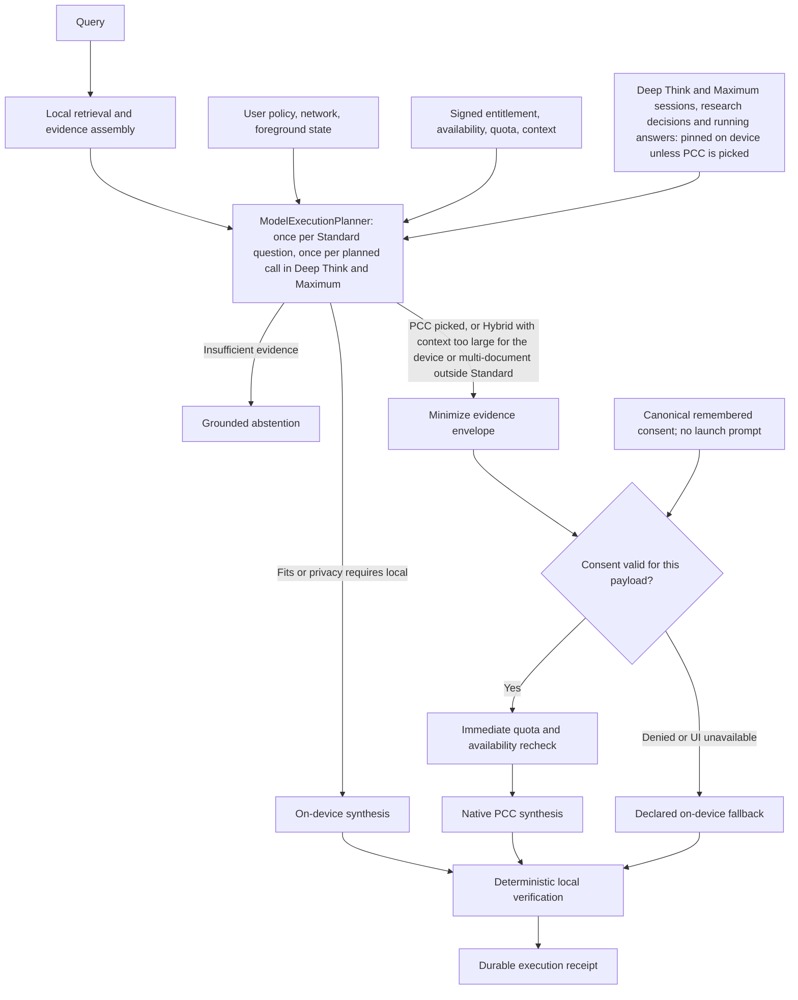

# Privacy and Model Routing — source-verified at v4.6; shipped version in `Docs/SHIPPED_VERSION.json`

> **Documentation status:** Source-verified on 2026-07-15 against v4.6. **Not re-verified as a whole since**; later-dated sections and inline evidence tags carry their own verification dates. Shipped and in-review versions are not restated here: `Docs/SHIPPED_VERSION.json` is the per-platform record. Corrected 2026-09-01, having said 4.9 since July; 5.1 recorded 2026-09-02, 5.2 recorded 2026-09-11, 5.3 recorded 2026-09-20. **Private Cloud Compute shipped in 5.2 on 2026-09-10 and is live on both platforms**; `Docs/SHIPPED_CAPABILITIES.json` carries it as `shipping`, so present-tense copy about it is correct. Native PCC execution is owner-confirmed on a physical device (2026-07-28). Signed physical-device installation, Archive/TestFlight entitlement propagation, quota-exhaustion, network-transition, and background/App Intent validation remain pending.
> **Corrected 2026-10-20 against the working tree (`b868fc0` plus the 5.7 work in progress):** which auxiliary calls run on no answer path and which reasoning level each call asks for ("Reasoning level is the only tier the public SDK offers"), the decision diagram, multi-document synthesis counting only outside Standard, and what a new install starts with and when the route is decided ("Post-retrieval decision flow"), which Deep Think and Maximum calls may go to Private Cloud Compute and that an explicit Private Cloud Compute pick lifts the device pin on the rest ("Fallback and stream integrity" and "A reasoning profile you write yourself"), that `executeMultiChainReasoning` is never called, and the one question that reaches Private Cloud Compute with no route plan and no consent sheet, a Standard question to a library with no documents ("The exception: a question to a library with no documents", with pointers from "Public execution targets", the decision diagram's note and "Always allow"), and what lowers the number of passages Standard gathers for the cloud. A claim that rests on a text search of the code ("no caller", "the only one") is tagged `grep_verified` and names the search. Each correction is marked where it is made. Line numbers are from the working tree as read at 21:41 that day and at about 23:00 (the files read at both times had not changed), and they move as the 5.7 work goes on.
> **Note on the routing picker:** until 2026-07-30 the stored routing policy did not govern Deep Think or Maximum, and an On-Device selection could still send a minimized envelope to PCC. Consent was never bypassed. Fixed in `6f29d2d`; see `Docs/CANONICAL_OPENINTELLIGENCE_SOURCE_OF_TRUTH.md` §8. If you are reading this document to answer a question about what a routing setting guaranteed *before* that date, the answer differs from what is described below.
> **Source of truth:** `Docs/CANONICAL_OPENINTELLIGENCE_SOURCE_OF_TRUTH.md` and the current implementation.

OpenIntelligence is local-first. Extraction, OCR, embeddings, vector and lexical retrieval, evidence scoring, route planning, transcript handling, and response verification run on the device. No document or query content is sent to a third-party AI provider. Apple Private Cloud Compute (PCC) is the only remote model target.

## Public execution targets

- **On-device:** `SystemLanguageModel.default` on supported Apple Intelligence devices.
- **Private Cloud Compute:** `FoundationModels.PrivateCloudComputeLanguageModel` on iOS/macOS 27+ when every capability and consent gate passes. (Corrected 2026-10-20: one path checks the capability gates and no consent gate, a Standard question typed to a library with no documents, see "The exception: a question to a library with no documents" under "Post-retrieval decision flow". Closed in 5.7 on 2026-10-21: a call with no route plan runs on the device.)

The public SDK does not expose separately selectable 3B, 20B, Advanced, or server parameter-count identities. OpenIntelligence therefore does not claim those models. iOS/macOS 26 is genuinely local-only; local generation is never labeled or simulated as PCC. `[evidence_level: compile_verified+code_verified, confidence: exact, evidence_source: FoundationModelSessionFactory.swift, EngineSDKCompatibility.swift]`

### Reasoning level is the only tier the public SDK offers, and it is PCC-only

Apple's own system UI on iOS 27 presents a model picker naming "Cloud" and "Cloud Pro". **Neither is reachable from a third-party app.** The public SDK declares exactly one server model class, `PrivateCloudComputeLanguageModel`, and no model-choice, tier, or variant type exists in any public framework. What third parties get instead is `ContextOptions.reasoningLevel`, new in iOS/macOS 27, whose cases are `.light`, `.moderate`, `.deep` and `.custom(String)`.

Apple's capability table states it directly: reasoning is **not supported** on-device and has **multiple levels** on PCC, alongside a 4K to 32K context increase. So the app sends a reasoning level only on the PCC route and never on-device, because the on-device model has no such knob; `GenerationOptions` carries only sampling, temperature, response tokens, and tool-calling mode.

`AppleFoundationModelRoute.reasoningLevel` is the single mapping from `PCCReasoningLevel` to Apple's enum, and `contextOptions(includeSchemaInPrompt:)` builds the value each call site passes. The parameter is not cosmetic: `ContextOptions` is a defaulted argument on **every** `respond` and `streamResponse` overload, so a call site that omits it silently runs at Apple's default effort rather than failing. Until 2026-09-10 one of the app's twenty-five generation call sites passed it, which meant Deep Think and Maximum advertised highest-effort reasoning and frequently did not request any. The streaming, continuation, structured and prose-fallback paths now all pass it.

`includeSchemaInPrompt` must be threaded rather than defaulted. The guided-generation overloads default it to `true` while the plain overloads leave it `nil`, and supplying any `ContextOptions` replaces that default wholesale, so handing a structured call a bare `ContextOptions(reasoningLevel:)` would quietly stop including the schema.

Auxiliary Foundation Models calls (HyDE, cluster labels, smart replies, suggested questions, contextual compression, tagging) deliberately send no reasoning level. They are internal utility generations, not the user's answer, and spending PCC reasoning quota on a cluster label is waste.

`[evidence_level: code_verified+build_verified, confidence: exact, evidence_source: FoundationModels.swiftinterface in the iOS 27 SDK (Xcode 27A5194q) — ContextOptions is @available(iOS 27.0, ...) with cases light/moderate/deep/custom, and is the only tier-like type across every public framework interface; https://developer.apple.com/documentation/foundationmodels/adding-server-side-intelligence-with-private-cloud-compute capability table, fetched 2026-09-10; Swift 6.4 build 2026-09-10 links ContextOptions symbols with a non-zero SystemLanguageModel control]`

Two of the auxiliary calls named above run on no answer path today (added 2026-10-20). HyDE is off in Standard, and the Deep Think and Maximum retrieval embeds each search phrase itself, translated first when the library needs it, never a hypothetical answer. Contextual compression has its only step in Standard's path, where Standard's mode turns it off, and Deep Think and Maximum leave that path before it. `RAGQualityMode` still reads true for HyDE in Deep Think and Maximum and for compression in Deep Think, and no step on their path reads either switch. `[evidence_level: code_verified, confidence: exact, evidence_source: RAGQualityMode.swift:189-195, :277-284, RAGService.swift:11579-11595, :12276-12325, :14316-14406, :21831-21833, :21863-21869, QueryRuntimeCoordinator.swift:222-227]` `[evidence_level: grep_verified, confidence: high, evidence_source: grep -rn "HyDEService()\|ContextualCompressionService()" OpenIntelligence OpenIntelligenceTests --include='*.swift', 2026-10-20: one of each, RAGService.swift:12325 and :14406]`

**Which level each call asks for (added 2026-10-20).** A call that reaches Private Cloud Compute asks for the level of the mode it passes: none for Standard, moderate for Deep Think, deep for Maximum. Deep Think and Maximum calls that pass no mode take Deep Think's, so in Maximum only the exhaustive synthesis that ends a chain asks for deep, and the final synthesis and refinement of Maximum's own loop ask for moderate. A written profile replaces either level (see "A reasoning profile you write yourself"). `[evidence_level: code_verified, confidence: exact, evidence_source: FoundationModelRoutePolicy.swift:39-44, LLMService.swift:721-727, AgenticOrchestrator.swift:9169, :9201, :5857-5865, :7432-7440, :7482-7490, FoundationModelRoute.swift:66-75]` `[evidence_level: grep_verified, confidence: high, evidence_source: grep -n "generateWithProperConsent(" AgenticOrchestrator.swift and each call's arguments read, 2026-10-20: of the fourteen calls only :5857 passes .maximum and :5939 .deepThink, and the rest pass no mode]`

## Post-retrieval decision flow

**Corrected 2026-10-20 against the working tree.** The diagram now shows that the planner runs once per Standard question and once for each call Deep Think and Maximum make through `RAGService.generateWithProperConsent`, that their sessions, research decisions and running answers reach it pinned to the device unless Private Cloud Compute is picked in the model picker, and which plans can pick Private Cloud Compute. It showed a single planner step and labelled the cloud branch "Evidence-sufficient PCC candidate". Calls made through `RAGService.generateWithFreshSession` never reach the planner and run on the device (see "Fallback and stream integrity"). A Standard question to a library with no documents reaches neither retrieval nor the planner (see "The exception: a question to a library with no documents" below). `[evidence_level: code_verified, confidence: exact, evidence_source: ModelExecutionPlanner.swift:37-104, RAGService.swift:15793, :11872-11874, :17045-17111, AgenticOrchestrator.swift:9123-9152, :9234-9240, :9268]`

`QueryRuntimeCoordinator` preserves the user's policy but does not predict a final route. After retrieval, `ModelExecutionPlanner` evaluates:

- evidence sufficiency, score distribution, context size, and multi-document synthesis need. **Corrected 2026-10-20:** multi-document need counts only outside Standard. Under Hybrid a Standard answer goes to Private Cloud Compute only when its context does not fit the device budget, and a Deep Think or Maximum call also when its passages come from more than one document. `[evidence_level: code_verified, confidence: exact, evidence_source: ModelExecutionPlanner.swift:77-85, RAGQualityMode.swift:43, RAGService.swift:15781-15792, :18494, AgenticOrchestrator.swift:9275]`
- automatic, on-device-only, prefer-cloud, or cloud-only policy. **Corrected 2026-09-24:** the planner tells apart only on-device-only (`requiresOnDevice`) and cloud-only (`requiresPCC`). Prefer-cloud sets neither, so it takes the same branch as automatic, and chat sends prefer-cloud whenever the model preference and the execution context are both Automatic. `[evidence_level: code_verified, confidence: exact, evidence_source: RAGService.swift:16278-16279, ModelExecutionPlanner.swift:41-104, ChatScreen.swift:2917-2919]` Unknown: whether prefer-cloud was meant to lean toward PCC. `ExecutionContext.preferCloud` is documented as "Prefer Private Cloud Compute" (LLMModel.swift:281-282) and no test references it. Verify: owner decision, then either a planner branch or a wording change;
- network and foreground/background state;
- signed PCC entitlement, live availability, live quota, and SDK-reported context size;
- whether the app is foreground-interactive, **now on macOS as well**. That input gates cloud alongside remembered consent, and until 2026-08-11 it was computed inside `#if canImport(UIKit)` with the `#else` branch hardcoding `true`. A backgrounded Shortcut on a Mac therefore reported itself foreground-interactive and could reach PCC with nobody present to answer the consent sheet, which is the case the gate exists to prevent. macOS reads `NSApplication.shared.isActive` now, and a platform with no UI framework falls closed to `false`. `[evidence_level: code_verified+build_verified, confidence: exact, evidence_source: RAGService.swift makePostRetrievalModelPlan]`;
- exact SDK token counts where available, otherwise a receipt-labeled conservative estimate.

Escalation never substitutes for missing evidence. Weak or irrelevant retrieval abstains or stays local according to the grounding policy. `[evidence_level: code_verified, confidence: high, evidence_source: ModelExecutionPlanner.swift, FoundationModelTokenBudget.swift, RAGService.swift]`

**What a new install starts with, and when the route is decided (added 2026-10-20).** A new install answers in Standard, with the model picker on Hybrid and Private Cloud Compute permission on "Ask when needed", so the chat sends Hybrid as prefer-cloud with Private Cloud Compute allowed. For a question answered from a library's passages, nothing is sent until the question's plan picks Private Cloud Compute and the person allows it on the consent sheet or has already allowed it for every question. The route is planned after retrieval: once per question in Standard, before the answer is generated, and once for each call Deep Think and Maximum make through `RAGService.generateWithProperConsent` (their calls through `RAGService.generateWithFreshSession` are never planned and run on the device). Standard's retrieval still depends on whether the cloud route is eligible (Apple's model answering, online, Private Cloud Compute allowed by the picker, not On-Device, consent not denied). Then it asks for at least 50 candidates, sizes its first pass for a 32,768-token window, up to 45,000 characters (never in the Simulator), and packs again for the device when the plan keeps the answer there and the context does not fit, or consent is refused. The candidates are capped by an adaptive limit: 75 on an A17 Pro, 100 on an A18, 150 on an A19 and 250 on an M-series chip, half that under critical memory pressure and 10 when the device is critically hot, and also 10 for a question of three words or fewer with no question mark, and at most 50 for one the app rates complex while the device is under no pressure. The battery level, Low Power Mode and heat short of critical change none of this, and only Standard's path reads the limit. `[evidence_level: code_verified, confidence: exact, evidence_source: SettingsStore.swift:50, :451, :454-462, :617-624, LLMModel.swift:218, :228, :266, ChatScreen.swift:3177-3181, QueryRuntimeCoordinator.swift:150-158, :232-233, RAGService.swift:11738-11745, :14532-14545, :14783-14852, :15793, :15841-15900, AgenticOrchestrator.swift:9123-9152, :9268, AdaptivePipelineOptimizer.swift:56-70, :115-192, :205-262, :324-370, :583-587, :606-631]` `[evidence_level: grep_verified, confidence: high, evidence_source: 2026-10-20, grep -n "adaptiveConfig" RAGService.swift AgenticOrchestrator.swift (read at RAGService.swift:11545, :11740, :14191 and :14325, all on Standard's path) and grep -rn "isLowPowerModeEnabled" OpenIntelligence --include='*.swift' (no hit in AdaptivePipelineOptimizer.swift or RAGService.swift)]`

**The exception: a question to a library with no documents (added 2026-10-20).** **Closed in 5.7 (2026-10-21):** a call with no route plan now runs on the device, because `FoundationModelRoutePolicy.determineRoute` returns `.onDevice` when no plan is attached, so this question stays on the device whatever the model picker and the permission say; the rest of this paragraph describes 5.6 and the 5.7 work before that date. `[evidence_level: code_verified, test_verified once PlanlessRouteTests runs, not run on a device, confidence: high, evidence_source: FoundationModelRoutePolicy.swift determineRoute, PlanlessRouteTests.swift]` A Standard question typed in the chat to a library with no documents, with reliability mode on (its default), skips retrieval and the planner, and the model answers it alone with no route plan. With no plan the consent step returns at once, so no sheet is shown, no transmission record is written and no execution receipt is built, and the route comes from the route policy's branch for a call with no plan. Under Hybrid that branch sends the question to Private Cloud Compute when the question's estimate is over the device's window (5,735 characters or more on a 4,096-token window, 11,469 or more on an 8,192-token window) and Private Cloud Compute is allowed, available and within quota, and it keeps the question on the device when the permission is Don't Allow. With Private Cloud Compute picked in the model picker it sends every such question there when Private Cloud Compute is available and within quota, at any length and whatever the permission, Don't Allow included. A question from Siri or Shortcuts to such a library is declined with the reason "This library has no documents yet." instead, and so is every such question when reliability mode is off. This was read link by link in the code and has not been run, because it needs a device where Private Cloud Compute runs. A device run settles it: on an iPhone, with an empty library, Hybrid and a question of 6,000 characters, the unified log's `routing` line (subsystem `Gunndamental.OpenIntelligence`) reads `route started actual=privateCloudCompute intended=direct` with `plan=direct` if the question went to Private Cloud Compute, and `actual=onDevice` if it stayed. `[evidence_level: code_verified, confidence: high, read link by link and not run on a device, evidence_source: ChatScreen.swift:3173-3190 (what the picker sends), SettingsStore.swift:516-521, :745-753, :776-784 (Don't Allow turns Private Cloud Compute off in the chat's config), QueryRuntimeCoordinator.swift:140-188 (a device build keeps it allowed when online), RAGService.swift:11532, :11579-11595, :11668-11671, :11872-11874, :17045-17111 (the branch and its call with no plan), :18742-18749, :4391-4404 (the consent step returns before any record when there is no plan), LLMService.swift:696-702, :717 (the estimate, at 1.4 characters a token), :729-745, :1181 (a receipt is built only from a plan), FoundationModelPromptCompiler.swift:129-142 (with no context the prompt is the question), FoundationModelRoutePolicy.swift:28-57 (no plan, then the picker, where a Private Cloud Compute pick returns before the permission is read), :91-95, :121-132, FoundationModelSessionFactory.swift:86-102 (entitlement, availability and quota only), FoundationModelTokenBudget.swift:28-38, :58, :74-80, RouteLog.swift:44-55, :79-82]` `[evidence_level: grep_verified, confidence: high, evidence_source: 2026-10-20, grep -n "modelExecutionPlan = " RAGService.swift (one hit, :15803, in the branch for a library with documents) and grep -n -i "consent" LLMService.swift FoundationModelRoutePolicy.swift FoundationModelSessionFactory.swift (one comment, FoundationModelRoutePolicy.swift:29)]`

### Correction: the policy did not reach Deep Think or Maximum before 2026-07-30

Recorded here because this document asserts the routing policy as a privacy guarantee, and for the agentic modes that assertion was not true.

`AgenticOrchestrator.generateWithProperConsent` constructed a fresh `InferenceConfig` from only `maxTokens`, `temperature`, and `systemPrompt`. `fmPreference`, `executionContext`, and `allowPrivateCloudCompute` therefore fell back to their defaults (`.automatic`, `.automatic`, `true`) even though `ChatScreen` had already assembled a config carrying the user's actual selection. The second bullet above — *"automatic, on-device-only, prefer-cloud, or cloud-only policy"* — was evaluated against a default, not against what the user chose.

Three physical-device runs, one per picker setting, were identical in routing. **With the picker on On-Device, a minimized evidence envelope of 16,642 bytes across 20 chunks was still sent to PCC, and the UI labeled it "(User Selected)".**

Scope, stated precisely:

- The consent gate was **not** bypassed. `consentState` is read independently of the picker, and `.denied` genuinely blocked PCC. The observed runs carried a remembered grant from a prior explicit allow.
- The destination was Apple PCC under the same minimization and entitlement gates described below. No third-party provider was involved, and no additional data left the device beyond the normal PCC envelope.
- What failed is narrower and still serious: **the picker and the `allowPrivateCloudCompute` setting did not restrict routing in the two modes that transmit the most.** A user who granted PCC consent once and later selected On-Device would not get on-device-only behavior.
- Standard was unaffected throughout. It consumes the `ChatScreen` config directly, derives `pccEligible` from those fields, and sizes packed context to match.

Fixed in `6f29d2d`. `RAGService` captures a `UserRoutingPreference` per query and applies it to the config before planning, so `allowsPCC` reflects the real selection. On-Device is absolute and covers final synthesis, not only the reasoning sessions. Query expansion and planning remain local under every setting by design.

`[evidence_level: device_verified_for_the_defect+build_verified+test_verified_for_the_fix, confidence: high_for_the_defect_unverified_on_device_for_the_fix, evidence_source: PCC/On-Device/Hybrid device logs 2026-07-30, ChatScreen.swift:2626, AgenticOrchestrator.swift, RAGService.swift]`

## Entitlement, OS, and quota gates

Apple approval of `com.apple.developer.private-cloud-compute` was confirmed by the user on 2026-07-15, and the source entitlement is enabled. Runtime evidence is platform-specific: native macOS uses Security.framework `SecTask`; iOS/Catalyst development and ad-hoc builds parse the embedded signed provisioning profile; App Store/TestFlight builds that omit that profile allow only the approved PCC key to continue to Apple's documented `PrivateCloudComputeLanguageModel.availability` and quota checks. The branch passes a generic arm64 iPhoneOS compile gate, while signed installation and distribution runtime validation remain pending. `[evidence_level: build_verified+sdk_verified+user_confirmed, confidence: high_for_source_unverified_for_distribution]`

Before PCC construction, the app verifies:

1. iOS/macOS 27 availability;
2. signed entitlement presence;
3. `PrivateCloudComputeLanguageModel` availability;
4. quota is not exhausted;
5. network and policy permit PCC;
6. the planned envelope fits the live context budget.

**What Settings says when a gate fails, corrected 2026-10-14 for 5.7.** On a system older than 27, the first gate fails, and `FoundationModelCapabilityProvider.snapshot` said "This build was compiled without Private Cloud Compute (requires Xcode 27)", the sentence for a build without it. It now says "Private Cloud Compute needs iOS 27 or iPadOS 27", or "needs macOS 27" on the Mac, and keeps the old sentence for a build that really lacks it. `[evidence_level: build_verified, confidence: high, evidence_source: FoundationModelCapabilityProvider.swift; only a device on 26 shows it]`

Quota is rechecked immediately before the model is constructed. A quota failure is not retried on PCC. Unknown future SDK quota states map to `.unknown` through Swift's `@unknown default` handling and therefore do not authorize PCC.

**Corrected 2026-08-11. That last sentence was true of the mapping and false of the consequence, for as long as it has been written here.** `FoundationModelCapabilitySnapshot.canUsePCC` tested `pccQuota != .limitReached` alone, so `.unknown` authorized a cloud attempt. Three places already asserted the opposite: this paragraph, `RouteEvalMetrics.RouteInvariant.quotaFailClosed` ("`.limitReached`, `.unsupported`, and `.unknown` are all fail-closed states"), and `ModelExecutionReceipt.nonAuthorizingQuotaStates`. Only the planner disagreed, and it is the one that decides. The rule now exists once as `PCCQuotaState.authorizesCloudExecution`, exhaustive over the enum, and both the planner and the scorer derive from it. Found by reconciling the roadmap against code; no test covered this path, and `PCCQuotaAuthorizationTests` covers it now. `[evidence_level: code_verified+test_verified, confidence: exact, evidence_source: ModelExecutionPlan.swift PCCQuotaState.authorizesCloudExecution and canUsePCC, RouteEvalMetrics.swift]` Hybrid and explicit PCC policy use the declared local fallback before meaningful streaming; the receipt retains PCC as intended and on-device as completed. `[evidence_level: code_verified+user_confirmed, confidence: high_for_source_unverified_for_distribution, evidence_source: FoundationModelCapabilityProvider.swift, FoundationModelSessionFactory.swift, ModelExecutionPlanner.swift, LLMService.swift, OpenIntelligence.entitlements]`

## Evidence minimization and consent

PCC consent happens only after the route and cloud evidence envelope are final. `CloudEvidenceMinimizer` selects a bounded set of source IDs, names, page numbers, and text. The consent sheet displays provider/model, prompt size, context size, chunk count, total estimated bytes, and the machine-readable route reason.

**Corrected 2026-10-20, in the 5.7 working tree: a Deep Think or Maximum step whose evidence is already rendered sends that text, not an envelope.** 13 of the 14 calls into the agentic generation step (`AgenticOrchestrator`, the function that plans each step) pass their evidence as rendered text with no chunk list. The envelope is built from chunks, so on Private Cloud Compute those steps went with an empty context. They now send the rendered evidence cut to the same character budget (800 to 12,000 characters, from the plan), and the consent sheet and the transmission record are made from that text, as `ensureConsentForDeepThink` receives it. A step that does pass chunks keeps the envelope, and its passages follow the envelope's order, which is the order its labels number (`RAGService.passages(_:inTheOrderOf:)`); the Standard answer on Private Cloud Compute does the same. `[evidence_level: code_verified, confidence: high for the code path; not run, because Private Cloud Compute is not reachable from the iOS Simulator]`

- **Allow once ("Just Once"):** grants one question. The grant is cleared when the next question starts, in every mode, and one question can make several model calls under it. **Corrected in 5.6 (2026-10-07):** through 5.5 only a Standard question cleared it (`RAGService.queryInternal`, where the query's container is set), and Deep Think and Maximum return before that line, so after Just Once the next Deep Think or Maximum question that routed to Private Cloud Compute was sent without the sheet. The grant is now also cleared before `executeAgenticQuery`. `[evidence_level: code_verified, confidence: high, evidence_source: RAGService.swift queryInternal, ensureCloudConsentIfNeeded and rememberTransientGrant, read 2026-10-07; not exercised on a device, and no test reaches this path]`
- **Always allow:** persists provider consent; each transmission still produces a local record. (Corrected 2026-10-20: a question to a library with no documents that reaches Private Cloud Compute produces none, see "The exception: a question to a library with no documents" under "Post-retrieval decision flow". Closed in 5.7 on 2026-10-21: a call with no route plan runs on the device.)
- **Deny:** blocks PCC. Hybrid and explicit PCC policy use the on-device fallback and label the answer accordingly.

Background and App Intent execution never waits on a consent sheet nobody can see. Remembered consent may permit PCC; otherwise Hybrid and explicit PCC policy complete through the declared on-device fallback. `[evidence_level: code_verified, confidence: high, evidence_source: RAGService.swift, CloudConsentPromptView.swift, AgenticOrchestrator.swift]`

**From 5.7 (2026-10-14), a question from Siri or Shortcuts can ask.** The five ask actions run in the background and may come forward (`supportedModes` `[.background, .foreground(.dynamic)]`). When the system lets one come forward (`systemContext.currentMode.canContinueInForeground`), its question counts as one a person can be asked about (`makePostRetrievalModelPlan` passes `isForegroundInteractive || bringAppForwardForConsent != nil` to the planner), so Private Cloud Compute may be chosen. Before anything is sent, the consent gate (`ensureCloudConsentIfNeeded`) brings the app forward (`continueInForeground`, which may first ask the person to confirm, per Apple's documentation of it) and the same consent sheet opens in the app's window: the chat shows the sheet only for its own engine, so a request from the engine an action builds for its question goes through `CloudConsentRelay` to `ContentView`, which shows it in the first window to claim it. Nothing is sent without the person's choice. If the app cannot come forward, the question goes on without Private Cloud Compute, as before. A sheet no window shows within 15 seconds is given up the same way, and nothing is remembered (`abandonCloudConsentRequest`), unlike Don't Allow. Through the first 5.7 builds an action whose question reached the consent step while the app was in front (on the Mac, whenever the app was active) waited for good on a sheet nothing showed (read from the code, not observed). **Corrected the same evening after a refuting review:** a choice already made (Always Allow, Don't Allow) is applied before anything about the foreground, so it needs no sheet and nothing comes forward for it, and on iPhone a question from the background now uses Always Allow, which the foreground check had blocked; the stored choice is read again at the start of each question and at each Private Cloud Compute step, so a change in Settings counts at once (`refreshCloudConsentFromDefaults`); only the engine an action builds asks through the relay (`asksThroughRelay`), never the chat's own; the relay keeps a request before announcing it, so a window can claim it (until then no window could); a sheet on screen is never taken away by a newer request, which is given up instead; on the Mac an action's question asks only when the app is in front; and a question whose sheet went unseen asks no more. `[evidence_level: build_verified; test_verified for the relay and the engine's side (CloudConsentRelayTests); code_verified for an action coming forward, which needs the system's context and a device where Private Cloud Compute runs (the Simulator never selects it), confidence: medium until a device run, evidence_source: RAGService.swift ensureCloudConsentIfNeeded, cloudConsentDecision and makePostRetrievalModelPlan; RAGAppIntents.swift AskActionRunner.foregroundRequest; CloudConsentRelay.swift; ContentView.swift]`

`cloudConsent.applePCC` is the canonical remembered value. On upgrade, the legacy PCC picker is synchronized to that value; it cannot erase an explicit allow/deny decision. Selecting Ask removes the canonical decision. App launch loads consent state but does not pre-create a transmission record or present the sheet, so a prompt is tied only to a real finalized post-retrieval envelope. `[evidence_level: code_verified+test_verified, confidence: high_pending_physical_device_validation, evidence_source: SettingsStore.swift, RAGService.swift, PCCConsentPreferenceMigrationTests.swift]`

## Fallback and stream integrity

- PCC may fall back to on-device only before meaningful response text has streamed.
- Once a meaningful partial response exists, OpenIntelligence returns that single-target partial response rather than mixing cloud and local output.
- PCC is not automatically retried after quota failure.
- Unless Private Cloud Compute is picked in the model picker, intermediate Deep Think and Maximum calls stay on the device. Calls made through `RAGService.generateWithFreshSession` are never planned and always run there, whatever is picked: the search phrasings, the relevance check, title routing, query reformulation, Speculative RAG's candidates, the decomposed pipeline's planning, analysis and refinement steps, graph expansion, and the first answer to a question that needs no documents. The chain's sessions, Maximum's sessions and running answers, and research's search-or-answer decisions are planned but pinned to the device, unless the person picked Private Cloud Compute in the model picker, which lifts their pin. Unless it is picked, only the calls that write an answer reach the planner unpinned and may be selected for Private Cloud Compute: the chain's synthesis (the exhaustive synthesis in Maximum), Maximum's final synthesis and its refinement pass, the single synthesis of a moderate first search or of a low one after Speculative RAG falls short, the decomposed pipeline's synthesis, research's closing synthesis, and the synthesis that replaces an answer given without documents when its self-check fails. (Corrected 2026-10-20: this said every intermediate session stays on the device and only the final synthesis may go, whatever the model picker says.) `[evidence_level: code_verified, confidence: exact, evidence_source: AgenticOrchestrator.swift:9123-9152 (generateWithFreshSession, a fresh config with Private Cloud Compute off and the picker's choice not carried), :9234-9240 (the pin and its lift), forceOnDevice at :3137, :5351, :6919, :7323, unpinned generateWithProperConsent at :1535, :1607 (reached from :3419 and :3502), :2778, :3209, :5857, :5939, :7432, :7482, and at :1684 (in executeHonestSynthesis) and :8023 (in synthesizeClusterInsights), ModelExecutionPlanner.swift:45-56]` `[evidence_level: grep_verified, confidence: high, evidence_source: 2026-10-20, grep -n "generateWithFreshSession(\|generateWithProperConsent(\|forceOnDevice: true" AgenticOrchestrator.swift (ten calls of the first, at :1292, :1812, :1965, :2349, :2566, :2680, :2712, :3438, :4440 and :4825, fourteen of the second, and four pins), the same search over the rest of the app (no other call), and grep -rn "executeHonestSynthesis(\|synthesizeClusterInsights(\|executeMultiChainReasoning(" OpenIntelligence OpenIntelligenceTests --include='*.swift' (the first and the last have only their definitions, and synthesizeClusterInsights is called only at :7670, inside executeMultiChainReasoning)]`
- Streaming follows the same line (5.4): in Deep Think and Maximum only the calls that write the final answer stream text to the chat; `AgenticOrchestrator.execute` holds the chat's handler back from every intermediate call. Where a final synthesis goes to PCC, the consent prompt still comes before any of its text streams. A short Standard answer on the structured path now streams its `answer` field as it is generated instead of replaying it; routing and consent for that call are unchanged.
- Retrieval evidence and citation verification remain local even when synthesis uses PCC.

`[evidence_level: code_verified, confidence: high, evidence_source: RAGService.generateWithFallback, AgenticOrchestrator.generateWithFreshSession]`

### How a failed generation is classified (added 2026-10-09, for 5.7)

The code that recovers from a failed generation decides what failed through `ModelErrorClassifier`, by the
error's type: the app's `LLMError`, the types Apple added in iOS 27 (`LanguageModelError`,
`GeneratedContent.ParsingError`, `LanguageModelSession.Error`, `SystemLanguageModel.Error`) and the iOS 26
`LanguageModelSession.GenerationError`. Text is read for an error of no known type, and for an
`LLMError.generationFailed` whose message is not one of the three the app writes for an unreadable response;
it is read as phrases. Through 5.6 three places tested single words: the reasoning chain cut its prompt down
whenever the text held "context", "exceeded", "4096" or "token", and `generateWithFallback` waited out a rate
limit whenever it held "rate", which "generated" does.
`[evidence_level: test_verified, confidence: high, evidence_source: ModelErrorClassifierTests, 2026-10-09; ModelErrorClassifier.swift; AgenticOrchestrator.executeReasoningChain; RAGService.generateWithFallback and isContextOverflowError]`

None of this changes where a question runs. What does change, none of it seen on a device:

- An unsupported-language failure, and any other error whose text merely holds one of those words, no longer
  sends a reasoning session back with a smaller prompt.
- In the chain, an unreadable response (all three messages the app writes for it) and a concurrent-request
  error are retried with the same prompt; one message was before. In `generateWithFallback` an unreadable
  response from the streaming path gets one retry after 2 seconds, where only the unmapped form was retried,
  by accident of its wording. A real rate limit keeps the 2, 5 and 12 second ladder.
- Private Cloud Compute's own error type is not named in the app. Every mention of that model stays behind
  `EntitlementChecker`, and its errors are read as text, which classifies none of them as retryable. The
  fallback to the on-device model after a Private Cloud Compute failure is unchanged: it runs after any error
  and labels a quota failure from the error's own text ("Your quota has been reached", as the macOS 27 SDK
  printed it on 2026-10-09).
  `[evidence_level: code_verified for the fallback, measured for Apple's wording; confidence: high; evidence_source: RAGService.generateWithFallback; a swiftc probe printing each error's localizedDescription, 2026-10-09]`

A notification the app posts when an import or a long answer finishes (5.7, off by default) carries a fixed
title and sentence and a link into the app. The rule that writes it is handed only whether something finished and how long it took, so it cannot carry the
question, an answer or a file name; a notification can be read on a locked screen. `[evidence_level: test_verified, confidence: high, evidence_source: CompletionNotificationPolicyTests testTheTextIsOneOfFourFixedSentences; CompletionNotificationService.swift]`

## Route telemetry

### What Apple reports, as distinct from what the app decided

`LanguageModelSession.usage` (iOS/macOS 27) is the only outcome-based evidence available about a
generation. `LanguageModelSession.Response` declares `content`, `rawContent`, `transcriptEntries`
and `usage`, and **nothing naming the backend**, so there is no way to ask Apple which model
served a request. `actualRoute` remains the app's own record of what it selected, which is a
statement of intent.

**Corrected 2026-10-05.** Two things do name the model, and the paragraph above missed both. The
release SDK (Xcode 27.0, `27A266a`) has `SystemLanguageModel.variant`, which reads `.core3` or
`.coreAdvanced3` for the on-device model backing the instance. And each `Transcript.Response` inside
a response's `transcriptEntries` carries `assetIDs`, public since iOS 26.0 and documented as
"Version-aware identifiers for all assets used to generate this response"; on the owner's Mac one
on-device response listed three `com.apple.fm.language.instruct_3b` assets. The app reads neither,
so `actualRoute` is still its only record of the route. **Measured 2026-10-06:** a Private Cloud
Compute response's `assetIDs` read `com.apple.fm.language.instruct_server_v2.fm_api.generic_11.110003.18`
and `com.apple.fm.language.instruct_server_v2.base_zap.generic_11.3.0` in each of five runs of a
development-signed probe that carried the PCC entitlement (51 requests on the owner's Mac), against
the three `instruct_3b` assets of an on-device response. So on that Mac the field told the two
routes apart, and reading it would give the app outcome-based evidence of the route. Not
established: whether the identifiers keep that shape on an iPhone or across OS releases.
`Docs/LIMITATIONS.md` (Technical Limits) has what was measured. `[evidence_level: sdk_verified+documented+measured+code_verified, confidence: exact_for_installed_sdk_and_one_mac, evidence_source: FoundationModels.swiftinterface in Xcode 27.0 27A266a read 2026-10-05; developer.apple.com/documentation/foundationmodels/systemlanguagemodel/variant-swift.property and transcript/response/assetids fetched 2026-10-05; a command-line probe on macOS 27.0 26A428 printing one response's assetIDs; grep -E for \.variant\b, coreAdvanced3 and assetIDs across app, engine and test Swift (no match); a development-signed probe carrying the PCC entitlement, run on the same Mac on 2026-10-06, printing the first response's assetIDs in each of five runs (51 requests)]`

`usage.output.reasoningTokenCount` is the useful counterpart. Apple's capability table lists
reasoning as unsupported on-device and available in multiple levels on Private Cloud Compute, so a
non-zero reasoning count is positive evidence that a reasoning-capable backend did the work. Zero
reasoning tokens on a route recorded as PCC with Deep Think or Maximum selected is a contradiction
worth investigating rather than a value to display.

This is telemetry of counts and public target names, which section 8 of `Docs/CANONICAL_OPENINTELLIGENCE_SOURCE_OF_TRUTH.md` permits. It records no query,
document, transcript or reasoning **content**, which section 8 forbids.

`[evidence_level: code_verified, confidence: exact, evidence_source: FoundationModels.swiftinterface, Xcode 27A266a: LanguageModelSession.usage is @available(iOS 27.0, macOS 27.0, ...); Usage.Output declares totalTokenCount and reasoningTokenCount; Usage.Input declares totalTokenCount and cachedTokenCount; Response declares no backend field]`

`ModelExecutionReceipt` is the durable route truth. It records plan/policy IDs, timestamps, reason codes, intended target, attempts, actual target, fallback reason, completed target, quota category, and verification result. `ResponseMetadata.executionRoute` is a compatibility summary derived from the completed receipt.

Telemetry may include identifiers, public target names, counts, budgets, hashes, quota categories, reason codes, and verification status. It must not include raw query text, document text, transcript content, or generated reasoning. Historical responses remain readable because receipt metadata is optional. `[evidence_level: code_verified, confidence: high, evidence_source: ModelExecutionReceipt.swift, RAGQuery.swift, LLMService.swift]`

**Kept with the answer (added 2026-10-15, for 5.7).** The usage was logged and kept nowhere. An answer now adds up the usage of every model call it makes (`AnswerUsageTally`, set by `RAGService.query`, added to where `LLMService` reads usage), and `finalizeResponse` saves the total in its metadata (`ResponseMetadata.appleUsage`): counts only, no text, in the conversation already saved on the device. The answer's details show it. `[evidence_level: test_verified (AnswerUsageTallyTests), confidence: high]`

### The unified-log line, so a TestFlight build can be observed at all

Until 2026-09-14 a Release build wrote **nothing** about routing to the unified logging system.
Every route-naming statement went through the `Log` facade, whose only console output is a
`print()` inside `#if DEBUG`; `print` reaches stdout and never Console.app; and Release defaults the
facade to `.error` with no categories enabled. `actualRoute` therefore existed only inside the app.

`RouteLog` (`Services/Infrastructure/Configuration/RouteLog.swift`) now writes one `notice`-level
line at the start of each generation and one at its end, to subsystem
`Gunndamental.OpenIntelligence`, category `routing`, from both generation paths in `LLMService`.
The line carries exactly: the actual target and the intended target (`ModelExecutionTarget` raw
values), the fallback reason (`ModelRouteReason` raw value or `none`), the Private Cloud Compute
reasoning level (`PCCReasoningLevel` raw value, only when that route ran), the attempt count, the
first eight characters of the plan UUID, and the policy version constant. Its API accepts only
those types, so no call site can hand it a query, a passage or an answer. Every interpolation is
marked `privacy: .public` because the unified log otherwise renders dynamic strings as `<private>`,
and each of these is a public target name or a code by construction. This is the section 8
(`Docs/CANONICAL_OPENINTELLIGENCE_SOURCE_OF_TRUTH.md`) allowance for public target names, reason codes and counts, applied to the unified log.

It deliberately bypasses the `Log` facade rather than adding a unified-log sink to it: the
facade's `.llm` lines can carry prompt and response text at debug level, which section 8 forbids
from any telemetry surface.

`[evidence_level: code_verified, confidence: exact, evidence_source: RouteLog.swift; LLMService.swift RouteLog.started/completed call sites; RouteLogLineTests pins the vocabulary; SDK check 2026-09-14: Logger.notice and OSLogPrivacy in iPhoneOS27.0.sdk os.swiftinterface]`

## Validation boundary

Private Cloud Compute shipped in 5.2 on 2026-09-10 and is live on both platforms, so the open question is no longer whether it reaches users but which of its paths have been exercised on a signed iOS 27 device and distribution artifact. These are still unconfirmed and are tracked as open items rather than assumed: entitlement inspection on a distribution artifact, intended-versus-actual receipt confirmation, consent allow/deny/revoke, App Intent and background behavior, quota approach and exhaustion, offline and mid-request network changes, and physical-device thermal and battery checks. Native PCC execution itself is owner-confirmed on a physical device (2026-07-28). `[evidence_level: code_verified, confidence: exact_for_unverified_status, evidence_source: PCC dynamic routing test matrix; Docs/SHIPPED_CAPABILITIES.json private_cloud_compute status `shipping` since 2026-09-10; Docs/SHIPPED_VERSION.json]`

## Two system model tools, off unless switched on (added 2026-10-10, for 5.7)

`FoundationModelToolRegistry.createTools` can add two tools Apple provides for FoundationModels sessions in iOS 27 and macOS 27 (`SystemModelTools`). Neither is added unless its `UserDefaults` switch is set (`systemTools.ocr.enabled`, `systemTools.spotlightSearch.enabled`); both are off when unset and there is no Settings control yet, so a shipped build behaves as before.

- `OCRTool` (`_Vision_FoundationModels`) reads text from an image the session already holds. It runs on the device.
- `SpotlightSearchTool` (`_CoreSpotlight_FoundationModels`) is configured with the Core Spotlight source only, which is the index this app itself wrote (its documents), with at most 8 results. The files source, which searches folders, is never configured. It is compiled for arm64 only: the macOS SDK's x86_64 interface for that module declares neither type, and Xcode Cloud archives the Mac app for Intel too (build 486, 2026-10-22).

What a tool returns becomes part of the session's prompt, as the app's own tools' results do, so it follows the same route and consent rules as retrieved evidence above. Whether either tool is offered to, or called by, a session routed to Private Cloud Compute has not been observed. `[evidence_level: code_verified for the registration and the switches; test_verified for the switches (SystemToolsAndScanTests); neither tool has been called on a device, confidence: low for behaviour, evidence_source: FoundationModelToolRegistry.swift; the two frameworks' interfaces in the iOS 27 SDK]`

Measured on 2026-10-15 on a Mac (macOS 27, an 8,192-token window, `tokenCount(for: tools)`): `OCRTool` takes 193 tokens and reads only an image attached to the conversation, which an answer never has, so it has nothing to read in the chat's sessions; `SpotlightSearchTool`'s description takes 13,606 tokens, more than the whole window, so it cannot be offered to the on-device model at all. Both switches stay off. From 5.7 `OCRTool` and `BarcodeReaderTool` (198 tokens) are given instead to the session that describes a picture at import (`ImageUnderstandingService.describeAttachedImage`), and only where Vision's barcode reader cannot run; that session runs on the device, so nothing it reads leaves it. `[evidence_level: measured (a swiftc probe on macOS 27); confidence: medium]`

## A web page the person asks for is downloaded (added 2026-10-09, for 5.7)

Four things download from the network, and only starting from an address the person gave them: "Save a Web Page" (`IngestURLIntent`, called "Ingest Webpage" through 5.6), the Link parameter of "Add to Library" (`AddToLibraryIntent`), the Paste control on the Documents screen when what was pasted is a web address (`PastedContentStaging`; added to this section 2026-10-12, the control dates from 2026-10-09), and a web page shared to OpenIntelligence from another app's share sheet, which the app takes the next time it is in front (`SharedInbox`, `SharedInboxImport`, through the Paste control's staging; added 2026-10-17). The share extension itself downloads nothing: it writes the address or the text to the app group's `ShareInbox` folder on the device. All four call `WebPageFetchService.fetch`, which makes a GET to that address on an ephemeral `URLSession` with cookies refused and the cache off, and sends nothing from the library with it. An `http` address is asked for as `https`: the app declares no transport-security exception, so plain `http` is never sent. The session follows the site's redirects, as a browser does, so a `www` variant or a short link can lead to further requests, and to a host other than the one in the address. No request goes to a service of this app. The page's text is stored on the device and indexed there like any imported file. This does not change where a question is answered: retrieval and ranking stay on the device, and Private Cloud Compute is reached only by the route described above. `[evidence_level: code_verified, confidence: exact, evidence_source: WebPageFetchService.swift fetch(_:now:), which builds the session with no delegate; ScreenAwarenessIntents.swift IngestURLIntent.perform; AddToLibraryIntent.swift perform; PastedContentStaging.swift]` Through 5.6 "Ingest Webpage" downloaded nothing, so no build before 5.7 makes this request.

## The plans screen asks the App Store for prices and the app's own rating (added 2026-10-28; in the app since 5.4)

Opening the plans screen (`PlanUpgradeSheet`) makes two kinds of request, neither carrying anything from a library.
`AppStoreRatingService.refreshIfStale` sends one GET to Apple's public lookup endpoint,
`https://itunes.apple.com/lookup?id=` with the app's own App Store id, on the shared `URLSession`, at most once a
day; the rating and count it returns are cached in `UserDefaults` for the one line on that screen that cites them,
and any failure is silent. The same screen refreshes the StoreKit products and the storefront
(`billingService.refreshProducts()`, `storefront.refresh()`), which reach the App Store through StoreKit, as buying
or restoring a plan does. A thesis review on 2026-10-28 listed the app's network paths as Private Cloud Compute,
iCloud Drive sync and the web page downloads above, which leaves these out.
`[evidence_level: code_verified, confidence: exact, evidence_source: AppStoreRatingSnapshot.swift:49-78 (AppStoreRatingService; the URL at 66, the once-a-day rule at 63-65), PlanUpgradeSheet.swift:165 (.task refreshIfStale) and 175-185 (refreshProducts, storefront.refresh); added in 0f6c5a0 on 2026-09-22, first released in v5.4.0; read 2026-10-28 at 90d78d6, unchanged since a7276983]`

## The Atlas may ask the system for a language's word classes (added 2026-10-17, for 5.7)

Before the Atlas names its axes and clusters, and before the library's topic chips are named, `AtlasLabeling.loadWordClasses`
reads the languages of about 200 of the passages (`NLLanguageRecognizer`) and, for each of the eight languages
NaturalLanguage has word classes for (`languagesWithWordClasses`: English, French, German, Italian, Portuguese,
Simplified Chinese, Spanish, Turkish) that the device does not have yet, calls `NLTagger.requestAssets(for:tagScheme:)`
with the language and `.lexicalClass`, once a launch, waiting up to 3 seconds. The call carries a language code and a
tag scheme and nothing from the library. Per `NLTagger.h` the system then loads the assets "at some point", which can
be a download; where it fetches them from is the system's own business, and the app makes no request of its own. The
word classes are used to leave adverbs and function words out of the map's labels (`namingTerms`). Added at the
owner's word on 2026-10-16 ("yes add the requestAssets"), after the iOS 27 Simulator showed no word classes for
Spanish or German (macOS 27 has them). `[evidence_level: code_verified, confidence: high, evidence_source:
AtlasLabeling.swift (loadWordClasses, requestWordClasses); NLTagger.h in the iOS 27 SDK]`

## Diagnostics from the system stay on the device (added 2026-10-12, for 5.7)

`MetricDiagnostics` (`OpenIntelligence/App/MetricDiagnostics.swift`) subscribes, on iOS 27 and macOS 27, to MetricKit's `MetricManager` for the reports the system gives an app about itself: hangs, crashes, CPU and disk exceptions, and launch and memory figures. It writes a one-line summary of each to the app's log and appends the report to `metric_reports.jsonl` in the app's local cache folder, keeping the newest 200 lines. The file has no upload code and makes no request, so the app sends these reports nowhere. Whether a person shares analytics with Apple and with developers is a setting of the system's own and is not changed or read by this. No report had been delivered on a device when this was written. `[evidence_level: code_verified; test_verified for the summaries and the 200-line limit (MetricDiagnosticsTests), confidence: high for the code, evidence_source: MetricDiagnostics.swift; a search of that file for URLSession and upload on 2026-10-12 found neither]`

From 5.7 the app also tells the system what it is doing (`AppStateReporting`, iOS and macOS 27), so these reports say whether an import the person started or a question asked in the chat was running (not a question from Siri or Shortcuts, nor an automatic rebuild): two domains with fixed labels, "Importing", and "Standard", "Deep Think" or "Maximum", and no metadata. No document name, question or text is ever a label. The reports, and the states in them, stay where the paragraph above says. `[evidence_level: code_verified, confidence: high, evidence_source: AppStateReporting.swift; MetricDiagnostics.swift]`

**A crash report leaves only when the person sends it (added 2026-10-14).** A crash diagnostic is also saved as a file of its own in the local cache's `CrashReports` folder, newest ten kept (`CrashReports`). It holds the app and system versions, the device model, how the app ended (termination category and reason, exception type and code, signal, the exception's name and class), which of the app's states were running and the call stack, which names code, not content. It leaves out an Objective-C exception's message text and its arguments, which can carry strings the app was handling, the memory region description, which can name a mapped file, and the region format, process id and signposts. The app offers the newest one once, in the first window to ask: Email Report opens a message to the feedback address in the person's own mail app with a short summary, and Settings, About emails it the same way or shares the whole file through the share sheet. A crash delivered twice is saved and offered once. The app makes no request with it. The in-app privacy policy says so. `[evidence_level: code_verified+test_verified (CrashReportsTests), confidence: high for what is saved; no crash diagnostic has been delivered on a device yet, evidence_source: CrashReports.swift, MetricDiagnostics.swift, PrivacyPolicyView.swift]`
## What the app hands to the system (added 2026-10-14, for 5.7)

5.7 connects the app to Handoff, Siri, Spotlight, Focus and the Lock Screen. Each of these hands the system
something; none of it leaves the person's devices through the app, and none of it carries a document's text
except where it says so below.

- **Handoff.** The chat ("Chat with Documents"), the Documents screen ("Browse Document Library") and a
  document's page ("Viewing" and the file's name) each advertise an activity carrying the library's and the
  document's identifiers, no text. Handoff offers it to the person's own devices. The document page's
  activity is offered to Spotlight and Siri's suggestions only while the Settings switch "Spotlight
  Indexing" is on, because its title names the file (`AppActivity.mayShareWithSystemSearch`); the two
  generic ones were offered before 5.7 as well. `[evidence_level: code_verified, confidence: high, evidence_source: AppNavigationRequest.swift AppActivity; ViewAnnotations.swift; ChatScreen.swift; DocumentLibraryView.swift]`
- **On screen.** The open document, library or conversation is named to Siri and Apple Intelligence by its
  identifier (`appEntityIdentifier`); the system resolves it through the app's own queries on the device.
  `[evidence_level: code_verified, confidence: high, evidence_source: ViewAnnotations.swift]`
- **Spotlight.** While "Spotlight Indexing" is on, the device's Spotlight index holds, as before 5.7, each
  library's name and counts; each document's name, its library's name, its page count and the first 500
  characters of its text; and, for a document imported whole, the first 300 characters of each passage.
  From 5.7 the entries do not expire, so each is removed with its document: deleting a document removes its
  passages' entries too (`SpotlightIndexService.deindexDocument(id:containerId:)`), a document deleted on
  another device is removed when this device next reads the documents (`documentsLoaded`, which keeps a list
  of document and library identifiers in the device's own folder), and an import that fails removes the
  entry it wrote. Turning the switch off removes every entry the app made, its saved activities and its
  Open Library donations (`indexingSwitched(on:)`); through 5.6 it only stopped new ones. A document that
  arrived from another device is listed with its name and first 500 characters, read from this device's
  full-text store, and without passages. `[evidence_level: code_verified, confidence: high, evidence_source: SpotlightIndexService.swift; RAGService.swift addDocument, applyLoadedDocuments; ContentView.swift]`
- **Siri's suggestions.** Picking a library or asking in one donates "Open Library" with that library's name
  and counts (`SiriDonations`), only while "Spotlight Indexing" is on. `[evidence_level: code_verified, confidence: high, evidence_source: SiriDonations.swift]`
- **Focus.** A Focus filter keeps the identifiers of the libraries it names in the app's own settings.
  `[evidence_level: code_verified, confidence: high, evidence_source: ContainerService+Focus.swift]`
- **The Lock Screen.** The Live Activity for a long answer shows a fixed title, the step it is on
  ("Searching this library") and how far along it is, never the question: the begin call's subtitle, which
  is the question's first words, is dropped (`QueryLiveActivityService.begin`). The system's own progress
  for the background task that keeps an answer going (`BackgroundTaskService.beginUserInitiatedQuery`) is
  given the question's first 72 characters as its subtitle, as it has been since that task was added; where
  the system shows that subtitle was not checked. `[evidence_level: code_verified, confidence: high for the Live Activity, low for where the system shows the task's subtitle; evidence_source: QueryLiveActivityService.swift; ChatScreen.swift ContinuedQueryCoordinator.begin]`
- **The Mac's Services menu.** Selected text or files come to the app only when the person picks the
  service; text goes into the chat field unsent or into the open library as a note, files into the import
  review. `[evidence_level: code_verified, confidence: high, evidence_source: MacServicesProvider.swift]`
- **Dictation.** The microphone runs only from a tap on the field's button until a second tap, a send or
  leaving the chat; a stop that comes while dictation is still preparing ends it before the microphone
  starts. Its audio goes to Apple's `DictationTranscriber` on the device and is not saved, and the words go
  into the field unsent.
  The model is one of Apple's system assets, installed by the system the first time. On the Mac the app's
  sandbox allows the microphone only through the `com.apple.security.device.audio-input` entitlement (added
  2026-10-14), and macOS asks the person the first time, as iOS does.
  `[evidence_level: code_verified, confidence: high, evidence_source: VoiceDictation.swift]`
- **Siri's search.** "Search OpenIntelligence for" a phrase opens the app's own search with it; no address
  carries the phrase (`AppDestination.searchFor` has no link form). `[evidence_level: code_verified, confidence: high, evidence_source: SearchInAppIntent.swift; AppNavigationRequest.swift]`
- **Visual Intelligence.** When the person asks Visual Intelligence about a picture, the system hands the app the
  picture and its labels. The app reads the picture's text on the device (Vision's `RecognizeTextRequest`),
  searches its own keyword index, keeps nothing, and hands back the matching documents as items, whose names,
  library and counts the system shows. `[evidence_level: code_verified, confidence: high, evidence_source: VisualDocumentSearch.swift]`
- **The Mac's menu bar.** A question typed there goes into the app's own chat, the same as one typed in the
  chat; no address carries it (`AppDestination.ask` has no link form). `[evidence_level: code_verified, confidence: high, evidence_source: MenuBarAsk.swift]`

- **Shortcuts' next step.** An answer or the passages an action hands to a shortcut ("Ask My Documents" and
  the other ask actions, "Find Passages") are kept in the app's local cache folder (`handed_out_items.json`)
  so the system can look each one up by its id for the shortcut's next step (added 2026-10-20, `HandedOutItems`).
  The file holds the answer's text and question and the passages' text, document name, page and section, with
  at most 100 answers and 500 passages that belong to no kept answer. An item more than a day old is removed
  whenever the file is read or written and each time the app loads its documents, and a passage whose document
  is in no library any more is removed at that load with every answer that used it, so a deleted document's text
  stays there until the app next loads its documents and never longer than a day after the app next runs. Its
  folder is the one described in the next section: never in the iCloud workspace, sent nowhere, and not excluded
  from a device backup. Before this the items were handed out whole and kept nowhere, and Shortcuts could not pass
  them on (`OIAnswerEntity`). `[evidence_level: code_verified, test_verified (HandedOutItemsTests), confidence: high, evidence_source: HandedOutItems.swift; OIAnswerEntity.swift; OIPassageEntity.swift; SearchPassagesIntent.swift; RAGService.swift applyLoadedDocuments]`

## What the app works out about a library is kept on the device (added 2026-10-13, for 5.7)

Two small files for each library are kept in the app's local cache folder, beside the keyword index, so the app
does not work them out again each time it opens: the library analysis (counts, language and vocabulary
measures, recommended settings, and for each document its name, three topics and the first 160 characters of
its first passage) and the vocabulary the first question builds (keywords, which keywords appear together, and
up to 300 snippets of up to 200 characters). Both come only from the library's own passages. The app sends
them nowhere and its iCloud sync does not copy them. The app sets no backup exclusion on that folder or on any
other, so a backup of the device treats them as it treats the keyword index beside them and the library itself. The vocabulary is kept only when it was built
from the passages of documents the library lists, so nothing of a file whose import was stopped part-way is in
it. Each file's name says which documents it was made from, and a
file made from documents the library no longer has is removed: when a document is added, deleted or replaced,
when the library is cleared or deleted, and, for every library, each time the app loads its documents, which
covers a document or a library removed on another device. Nothing about routing changes.
`[evidence_level: test_verified for what is removed given the documents and for when a vocabulary may be kept (LibraryAnalysisSampleTests), code_verified for where the removal is called from, confidence: high, evidence_source: AdaptiveEmbeddingOptimizer.swift LibraryIntelligenceCache; RAGService.swift refreshIntelligence, removeStaleKeptAnalysis, generateIntelligenceSnapshot, libraryVocabulary, applyLoadedDocuments; ContainerService.swift deleteContainer; ContentView.swift]`

## Adaptive profiles and routing (added 2026-09-11, corrected 2026-10-15)

`FoundationModelDynamicProfileRegistry` chooses `temperature` and `maxTokens` from the answer
intent when Adapt to the question is on (`InferenceConfig.applyingAdaptiveProfile` replaces both).

**Corrected 2026-10-15.** This section said a profile has no effect on where a request runs,
because `FoundationModelRoutePolicy` never reads it. Answers are routed by `ModelExecutionPlanner`
(`RAGService.makePostRetrievalModelPlan`), and its on-device budget reserves `max(128, maxTokens)`
for the answer (`FoundationModelTokenBudget.snapshot`, `outputReserve`). A profile's `maxTokens`
(400 to 1,400) is that reserve, so a larger one leaves less of the window for passages and, with
Hybrid and permission, can send to Private Cloud Compute an answer that would have fit on the
device; a smaller one can keep one on the device. The coupling is deliberate: the reserve has to
match what the generation will ask for, or the on-device call overflows. A profile does not change
the consent prompt or what is sent. Found by the 2026-09-24 audit
(`Docs/AuditArtifacts/DocOverhaul_2026-09-24/README.md`, privacy-routing) and confirmed in the
code; the effect has not been observed on a device.

**The X-Ray and a cloud answer (2026-10-19).** The hardware X-Ray lit the Neural Engine while Apple's model wrote any answer, one written on Private Cloud Compute included, which put a cloud answer on this device's chip. `LLMService.generate` now reports to it only when `actualRoute` is not `.privateCloudCompute`. Routing is unchanged. `[evidence_level: code_verified, confidence: high, evidence_source: LLMService.swift generate]`

**The window in what a person reads (2026-10-18).** The Glossary, the model card, the sample
documents and the chat's context gauge said 4,096 tokens for every device. They now show the window
the device reports (`FoundationModelTokenBudget.reportedOnDeviceContextSize`, `nil` where the model
is unavailable, as in every Simulator, where `contextSize` is 0): 8,192 on a Mac with macOS 27.
Routing already read the live window; this changes text and the gauge's fallback only.
`[evidence_level: code_verified, confidence: high, evidence_source: FoundationModelTokenBudget.swift,
Glossary.swift, LLMModelType.swift, ChatScreen.swift maxContextTokensForUI]`

This is worth stating because the registry's previous shape could have affected routing
indirectly: it produced a full replacement `systemPrompt`, and prompt length feeds the token
estimate that the planless routing branch compares against the on-device context window. Producing
generation parameters only removes that coupling.

`[evidence_level: code_verified, confidence: high, evidence_source: FoundationModelDynamicProfileRegistry.swift applyingAdaptiveProfile replaces maxTokens; RAGService.makePostRetrievalModelPlan passes outputReserve: max(128, config.maxTokens); ModelExecutionPlanner sends to PCC when !localBudget.fits]`

**Settings are not written (2026-10-20).** `InferenceConfig.applyingAdaptiveProfile` returns a copy and writes nothing to
`UserDefaults` (`AdaptiveInferenceProfileTests.testApplyingAProfileWritesNothingToUserDefaults`). `AutoTuneService`, which
wrote the same two settings back into `UserDefaults` and had no caller, was removed in 5.7 that day.
`[evidence_level: code_verified, confidence: high, evidence_source: FoundationModelDynamicProfileRegistry.swift applyingAdaptiveProfile; AdaptiveInferenceProfileTests.swift; grep for AutoTuneService]`

## A reasoning profile you write yourself (added 2026-09-11)

`ContextOptions.ReasoningLevel` has a fourth case besides `light`, `moderate` and `deep`:
`custom(String)`. It carries free text describing how the model should approach the problem. The
named levels are a dial; this is a sentence. `AppleFoundationModelRoute.reasoningLevel` reads
`UserDefaults` key `customReasoningProfile` and substitutes `.custom(...)` when it is non-empty.

**What this does and does not touch, since it is text the owner wrote reaching Apple's servers:**

- **It is not the app's reasoning, and the distinction matters.** Deep Think and Maximum run their
  own multi-session reasoning through `executeReasoningChain`, `executeTrueUnlimitedReasoning` and
  `executeRecursiveResearch` (`executeMultiChainReasoning` is defined and has no caller). Four calls
  in them pass `forceOnDevice: true`: the chain's sessions, Maximum's sessions, Maximum's running
  answer and research's search-or-answer decision. That reasoning happens on the device and a
  written profile does not touch it, unless the person picked Private Cloud Compute in the model
  picker: that lifts the pin, so those calls can run there at Deep Think's level, which a written
  profile then replaces. (Corrected 2026-10-20: this listed `executeMultiChainReasoning` among the
  paths in use, and did not say an explicit Private Cloud Compute pick lifts the pin.)
  `[evidence_level: code_verified, confidence: exact, evidence_source: AgenticOrchestrator.swift:3137, :5351, :6919, :7323, :7533, :9234, FoundationModelRoute.swift:66-75]`
  `[evidence_level: grep_verified, confidence: high, evidence_source: 2026-10-20, grep -rn "executeMultiChainReasoning(" OpenIntelligence OpenIntelligenceTests --include='*.swift' (its definition only, :7533), grep -n "forceOnDevice: true" AgenticOrchestrator.swift (four hits, the ones above), git show v5.6.0:OpenIntelligence/Services/Agentic/AgenticOrchestrator.swift searched for "let budgetPin" (the same rule, at :9095), and git grep -n "executeMultiChainReasoning(" v5.6.0 -- '*.swift' (its definition only, at :7401)]`
  What this field controls is Apple's **model-internal** reasoning setting, the effort spent
  inside one generation.
- It therefore applies **only on the Private Cloud Compute route.** Apple's capability table lists
  that setting as unsupported on-device and `GenerationOptions` carries no equivalent, so an
  on-device generation has no reasoning level to replace. Pinned by
  `testAProfileDoesNotLeakOntoTheOnDeviceRoute`. **Read carefully:** this says Apple's model does
  not expose a reasoning dial on device. It does not say this app does not reason on device, which
  is the opposite of true and is exactly the conflation the first draft of the settings copy
  shipped.
- It **cannot start reasoning that was not already going to happen.** `.none` means the query type
  does not warrant the spend, and the substitution is skipped for it. Without that guard a profile
  reading "think very hard about everything" would convert every cheap lookup into a billed PCC
  reasoning request. Pinned by `testAProfileDoesNotStartReasoningWhereThereWasNone`.
- It changes **nothing about routing**: not whether a request goes to PCC, not the consent prompt,
  not what evidence is attached. It describes how the model should think once a request has already
  been approved and sent.
- The text is **sent to Apple as part of the request** on a PCC route, under the same end-to-end
  encrypted, non-retained terms as the rest of that request. Anyone writing a profile should
  understand it leaves the device exactly as the question and the approved passages do. The
  Model Parameters footer says where it applies; this is the privacy statement behind it.

`[evidence_level: test_verified, confidence: high, evidence_source: FoundationModelRoute.swift reasoningLevel; CustomReasoningProfileTests, 6 cases; ReasoningLevel.custom read from iPhoneOS27.0.sdk FoundationModels.swiftinterface]`
