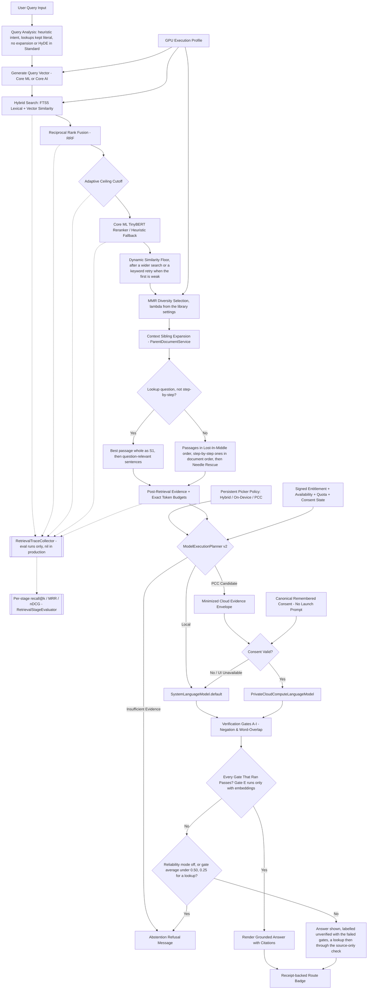

# Retrieval Pipeline — narrative source-verified at v4.6; claims re-checked 2026-09-01

> **Documentation status:** Sections 1–5 source-verified 2026-07-15 against v4.6 and **not re-narrated since**; 4.8–4.9 changed retrieval behaviour in ways they do not describe. The numbered items 12–22 and the Suggested questions section are individually dated and evidence-tagged and are the current record.
>
> **Corrected 2026-10-20 against the working tree (`b868fc0` plus the 5.7 work in progress):** the flow diagram in section 2 (Standard's query analysis, where the similarity floor sits, the λ its MMR step uses, the two packing paths and the order of step-by-step passages, what a failed gate check does and which gates run, with a note on how Deep Think and Maximum differ), stage 3's chunk sizes and cutting rule, stage 4's two keyword-index writes, its page rows and its flat vector file, stage 7's "compressed" and its overlap skip, stage 8's "per query", its per-call routing in Deep Think and Maximum and the question to an empty library that has no route plan, item 13's list of what goes through sentence selection, item 14's account of Needle Rescue and item 15's note on it, item 18's note on which synthesis it describes and which passages it is given, item 22's places a locked value is used, the known-drift line that named `executeReasoningChain` and the callers its tag names, the section on an extracted value (the function its five places share, and in its 2026-10-20 note the count of places that follow the model's answer and what the other three share), the answer mode's λ said to be read by logging, the re-pack after the route plan ("Retrieval's best passage reaches the model"), the condition on the measured iPhone budget and the limit on candidates, and the minimum Deep Think and Maximum pass to each search. A claim that rests on a text search of the code ("no caller", "the only one") is tagged `grep_verified` and names the search. Each correction is marked where it is made. Line numbers are from the working tree as read at 21:41 that day and at about 23:00 (the files read at both times had not changed), and they move as the 5.7 work goes on.
>
> **Shipped versions:** read `Docs/SHIPPED_VERSION.json`, the per-platform record. This document deliberately states no current version number, because each one it stated went stale: before 2026-09-01 this block said "iOS/macOS 4.9 is the shipped version" while the title said v5.0, and the correction made that day (iOS 5.0, macOS 5.0.2) has since been superseded too. The 2026-09-01 note that PCC device/distribution validation was pending predates PCC shipping; `Docs/SHIPPED_CAPABILITIES.json` records `private_cloud_compute` as `shipping` since 2026-09-10. <!-- verify-doc-claims: ignore, this line quotes the withdrawn claim -->
>
> **Claims re-checked against source 2026-09-01, all holding:** the seven `RetrievalTraceCollector` stages and their order; `executeFullRetrievalPipeline` taking a defaulted `trace` parameter (item 19); the collector defaulting to `nil` everywhere, so production pays a nil check; the Core ML TinyBERT cross-encoder with heuristic fallback in the flow diagram, which is loaded at `RAGEngine.swift:82` and invoked at `:331`; and every referenced document existing.
>
> **The benchmark directories cited in items 12 and 19 — `BenchmarkRuns/20260811-133233-matrix` and `BenchmarkRuns/paired-retry` — are archived, not deleted.** All 90 run directories are in `~/OpenIntelligence-BenchmarkArchive/BenchmarkRuns-2026-09-01.tar.gz`, verified byte-identical before removal. Extract to read them; see `BenchmarkRuns/LEDGER.md`.
> **Known drift as of 2026-08-05** — each of these is in the changelog under 4.9 (moved on 2026-09-24 from `CHANGELOG.md` to `Docs/Archive/CHANGELOG_2.0_to_5.2.md`) but not yet reflected below:
> - Gate E measures query coverage as the better of combined-evidence and best-single-chunk, not the per-chunk maximum.
> - `DomainIsolationService` relaxes only the cross-domain-mixing clause when the retrieved chunks all come from one `documentId`.
> - `DomainIsolationService` (5.7, 2026-10-15) matches its keywords as whole words, has no two-letter abbreviations, and engages only when the question scores two or more of them; it had failed right answers about everyday documents by matching "um" inside "number" and "ip" inside "trip".
> - The Deep Think and Maximum front half (`AgenticOrchestrator.executeHoldingAnswerStream`) searches the question as the user wrote it when its search phrasings (from the query planner, or from one on-device model call with fixed phrasings as the fallback) fuse zero passages and none of them was that wording, before the relevance gate judges the library. (Corrected 2026-10-20: this line named `executeReasoningChain`, which starts after that gate and has no such retry.) `[evidence_level: code_verified, confidence: exact, evidence_source: AgenticOrchestrator.swift:285, :339, :363-372, :396-454 (the relevance gate), :1916-1990 (generateSearchQueries), :4880 (executeReasoningChain)]` `[evidence_level: grep_verified, confidence: high, evidence_source: grep -n "Retrying with" AgenticOrchestrator.swift (one hit, :365) and grep -rn "executeReasoningChain(" OpenIntelligence OpenIntelligenceTests --include='*.swift', 2026-10-20: four calls, at :639 and :877 in the front half, at :9113 in executeStandardReasoningChain, Standard's chain, which runs only with the developer switch forceReasoningChain (RAGService.swift:15952-15960, called at :16002), and at :7915 in executeClusterChain, reached only from executeMultiChainReasoning (:7594), which has no caller]`
> - `makePostRetrievalModelPlan` takes the maximum similarity over the chunk set rather than reading `chunks.first`, which is not the best chunk after MMR, expansion, and Lost-in-the-Middle reordering.
> **Source of truth:** the code. The codebase audit this line used to cite in `Docs/AUDIT/` is not in the repository (`Docs/AUDIT/` is gitignored). For anything retrieval-related in 4.8–4.9, read those sections of `Docs/Archive/CHANGELOG_2.0_to_5.2.md`, where they moved from `CHANGELOG.md` on 2026-09-24.
> **Scope:** Describes shipped behavior unless explicitly labeled experimental, developer-only, or scaffolded.

---

> **Large libraries, changed 2026-10-10 for 5.7.** Three steps described in this document used to walk every passage of the active library: the query-expansion vocabulary (`CorpusVocabulary.build`, a part-of-speech tagger per passage, built for the first question after a launch or an import), the suggested-question sampler (`RAGService.getSampleChunks`) and the cross-reference graph (a regular expression compiled per pattern per passage). Above 4,000 passages the first two now work from an even sample of the library (the sampler also keeps every document summary), and the graph's patterns are compiled once. A vocabulary built from a sample can miss a term that appears in few passages; that is the trade. Later the same day: the hybrid search joins keyword hits through a lookup of only the keys a pass needs (`HybridSearchService.buildNeededChunkLookup`), and the extractive "spec" scan scores an even sample of 20,000 passages above that size (`RAGService.passagesToScanForSpecSniper`). `[evidence_level: test_verified for the sampling rules; code_verified; not timed on a device, confidence: medium, evidence_source: LargeLibraryCostTests, QueryEnhancementService.swift, RAGService.swift, GraphIndexService.swift]`
>
> **Where passages come from, changed 2026-10-12 for 5.7.** The vector store no longer holds every passage's text after it opens a library. A vector search scores every vector as before and decodes only the passages that come out on top. Two lookups in hybrid search that used to load every passage when none were handed in now ask the store's records which passages they need and read those by id: the search inside named documents (`searchInsideScope`) and the lookup that turns keyword hits into passages (`HybridSearchService.neededChunkPositions`, which picks the same passages `buildNeededChunkLookup` picked from the full array). The question path itself still loads every passage once, through `readableChunks()`, because its summary, enumeration, parent-expansion, cross-reference, extractive-scan and multi-hop steps read all of the text, so what a question retrieves is unchanged. A passage the store cannot read is left out of that array and of every search. `[evidence_level: test_verified for the two lookups (VectorStorePassageIndexTests), code_verified for the rest, confidence: high, evidence_source: HybridSearchService.swift, BNNSVectorDatabase.swift, RAGService.swift; CHANGELOG.md 5.7 Changed]`
>
> **A question limited to named documents is ranked by vector as well as by words, corrected 2026-10-13 for 5.7.** `searchInsideScope` took each passage's similarity from the vector on the passage. The vector store hands passages back without their vectors, so every similarity was 0 and the scoped ranking was by the question's words alone. It now asks the store how close each passage is (`similarities(to:forChunkIDs:)`, worked out where the vectors are kept); a store that hands passages back with their vectors is ranked from them as before. Up to 6,000 passages in the named documents, every passage is scored both ways. Past that (one document of 144,247 passages exists) every vector is scored and words are compared for the 2,000 closest passages and for the keyword index's best 400 hits inside the scope, whether the passages were handed in or are read by id; with no vector to score, every passage is read, and a question whose own embedding failed counts as that. The keyword hits come from the index's chunk search, which is library-wide and matches every word before it matches any, so a passage outside the scope that holds every word leaves the scope without keyword candidates. The log lines `[Hybrid] Document scope: ...` say which happened and how many passages were compared by vector. `[evidence_level: test_verified (HybridSearchServiceTests, nine tests), not run on a device, confidence: high, evidence_source: HybridSearchService.swift searchInsideScope; BNNSVectorDatabase.swift similarities]`
>
> **Parent expansion, changed 2026-10-13 for 5.7.** `ParentDocumentService.expandWithSiblings` gathers only the passages of the documents its retrieved passages come from and sorts each document once. It used to index and group every passage of the library for each question. The siblings it adds are the same. `[evidence_level: test_verified (ParentDocumentServiceTests), confidence: high, evidence_source: ParentDocumentService.swift]`
>
> **The first question's vocabulary is built off the main actor and kept, changed 2026-10-13 for 5.7.** `CorpusVocabulary.build` ran for the first question after every launch, as a plain call on the main actor (2.6 to 2.7 s on the 144,247-passage benchmark store, from its 4,000-passage sample). It now runs on the concurrent pool, and the vocabulary is kept on disk under a name that carries the library's documents and passage count (`LibraryIntelligenceCache`), read back while the library is what the name says, and removed when it is not. It is kept only when it was built from every passage in the store and each belongs to a listed document. The standard path and the Deep Think and Maximum path, which built its own copy, share one function (`RAGService.libraryVocabulary`). It holds a vocabulary in memory for later questions only when it is of the whole library as the library is when the build ends: a question limited to named documents on the Deep Think or Maximum path builds from those documents for itself and leaves nothing behind (from 2026-10-09 until this change it left that vocabulary as the library's; no version shipped with it). `[evidence_level: test_verified for the kept file and the rule for keeping it (LibraryAnalysisSampleTests), measured on the Mac for the build's time, code_verified for which actor it runs on, confidence: high, evidence_source: RAGService.swift libraryVocabulary, queryInternal, performFullRetrievalPipeline; AdaptiveEmbeddingOptimizer.swift LibraryIntelligenceCache]`

## 1. Overview
The retrieval pipeline is the core engineering idea in OpenIntelligence: answers are grounded in user-provided material and expose the exact evidence that influenced them. The app is built to bias responses toward groundedness, showing uncertainty when evidence is weak rather than inventing confident prose.

---

## 2. RAG Retrieval Flow

**Corrected 2026-10-20 against the working tree.** The diagram is Standard's path. Deep Think and Maximum leave it once the question is profiled (`queryInternal` returns the answer of `executeAgenticQuery` before the rewrite, the embedding and the search) and search through `executeFullRetrievalPipeline`, where each search runs the reranker, then MMR, then the floor. From 5.7 the answer of a Deep Think or Maximum run is labelled by the verification gates, and never abstains on them, unless the source-only check replaced it (rewrote it from the passages, or declined to answer). A check that does not run, or runs and keeps the answer, leaves the gates to label it. Through 5.6 those answers read Not Checked unless the source-only check replaced them, and a value the precision lookup returns before any run still does (item 22). In Standard a failed gate check abstains only when reliability mode is off (it is on by default) or the gates' average confidence is under the mode's bar, 0.50 or 0.25 for a lookup. Otherwise the answer is shown labelled `unverified:` with the failed gates, and a lookup's answer then goes through the source-only check, which can rewrite it from the passages or, for a precise value or a state, decline to answer. The critical-gate flag (`shouldAbstain`, gates A, C and E) decides nothing: its one reader, `StructuredAnswer.applyVerification`, adds its reason to the answer's list of what is missing. Gate E runs only when the answer's and the passages' embeddings are at hand. When the plan keeps the answer on the device and the context does not fit there (usually because the first pass was sized for Private Cloud Compute), or consent is refused, the context is packed again passage by passage (`RAGEngine.assembleContext`), a lookup's too. Standard expands no question, so the part-of-speech tagging that picks a question's key terms for synonym lookup (`QueryEnhancementService.extractKeyTerms`, inside `expandQuery`, which keeps nouns, verbs and adjectives and tags no names) runs only for Deep Think and Maximum, and the router's entity tagger (`QueryRouterService.extractQueryEntities`) has no caller. This diagram used to read "Query Analysis: NER & Expansion", went from the reranker straight to MMR, with no λ named, and from siblings to Lost-in-the-Middle for every question, asked "Critical Gates Pass?", and sent every failed check to abstention. `[evidence_level: code_verified, confidence: exact, evidence_source: RAGService.swift:11520-11541 (the profile), :11579-11595 (the branch), :11668, :12099-12105, :12117, :12137, :13070, :13135, :13242, :13423, :13696-13703, :14862-14876 (step-by-step passages sorted by their place in the document), :14946, :14968-14975, :15000, :15026-15043, :15841-15900, :16681, :16827, :16868-16910, :19575, :11212-11236 (the source-only check after a run sets the gating decision only when it returns an outcome), :11238-11253 (the gates, when it set none), :19494-19597 (sourceOnlyOutcomeIfNeeded returns nil when it declines or keeps the answer), :18205-18252, :21909, :21975, :21993, :22005, VerificationGateService.swift:200-223 (Gate E), :249-254, StructuredAnswer.swift:974, ConfidencePolicyService.swift:48-54, RAGQualityMode.swift:226-243, SettingsStore.swift:532-535, QueryEnhancementService.swift:730-739, :802-831 (extractKeyTerms enumerates .lexicalClass only), QueryRuntimeCoordinator.swift:197-200, and executeAgenticQuery in v5.6.0's RAGService.swift (lines 8849-9416 of that file), where every verificationResult is nil]` `[evidence_level: grep_verified, confidence: high, evidence_source: 2026-10-20, grep -rn "extractQueryEntities\|\.shouldAbstain" OpenIntelligence OpenIntelligenceTests --include='*.swift' (extractQueryEntities: its definition only, QueryRouterService.swift:292, and on a RAGVerificationResult .shouldAbstain is read in the app only at StructuredAnswer.swift:974, the other hits being other types' flags or tests), and git show v5.6.0:OpenIntelligence/Services/RAG/Orchestration/RAGService.swift piped to grep -c verifyAgenticAnswer (0)]`

---

## 3. Pipeline Stages

1. **Import**: Files enter through Apple platform document workflows.
2. **Extraction**: Text, layout, and metadata are extracted.
3. **Chunking**: Chunks are generated with metadata using semantic and structure-aware rules, applied to word counts. A cut goes, in this order of preference, at the start of a section, at the end of a table or before a transition phrase ("However,", "In conclusion,"), when one lies within the size limits, and otherwise near the target size, at a sentence end within 100 characters of it or else between words. The phrases are the semantic part, and the code preset leaves them out. The target and overlap come from the library's chunking plan when it has one, and otherwise from the file's preset: 240 and 45 words for a PDF, an image or a CSV file, 180 and 35 for code, and 260 and 50 for other text. Either way they are never more than 260 and 50, and the ceiling is 310 words. Every library the app makes adapts itself (`autoAdaptDimension`) until the person turns that off in Library Settings, and a library saved before the setting existed reads it as off. An adapting library writes a plan from each file's opening text before it cuts the file (a PDF's first ten pages, or a file that reads as UTF-8 text), and that plan always asks for 280 words or more with an overlap of 50 or more, so in such a library every file is cut at 260 and 50 once a plan exists, and the plan's kind can turn the phrases on for code too. An image, an Office file or a PDF with no text layer gives no opening text and writes no plan, so it is cut by the library's last plan, or by its preset when the library has none. A library set by hand uses the two values chosen in Library Settings. A passage of under 15 words is merged into the one before it, with no size check, so a merged passage can pass the ceiling. A table stays one passage only up to 380 words, a larger one is split, and each table also gets a summary passage. A passage over 430 WordPiece tokens is split again. The embedding-based topic boundaries described at the top of `SemanticChunker.swift` never run: the app cuts with `chunkText`, from a chunker made without an embedding service, and `chunkTextAsync`, the only path to `detectEmbeddingBoundaries`, is called only by a test. (Corrected 2026-10-20: this said only "semantic and structure-aware rules". The sizes, the cues and the merge and split rules are added, and "semantic" is narrowed to the phrase cues.) `[evidence_level: code_verified, confidence: exact, evidence_source: SemanticChunker.swift:7-16, :168, :264-275, :288-320 (the presets), :325-392 (recommended(for:strategyOverride:), where a dense or elastic plan turns the phrases on), :488-498, :576-582, :1319-1337 (the transition phrases), :1435-1554 (findOptimalChunkRange: a section start, then a table end, then a phrase, then a sentence end or a word boundary), :712-725, :808, :1357-1362, DocumentProcessor.swift:1054-1059 (the plan's values, else the preset's), :1072-1076 (clamped to 260 and 50), :1120, :1144, :5505, :5594-5600, :5642-5652, :6773, :6827, RAGService.swift:7086, :7226-7256 (the plan written before a file is cut), :10270-10280 (chunkingOverride), :10282-10300 (the opening text), AdaptiveEmbeddingOptimizer.swift:241-337 (every plan asks for 280 words or more and an overlap of 50 or more), KnowledgeContainer.swift:110, :172, ContainerSettingsSheet.swift:662-674]` `[evidence_level: grep_verified, confidence: high, evidence_source: 2026-10-20, grep -rn "chunkTextAsync(\|detectEmbeddingBoundaries(\|SemanticChunker(" OpenIntelligence OpenIntelligenceTests --include='*.swift' (chunkTextAsync is called only at SemanticChunkerTests.swift:233, detectEmbeddingBoundaries only from chunkTextAsync, and each SemanticChunker() in the app is made without an embedding service) and grep -rn "autoAdaptDimension:" OpenIntelligence --include='*.swift' (every library is made with the default, true, ContainerService.swift:121, :140, :493)]`
4. **Indexing**: Chunks are written into local search (SQLite FTS5) and vector databases ([BNNSVectorDatabase.swift](../OpenIntelligence/Services/VectorStore/BNNSVectorDatabase.swift)). The keyword index is written twice: the document's whole text before the text is cut, with one row per page as well for a PDF of more than one page and for each batch of a PDF imported in batches, and one row per passage after its vectors are stored, all stemmed and case-folded by `porter unicode61`. A large text, Markdown or JSON Lines file is imported in pieces, and its whole text is written once, after every piece is in. The vectors are kept in arrival order in one flat Float32 file per library, which each save writes again whole, and a search compares the question with every vector (on the GPU from 1,000 vectors when the device policy allows it). There is no approximate index and no grouping by topic. (Added 2026-10-20.) `[evidence_level: code_verified, confidence: exact, evidence_source: DocumentProcessor.swift:696-707 (which files are imported in pieces), :981-987 (pages are numbered for more than one page or a PDF batch), :1001-1003 (a piece's text goes back to its caller), :1009 (before chunking at :1046), RAGService+TextStreaming.swift:313-317 (the whole text, after the last piece), RAGService.swift:7894 (vectors), :7981 (passage rows), SQLiteFullTextService.swift:191-195, :242-252, :321-327, BNNSVectorDatabase.swift:29-36 (each file written whole on a save), :1036-1048, :1063-1091 (storeBatch appends in memory, persist saves), :1104-1126, VectorStoreRouter.swift:160-161]` `[evidence_level: grep_verified, confidence: high, evidence_source: grep -rn "pageBreakSentinel" OpenIntelligence --include='*.swift', 2026-10-20: the page break is written only at DocumentProcessor.swift:4072 and :5369, both in PDF extraction]`
5. **Query Analysis & Planning**: Incoming questions are classified, scoped, and prepared for retrieval.
6. **Retrieval**: Candidate chunks are selected from the active library or workspace container.
7. **Reranking and Packing**: Evidence is scored using a local Core ML TinyBERT cross-encoder (with proximity-based heuristic fallback if the model is absent), deduplicated (MMR, which acts from 5.7, see "MMR and the passages' vectors" below), expanded with sibling context, and packed into the budget. When the packing goes passage by passage (`RAGEngine.assembleContext`), a passage whose words overlap 75% or more with one already packed is skipped. A lookup's first pass packs chosen sentences instead (item 13), and there a sentence whose words overlap more than 70% with one already chosen gives way to the better-scored of the two. Contextual compression, a model call that cuts irrelevant sentences, runs on no answer path: Standard's mode turns it off, and Deep Think and Maximum leave Standard's path before its one compression step, although `RAGQualityMode.usesContextualCompression` reads true for Deep Think. (Corrected 2026-10-20: this said "and compressed".) `[evidence_level: code_verified, confidence: exact, evidence_source: RAGQualityMode.swift:277-284, RAGService.swift:11579-11595, :14316-14326, :14406, :11342-11347 (the fallback rerun is Standard), :21748-22170 (executeFullRetrievalPipeline and performFullRetrievalPipeline, no compression step), :14968-14978 (a lookup's first pass), :4099-4160 (the sentences' own overlap test), QueryRuntimeCoordinator.swift:222-227, RAGEngine.swift:563, :589-608 (the 75% test, in assembleContext)]` `[evidence_level: grep_verified, confidence: high, evidence_source: grep -rn "ContextualCompressionService()" OpenIntelligence OpenIntelligenceTests --include='*.swift', 2026-10-20: one hit, RAGService.swift:14406]` Only the first `min(count, max(100, min(250, topK × 5)))` fused candidates reach the reranker (`RAGEngine.rerank`); from 5.7 a warning line says how many were left out whenever that ceiling binds, which nothing showed before (roadmap F-03). `[evidence_level: code_verified, confidence: high, evidence_source: RAGEngine.swift, the adaptiveCeiling lines]`
8. **Post-Retrieval Model Routing & Generation**: `ModelExecutionPlanner` combines evidence sufficiency and synthesis burden with the captured persistent policy, foreground state, network, signed entitlement, live quota/availability, and SDK token/context budgets. Hybrid chooses per question in Standard and per planned call in Deep Think and Maximum, On-Device is local-only, and explicit PCC requests cloud but records a truthful local completion when any cloud gate prevents use. (Corrected 2026-10-20: this said Hybrid chooses "per query".) Local execution uses `SystemLanguageModel.default`; eligible iOS/macOS 27 synthesis may use native PCC after the exact minimized envelope is consented. iOS/macOS 26 remains local-only. `[evidence_level: code_verified, confidence: high_pending_physical_device_validation, evidence_source: ChatScreen.swift, ModelExecutionPlanner.swift, LLMService.swift, RAGService.swift]` In Standard, for a library that has passages, the plan is made once, before the answer is generated. A Standard question typed to a library with no documents gets no plan: the model answers it alone, and the route policy's branch for a call with no plan can send it to PCC with no consent sheet, under Hybrid when it is longer than the device's window, and at any length when PCC is picked, even with the permission on Don't Allow (`Docs/PRIVACY_AND_ROUTING.md`, "The exception: a question to a library with no documents"). `[evidence_level: code_verified, confidence: high, read link by link and not run on a device, evidence_source: RAGService.swift:11872-11874, :17045-17111 (the empty library), :18742-18749, :4391-4399 (no plan, no consent), FoundationModelRoutePolicy.swift:28-57, :91-95, FoundationModelSessionFactory.swift:86-102]` In Deep Think and Maximum each call made through `RAGService.generateWithProperConsent` is planned on its own, and the calls made through `RAGService.generateWithFreshSession` are never planned and run on the device. Under Hybrid only the calls that write an answer can be planned to PCC. Such a call goes there when PCC is usable, the device is online, the person can be asked (the app is in front, or a Siri or Shortcuts action can bring it forward) or has already allowed it, and the call's context fits PCC's window, and when, besides, its context does not fit the device budget or, outside Standard, its passages come from more than one document. Consent is then asked before anything is sent, unless a choice is remembered. The other planned calls in those modes (the sessions, research's search-or-answer decisions and Maximum's running answers) are held on the device unless the person picked PCC in the model picker (`Docs/PRIVACY_AND_ROUTING.md`, "Fallback and stream integrity"). (Added 2026-10-20.) `[evidence_level: code_verified, confidence: exact, evidence_source: RAGService.swift:15793 (Standard's one plan), :18484-18494, AgenticOrchestrator.swift:9123-9152, :9234-9240, :9268-9276, ModelExecutionPlanner.swift:45-56, :77-85]`
9. **Fidelity Verification & Receipt**: Responses pass through local verification checks. Route metadata is persisted as a `ModelExecutionReceipt` that separates intended, attempted, actual, fallback, and completed targets. `[evidence_level: code_verified, confidence: high, evidence_source: VerificationGateService.swift, ModelExecutionReceipt.swift, RAGQuery.swift]` From 5.7 the numeric check compares a number as a value (`NumericValueExtractor`): "2.5 billion" has to be stated as 2.5 billion, a number that is part of a name or code ("Qwen-2.5-3B") is matched as that name, and digits inside a larger number do not match. A sentence whose figure is not stated in the passages is Partial, not Supported. The same reading is applied in the source-only check that follows a Deep Think or Maximum answer. From 2026-10-20 a claim's check (Fact Check, Check a Claim) also counts an ordinal ("the 16th", against the same number in digits or words) and an amount written in words ("four hundred dollars", `NumericValueExtractor.spelledAmounts`); the numeric gate over a whole answer counts neither, and a passage's amounts in words are values an answer's digits can match. `[evidence_level: test_verified (NumericSanityGateTests), confidence: high, evidence_source: NumericValueExtractor.swift, VerificationGateService.swift]` `[evidence_level: test_verified for Standard's gate and claim check, build_verified for the source-only check; confidence: high; evidence_source: NumericSanityGateTests, 2026-10-09; SourceOnlyAnswerService.swift]`
10. **Presentation**: Answers are shown with liquid glass UI indicators, citations, quality gauges, and review affordances.
11. **Continuous Evaluation**: `RAGEvalRunner` runs the cases in `Benchmarks/rag_eval_v1.jsonl` through the live pipeline and scores answer match, retrieval recall, citation precision and abstention.

    **Corrected 2026-08-08.** This item previously read "verified against quality targets (e.g. Recall@5 $\ge 0.85$, Citation Precision $\ge 0.90$) using the native Evaluations harness". Two parts of that were untrue and are withdrawn rather than deleted, so the record shows what was claimed. The `\ge 0.85` recall gate was never met and could not be: `retrievalRecallAt5` returned exactly `0.0` on every run regardless of retrieval quality, because the runner only scored recall when a case supplied `groundTruthChunkIds` and every committed case carries `null` there. And there is no native Evaluations harness: `AppleEvaluationsBridge.swift` is named for Apple's Evaluations framework but imports only `Foundation` and `FoundationModels`. `[evidence_level: code_verified, confidence: exact, evidence_source: AppleEvaluationsBridge.swift imports, Benchmarks/rag_eval_v1.jsonl all 20 records, CHANGELOG.md 4.9]`

12. **Per-stage retrieval measurement** *(added 2026-08-08)*: A `RetrievalTraceCollector` may be attached to a query. It records the rank-ordered output of each retrieval stage, and `RetrievalStageEvaluator` scores recall@1/3/5/10, MRR, nDCG@5/10 and precision@5 **per stage** rather than once at the end.

    `RetrievalTraceCollector.Stage` has seven cases, in pipeline order: `vector`, `lexical`, `fusion`, `boosted`, `candidates`, `rerank`, `final`. The first five are recorded by `HybridSearchService` in both its search paths; `rerank` is recorded by `RAGService` after `RAGEngine.rerank`, because that is where reranking runs; `final` is recorded at the `queryWithAudit` boundary from the chunks on the response.

    The split matters for attribution. Reranking cannot recover a chunk the first stage never returned, so a single end-of-pipeline number cannot tell a first-stage regression from a reranker regression, and a later stage can mask an earlier one. A recall drop between `boosted` and `candidates` means top-K truncation is too tight; a drop between `candidates` and `rerank` means the cross-encoder demoted the right chunk.

    **That last inference holds only when ground truth credits every document the question requires, and on 2026-08-11 it did not.** `scripts/build_eval_dataset.py` emitted a single-element `expectedCitations` from the manifest's singular `expected_source`, and `scripts/run_quality_matrix.py` passed that one filename to the harness. All five `multi_hop_project_m*` cases ask a two-part question whose halves live in different fixtures, so ranking the *other* required document first scored as a demotion. That produced `rerank` MRR@10 0.972 and `final` 0.917 against a `vector` stage at 1.000, and the arithmetic closed exactly at `(17 + 0.5)/18` and `(15 + 1.5)/18` while all five cases answered correctly. The reranker was not demoting anything. Both scripts now read a plural `expected_sources`, falling back to the singular key, and the manifest carries both filenames for those five cases. **Before attributing a late-stage drop to the reranker, check that every case in play credits all of its required documents.** `[evidence_level: measured+code_verified, confidence: exact, evidence_source: BenchmarkRuns/20260811-133233-matrix/results.json, build_eval_dataset.py, run_quality_matrix.py, tiny_research_suite/manifest.json]`

    The collector is one instance per query, passed explicitly as a defaulted parameter. It is `nil` in production, where the only cost is a nil check per stage. It is deliberately not a shared sink: retrieval runs concurrent child tasks, and a process-wide collector would interleave stages from overlapping queries with no way to separate them. `[evidence_level: code_verified, confidence: exact, evidence_source: RetrievalTraceCollector.swift, HybridSearchService.swift, RAGService.swift, RetrievalStageMetrics.swift]`

13. **Sentence selection, which runs after the last measured stage** *(added 2026-08-13)*: `RAGService.extractRelevantSentences` turns the retrieved chunks into the text the model actually sees. It runs **downstream of `final`**, so none of the seven stage metrics above observe it. A query whose every stage figure is excellent can still reach the model with nothing usable in its context, and on 2026-08-13 one did. **From 5.6** a Deep Think chain session skips this stage when its window's chunks fit the device's context window in tokens and reads them whole (`SessionEvidencePlan`). `[evidence_level: code_verified, confidence: high; not run on a device]` Standard's lookups, the Needle Rescue that follows Standard's passage-by-passage packing (item 14), Maximum's own loop, Self-RAG's synthesis (`executeComprehensiveSynthesis`) and every window that does not fit still go through it. Standard's other questions are packed passage by passage by `RAGEngine.assembleContext`, and so is a lookup whose sentence selection comes back empty or whose context is packed again after the route plan. (Corrected 2026-10-20: this said Standard as a whole goes through it.) `[evidence_level: code_verified, confidence: exact, evidence_source: RAGService.swift:14968-14975, :15000, :15026-15048, :15857, :15884, AgenticOrchestrator.swift:1580, :5040, :5380, :6834]`

    **Line and sentence cuts, corrected 2026-10-09 for 5.7.** The stage split each passage at every line break and then split each line at every ". ". A sentence wrapped over two lines became two fragments, scored and kept separately, and "Rent is late after 11:59 p.m. on the 5th." was cut after "p.m", so the model could be handed "on the 5th" without the first half of the sentence (roadmap row 3f349a74d54f81748e49d885416a4ced). `EvidenceLineSplitter` (`Services/RAG/Tuning/EvidenceLineSplitter.swift`) now does both cuts. `lines(in:)` joins two lines only when the first is at least 40 characters and ends in a word, a comma or an abbreviation's period ("p.m."), the second starts with a lowercase letter and is neither a field (`model: on-device`, `monthly rent: 1200`, `retries = 3`; a name of up to four words in any script) nor a lettered list item (`a) ...`, `b. ...`), and neither is a table row. So the fields of an imported record, rows that end in a figure, lines of code and a line that ends a sentence stay as they were; a blank line always ends a line; and a heading under 40 characters stays on its own line. A heading of 40 to 80 characters directly above a lowercase line is joined to it, which the old code did not do. Whether a line-ending period ends a sentence is judged with a capitalised word after it, because the sentence splitter reads a lowercase word after any period as the same sentence going on. `units(in:)` splits a line with `AnswerSentenceSplitter`, the splitter the answer cleanup has used since 5.6, which does not cut inside a time, an amount or an abbreviation; a row with a tab, two spaces or a pipe is kept whole, as before. All six callers of the stage share it, so Deep Think and Maximum evidence changes with Standard's. `[evidence_level: test_verified, confidence: high, evidence_source: EvidenceLineSplitterTests on an iOS 27.0 simulator, 2026-10-09; RAGService.swift extractRelevantSentencesOffMain]` No answer has been compared before and after on a device.

    **What a device log showed.** For "How often must reprocessing occur?" retrieval completed in 88.5ms with 177 candidates, 57 of them found by FTS5 and missed by vector search, and the reranker normalised the top chunk from 0.10 to 0.90 with the correct section in first place. Sentence selection then handed the reasoning chain **67 characters against a 3000+ character budget**: a section label and a filename. Deep Think ran eight sessions over that, its insights degenerated to "[S1] contains a section titled", and the final generation failed to parse. The user's query failed while every retrieval metric was healthy.

    **Two independent causes, both fixed.** Selection kept a sentence only if it contained a query keyword as a raw substring, with no stemming, while FTS5 indexes with `porter unicode61`. Retrieval therefore matched "reprocessed" to a query saying "reprocessing" and selection then discarded those same sentences, leaving only lines carrying the literal token. Separately, a line qualified as a heading only if it contained no digits at all, which rejects every heading in a numbered technical manual ("4 Reprocessing", "4.5.1 Overview"), so no sentence could inherit its section's keywords. Keyword matching is now additive across raw substring and a shared suffix-stripped stem, the digit test applies only after a leading section number is removed, and the section is seeded from `chunk.metadata.sectionTitle` rather than re-derived from raw text. `[evidence_level: measured+code_verified, confidence: exact, evidence_source: iPhone console capture 2026-08-13, app 4.9 build 150, not retained in the repository (root .txt is gitignored: these captures run to several MB and carry container UUIDs and document names); the figures it produced are quoted inline above and in the 2026-08-13 CHANGELOG entry; RAGService.swift extractRelevantSentencesOffMain; DocumentChunk.swift ChunkMetadata.sectionTitle]`

    **Confirmed on device the same day.** A second capture after the fix, on a different question ("What safety protocols are mandatory?"), recorded session contexts of **855, 1468, 850, 242, 252, 252, 242, 899 characters** against the pre-fix 106, 123, 67, 53, 167, 111, 67, 67. The four sessions landing near 242 are the new too-small fallback firing. Insights carried real cited findings rather than "contains a section titled", and no session echoed its system prompt. **The query still failed**, which disproved the assumption that context starvation was contributing to the final parse error: that failure is independent, and is a rate limit. See the 2026-08-13 CHANGELOG entry on escalating backoff. `[evidence_level: measured, confidence: exact, evidence_source: second iPhone console capture 2026-08-13, same caveat on retention]`

    **The general lesson, and it is the same one item 12 records one level up.** Stage metrics measure retrieval, not what the model receives. `AgenticOrchestrator` had a fallback to raw chunk content, but it tested `isEmpty`, and 67 characters of section title is not empty. Guard the layers between retrieval and generation on *usefulness*, not on presence.

---

## 4. Library Isolation
Library and workspace boundaries are critical because retrieval quality depends on scope. The app is designed so that a query is answered strictly against the user-selected document container rather than all files indiscriminately, preventing cross-container leakage.

From 5.7 a question can also be held to named documents inside the library. The three Shortcuts actions that name a document pass a `RAGQueryScope`, run in Standard, and refuse an answer whose passages are not all from those documents. `[evidence_level: code_verified, confidence: high; not run from Shortcuts or Siri on a device, evidence_source: RAGAppIntents.swift AskActionRunner; Docs/OPENINTELLIGENCE_ARCHITECTURE_ATLAS.md, the 5.7 Shortcuts paragraph]`

---

## 5. Diagnostics & Telemetry
Diagnostic and telemetry surfaces are included for inspecting chunks, retrieval quality, answer details, and pipeline behavior. These are engineering tools for iteration and must not be interpreted as validation for regulated or safety-critical workflows.

14. **Citation labels are one namespace, and the response must be able to resolve them** *(added 2026-08-14)*: `RAGEngine.assembleContext` packs chunks until the character budget runs out and labels them `[S1]`...`[S{used}]`. Whatever did not fit is handed to **Needle Rescue**, which runs `extractRelevantSentences` over the dropped chunks and appends the result to the *same* prompt. Rescue previously labelled its sources from `[S1]` again, so one prompt presented two different chunks under the same label. A device trace on 2026-08-14 shows the consequence: four packed sources, then rescue sources numbered from one, and an answer citing `[S5]` and `[S6]`, being the fifth and sixth sources the model had been shown. Those resolved to nothing, because `includedRetrievedChunks` was `orderedCandidates.prefix(actualChunksUsed)` and carried only the packed four.

    **Corrected 2026-10-20: not everything that did not fit reaches the rescue.** For a question that is not step-by-step, packing fills the budget in Lost-in-the-Middle order (ranks 1, 3, 5 and onward, then the even ranks reversed), but the rescue takes `orderedCandidates.dropFirst(assembled.used)`, the input list as it was before that reorder. With ten candidates and room for three, the prompt holds ranks 1, 3 and 5, the rescue is offered ranks 4 to 10, rank 5 among them again, and rank 2 is neither packed nor rescued. It is the `prefix(used)` defect of item 15 seen from the other side, and it is in the working tree of 2026-10-20. `[evidence_level: code_verified, confidence: high, read from the code and not run, evidence_source: RAGEngine.swift:500-504, :779-797, RAGService.swift:14946, :15026-15043]`

    **Fixed later the same night, in the 5.7 working tree.** `assembleContext` now chooses the passages that fit in rank order and places only those (best first and second best last, when four or more fit). The graph packer that serves investigate, compare and findings questions no longer reorders its own output (`ContextPackingService.pack` returns priority order), so the assembler is the one place that places passages. The rescue reads the candidates after where the assembler stopped (`RAGService.candidatesPastThePacked`). With ten candidates and room for three, the prompt now holds ranks 1, 2 and 3, and the rescue reads ranks 4 to 10. The trace logs the candidates a whole-passage context kept, in label order (`[RAG] Whole-passage context keeps candidates [1, 3, 4, 2] of 17, in label order`, from `RAGService.candidatePlaces`). `[evidence_level: code_verified, confidence: high, evidence_source: RAGEngine.swift assembleContext; ContextPackingService.swift pack; RAGService.swift candidatesPastThePacked; tests CitationLabelNumberingTests.testTheSecondBestPassageIsKeptAndPlacedLast, ContextPackingServiceTests.testPackKeepsPriorityOrderForTheAssembler]`

    Two rules now hold together, and neither works alone. Rescue continues the packed block's numbering through a `labelOffset`, and the chunks rescue contributed are attached to the response. `SentenceExtractionResult.usedSourceIndices` exists to make the second possible; returning only a count is what let the prompt and the response disagree about what a citation meant.

    **The general rule:** anything that puts text in front of the model under a citation label must also put the corresponding chunk in the response. Three separate layers already drop out-of-range citations (`StructuredAnswer.citedEvidence`, the empty-evidence confidence floor, `normalizeStructuredCitations`) and Gate B fails on them. None of that helps, because the answer prose is not validated and it is the only part a reader sees.

15. **The prompt's source array and the response's source array must be the same array** *(added 2026-08-14)*: `RAGEngine.assembleContext` reorders chunks for Lost-in-the-Middle mitigation **before** numbering them, so `[S1]`...`[Sn]` are labels over `front + back.reversed()`, not over the input. Every caller independently rebuilt the citation list as `prefix(used)` of the array it had passed *in*, which is a different set for any query with four or more chunks. `[A,B,C,D]` is presented as `[A,C,D,B]`, so a citation of `[S2]` meant C and resolved to B.

    This was undetectable by every guard in place. Indices were in range, chunks existed, and the citation resolved to a real source. It was simply the wrong one. Five call sites had the same defect, which is the signature of a label related to its chunk by convention rather than by construction.

    `assembleContext` now returns `sources`: the chunks in the exact order their labels were assigned. Callers must use it and must not recompute a prefix. One caller still does the same thing from the other side: Standard's Needle Rescue takes `dropFirst(assembled.used)` of its own input (item 14, corrected 2026-10-20). Since later that night (5.7) the assembler chooses the passages that fit before it places them, its labels still number the final order and `sources` still returns it, and the rescue no longer takes `dropFirst` (item 14). **If you add a stage that puts text in the prompt under a citation label, it must return the chunks it labelled.** Item 14 records the related case where needle rescue appended labelled text whose chunks reached no one.

16. **The right fusion weight is corpus-dependent, and the app can already tell which kind it is facing** *(added 2026-08-14)*: the offline sweep (`Docs/EVALS.md`) found MRR@10 maximised at dense weight 0.00, monotonically. That was measured on `qasper_external_v1`, whose questions were written by readers shown only a title and abstract and therefore reuse the paper's exact vocabulary, which favours the lexical arm. It is a property of the fixture, not of retrieval.

    Device captures on 2026-08-14 show the arms inverting between real libraries. A manuals corpus returned 120 vector + 60 FTS5 with 57 lexical-only hits. A research corpus asked "What is the role of serotonin signaling?" returned **140 vector + 6 FTS5**, and the log explains why: it reports that the keyword `serotonin` hit 51% of chunks and therefore received zero boost. On a corpus where the domain term is on every page, lexical search discriminates nothing and the dense arm is carrying the entire query. Zeroing the dense weight there would sink 140 candidates beneath six.

    **Do not set a single global weight from a single fixture.** `HybridSearchService` already computes per-keyword hit rates and builds `discriminativeKeywords` before fusion runs, so the signal needed to choose a weight per query already exists at the moment the weight is applied. The completion log now reports `unique: N vector-only, M lexical-only` with the weights actually used, which is the evidence any future weight change should be argued from.

17. **Retrieval has a second consumer, and it needs the passage judged rather than the output judged** *(added 2026-08-15)*: `SuggestedQuestionsService` runs the same retrieval and turns the chunks into the questions offered before the user types anything. `buildGroundedPassages` took `chunks.prefix(limit)` with no quality test, so whatever retrieval returned became question material.

    The service already carried five filters, and every one of them inspects the **generated question**: `isJunkString`, `sanitizeGeneratedQuestion`, `isUsableLLMGeneratedQuestion`, `isUsableGeneratedQuestion`, `isStructuralOrMetaQuestion`. A reference list defeats all five at once. It is grammatical, it is dense with capitalised domain nouns, and the question it produces is well formed, so no test applied to the question can separate "What is the role of Neurosci Yagishita Transient?" from a real one. The defect is only visible in the source text.

    `questionSourcePenalty` scores the chunk instead, on citation density, dot leaders, access boilerplate, digit-to-letter ratio, vowel-free token ratio, and absence of sentence enders. It **demotes rather than filters**, because a hard filter returns an empty set for a document that is entirely a reference list or a scanned table, which disables the feature precisely where it is already weakest.

    **Hand-built samples were not enough to get this right, and the corpus run is what corrected it.** The first version passed all nine hand-built cases and still hard-demoted 51 chunks of ordinary body prose out of a 5,425-chunk sample of the real library. Two signals were wrong in a way no synthetic sample exposed. A parenthetical year counted three or more times is the marker of an author-year citation *in running text*, so it fires hardest on the related-work paragraph, which is good question material; a numbered reference list writes `2017;6:e20975` instead, so the signal was evidence **against** a bibliography. And matching author initials as `[A-Z][a-z]{2,}\s+[A-Z]{1,3}[,.]` without requiring the entries to be consecutive matched "Detection DET." and "Twitter PHEME," in any paper whose body is full of acronyms.

    Author detection now requires three consecutive `Surname AB,` entries **with distinct surnames**. The surname test is the part that generalises beyond papers: "Phase A, Phase A, Phase B," is shape-identical to "Correia PA, Lottem E, Banerjee D," and a repeat count cannot separate them, while "Section A, Section B, Section C" and "Option A, Option B, Option C" are ordinary content in manuals, forms and agreements. `[evidence_level: measured, confidence: high, evidence_source: the shipped function extracted verbatim and run over a stratified 5,425-chunk sample of LocalCache/FTS5/fulltext.sqlite; 99.2% score 0 and zero are falsely hard-demoted, while bibliography, numbered references, table of contents, running header and numeric table all still demote hard]`

    The general rule this is an instance of: **item 12's stage metrics stop at `final`, and both known defects since have been downstream of it.** Item 13 was sentence selection, this is question generation. A stage figure cannot tell you that a consumer of the stage output is unusable.

18. **A fixed-size cut over a Lost-in-the-Middle ordering removes the best chunk by construction** *(added 2026-08-17)*: `executeFullRetrievalPipeline` finishes with a Lost-in-the-Middle reorder, and Deep Think's synthesis then truncated what it received. Both stages were defensible alone. Composed, they discarded the single highest-scoring chunk on every query large enough to matter.

    The reorder sorts by score and interleaves: even ranks are appended, odd ranks are inserted at the midpoint. For 85 chunks that yields `[c1, c3, c5, ...]` with **rank 0 at index 42**, so the best chunk sits in the exact middle of the array. `executeSearchStepWithChunks` then rendered `chunks.prefix(10)`, which for 85 chunks is ranks 1, 3, 5 ... 19 and excludes rank 0 outright, and `executeDirectSynthesis` applied `String(searchResults.prefix(3000))` to what was left. The comment above that cut justified 3000 characters against a system prompt it no longer matched.

    Nothing about this was visible. The cut logged nothing, the citations that survived resolved correctly, and Self-RAG scored the result `relevance=70%, citations=1/1, confidence=88%`. The observable symptom was an inversion: on "How does dopamine affect social behavior?" Deep Think answered that the documents provide no evidence, in 202.7s, while Standard assembled 3 chunks and 522 words, fit inside its budget, and answered correctly in 6.7s. `[evidence_level: measured, confidence: exact, evidence_source: device capture Standard+DeepThink+Xcodeconsole.txt 2026-08-16, gitignored per the item 13 retention caveat; figures quoted inline]`

    **Three changes, and the ordering one is the load-bearing one.** Synthesis now packs from the chunks rather than the pre-rendered string, sorted by score with array position as a deterministic tiebreak, so truncation removes the least relevant evidence instead of the most relevant. The budget is derived from `FoundationModelTokenBudget` against the actual system prompt, query and output reserve rather than a hardcoded character count. And every assembly emits one line naming chunks kept, tokens used and chunks dropped, so a future instance of this is readable in a trace instead of inferable from a wrong answer.

    Parent document expansion is now gated on the same budget. It grew an 18-chunk result to 85 immediately before a cut that could hold roughly eight, so it was not neutral: it added nothing that fit and displaced the ranked set that did. Primary matches are never gated, only siblings, because dropping retrieval's own results here would trade one silent loss for another.

    **Rank-ordered packing does not license recomputing the citation list.** Item 15's invariant still binds: the budgeted subset is passed to `generateWithProperConsent` as `sourceChunks` in the order it was labelled, because `[S1]` resolves positionally. Reordering for relevance without carrying the order forward would have swapped one defect for a misattribution. `[evidence_level: code_verified, confidence: exact, evidence_source: AgenticOrchestrator.assembleBudgetedEvidence and executeDirectSynthesis; RAGService.swift step 7.5; reorder reproduced directly for n=85]`

    **Not device-verified.** The change is build-verified and passes the 236-test suite, and this path has no test coverage, so the claim that Deep Think stops abstaining on the dopamine query remains unverified until the identical query is re-run on hardware and compared against the saved trace. `[evidence_level: code_verified, confidence: high_pending_device_validation]`

    **Which synthesis this is (note of 2026-10-20).** The synthesis here is the single one a Deep Think or Maximum question gets when its first search grades moderate, or low with Speculative RAG falling short (`executeDirectSynthesis`), and the decomposed pipeline's (`executeSynthesisStep`), which a low grade can reach. When the first search grades excellent or good, Deep Think runs the reasoning chain instead, and so does Maximum on good (on excellent it runs its own loop). The chain's closing synthesis is written from the sessions' findings, at most 3,000 characters in Deep Think and 5,000 in Maximum, and its context holds no passages when the plan keeps it on the device. When the plan picks Private Cloud Compute, `generateWithProperConsent` puts in place of that empty context a minimized envelope of the pool's best-ranked passages, up to 12,000 characters, and if consent is then refused or cannot be asked, the call runs on the device with the same envelope. The front half also sorts the fused passages again by a blend of the best reranker score and the fusion score, so the chain's pool is not in Lost-in-the-Middle order. `[evidence_level: code_verified, confidence: exact, evidence_source: AgenticOrchestrator.swift:545 (excellent), :841 (good), :947 (moderate), :1043 (low), :996, :1023, :1078, :1123, :1535, :1773, :2250-2258, :5788-5866 (Maximum's exhaustive synthesis), :5879-5947 (Deep Think's synthesis), :5857-5865 and :5939-5947 (both pass an empty context and the pool as sourceChunks), :9284-9303 (the envelope), :9313-9327 (a refused or unavailable consent), :9373-9379 (generated from the routed context), ModelExecutionPlanner.swift:139-178 (CloudEvidenceMinimizer, passages by rank), RAGService.swift:18571-18576 (the envelope as text)]`

19. **The agentic path was never measured, which is why its recall gap could not be attributed** *(added 2026-08-19)*: item 12 records seven per-stage metrics — `vector`, `lexical`, `fusion`, `boosted`, `candidates`, `rerank`, `final`. Those come from `HybridSearchService` and from `queryWithAudit`. **Deep Think and Maximum reach retrieval through `AgenticOrchestrator`, which calls `executeFullRetrievalPipeline`, and that function took no `trace` parameter at all.**

    The consequence showed up the first time the two modes were benchmarked against each other. Standard reported all seven stages; Deep Think reported exactly one, `final`, recorded downstream from the response.

    | stage | standard r@10 | deep-think r@10 |
    | :--- | :---: | :---: |
    | vector | 0.571 | — |
    | lexical | **0.857** | — |
    | fusion | 0.714 | — |
    | rerank | 0.857 | — |
    | **final** | **1.000** | **0.625** |

    Standard's retrieval is perfect on this set: r@5 and r@10 both 1.000 across seven scored cases. Deep Think finds the gold document 62.5% of the time on the same eight. **That gap is the entire quality difference between the modes**, because `correct == (gold_recall == 1.0)` held in 14 of 15 scored runs — synthesis was right whenever it had the evidence and wrong whenever it did not.

    **Two hypotheses were formed and refuted by reading source within the hour.** That query expansion degrades the lexical arm: false, `searchWithFTS5` searches `originalQuery` and uses expansions only as a fallback when the original returns nothing. That expansion replaces the original query: false for the same reason, and the keyword boost also uses `originalQuery`. A third guess was not attempted. The path is now instrumented instead.

    `executeFullRetrievalPipeline` takes a `trace`, and `queryWithAudit` holds the collector for the query's duration so all nine agentic call sites inherit it without a signature change. That property is diagnostic-only and not concurrency-safe: two overlapping traced queries would share a collector. The harness runs one case at a time and production passes nil, so it cannot arise today; a second concurrent traced query would need a task-local instead.

    **Also confirmed by the same table, and already an open row:** fusion ranks *below* the lexical arm it is fusing, 0.714 against 0.857. The keyword arm alone would have retrieved more than the hybrid did.

    `[evidence_level: measured, confidence: exact_for_the_gap, cause_unattributed_pending_instrumented_run, evidence_source: BenchmarkRuns/paired-retry stage_summaries, 8 cases, pool_limit 10, qasper_external_v1]`

20. **Retrieval is nondeterministic, which subordinates every measurement in this document** *(added 2026-09-01)*: two runs of one build return different retrieved evidence, and different answers, for the same question against the same library.

    That does not invalidate the per-stage machinery in item 12 — the stages, the metrics and the attribution logic are all sound. It invalidates **comparison**. Every figure above that contrasts one thing with another assumes the only difference between two runs is the change under test, and right now that assumption does not hold. Item 19's Standard-versus-Deep-Think table, item 16's arm inversion, and any future A/B over fusion weights, reranking or contextual retrieval all inherit the problem.

    **The practical rule until this is fixed:** treat a single run as an observation, never as a measurement, and do not attribute a difference between two runs to a code change without establishing that the same run repeats. Item 12's warning about attribution was about *which stage* lost recall; this is a level beneath it, about whether the numbers are stable enough to attribute at all.

    The cause is upstream of tie-breaking and is not yet identified. Tracked as a `Future Backlog` row at High priority because it gates every other retrieval row, including the embedding migration and contextual retrieval. `[evidence_level: observed, confidence: high, evidence_source: repeated runs of a single build returning different retrieved evidence and different answers for one question]` *(2026-10-17: "upstream of tie-breaking" was written when seven sorts already broke ties by name and place (`byScoreThenId` in four places and `stableTieBreakKey` in two more in `HybridSearchService`, and fusion's keyword ranking in `RAGEngine`); eight others ordered by score alone, and at these stages a passage's name is often empty or "Unknown", so ties between documents remained even where the key was used. See the next paragraph.)*

    **2026-10-17, for 5.7: every score sort in retrieval breaks ties the same way.** Eight sorts ordered passages by score alone, so passages with equal scores kept whatever order they arrived in: the keyword boost, the structure boost and the scoped search (`HybridSearchService`, now `byScoreThenId`), and the heuristic rerank, the brute-force vector search, reciprocal rank fusion and both cross-encoder sorts (`RAGEngine`, by `HybridSearchService.stableTieBreakKey`). The key is the document's name, the passage's place in it and, from that day, the document's id: vector hits carry no name and keyword-only hits are named "Unknown" at these stages, and keyword results reach fusion in a dictionary's order, so passages of two documents at the same place still tied without it. The brute-force search sorts by document id and place. The cross-encoder's penalties floor scores at 0.01, so ties there are common right at the cut. This removes one known source of the difference between runs; whether two runs of one build now agree has not been measured (a greedy A/A pair on the Mac closes the row). Since 2026-10-18 both helpers are `nonisolated`: `RAGEngine` calls `stableTieBreakKey` off the main actor, and the module's default isolation made each call a main-actor call from a nonisolated context (ten warnings, two at each of five sorts, in the demo copy's Release build of `b19b9b5`), and the same build warned three times at three sorts inside `HybridSearchService`, "call to main actor-isolated static method 'byScoreThenId' in a synchronous nonisolated context"; there are none of either in the test build of the next commit's tree. `[evidence_level: measured (that build log: 10 and 3 warnings), build_verified (0 of either, 2026-10-18), confidence: high, evidence_source: HybridSearchService.swift, RAGEngine.swift]` `[evidence_level: test_verified (HybridSearchServiceTests: tied passages, named and unnamed, come out in one order whatever order they went in), not yet measured as A/A, confidence: medium, evidence_source: HybridSearchService.swift, RAGEngine.swift]`

21. **The cross-encoder reranker is real and lives in `Orchestration`, not `Retrieval`** *(added 2026-09-01)*: stated here because a search scoped to `Services/RAG/Retrieval/` finds only heuristic scoring and reads as though no reranker exists. It does. `RAGEngine.swift:82` loads `ReRankerModel` at launch and `rerankWithCrossEncoder` runs at `:331` whenever the model and its tokenizer are both present, falling back when either is missing to the heuristic scorer in the same function, not to fusion order: each candidate's incoming score plus keyword, proximity, chunk-position and metadata boosts, minus the TOC, question-bank and bibliography penalties, with a `Cross-encoder unavailable ... heuristic fallback` warning logged every time. **Corrected 2026-09-24:** this sentence said "falling through to fusion order", which contradicted the flow diagram and item 7. `[evidence_level: code_verified, confidence: exact, evidence_source: RAGEngine.swift:330, :343, :370-400]` It is bound to `cross-encoder/ms-marco-TinyBERT-L2-v2` by exact path in `THIRD_PARTY_NOTICES.md`.

    The flow diagram in section 2 has always shown this correctly as "Core ML TinyBERT Reranker / Heuristic Fallback". An audit on 2026-08-29 nonetheless concluded the reranker was absent, and that claim reached a published document and a roadmap row before `Docs/ai/ARCHITECTURE.md` contradicted it. `[evidence_level: code_verified, confidence: exact, evidence_source: RAGEngine.swift:82 and :331; Resources/MLModels/ReRankerModel.mlpackage]`

22. **The extractive lookup may answer only when the question asks for the kind of value it found** *(added 2026-09-26)*: `SpecificationExtractor.extract` runs the specification patterns over the retrieved chunks and scores every value they match. `RAGService.highPrecisionLookupOverrideAnswer` makes a span scoring at or above `EvidenceScoringPolicyService.precisionLockThreshold` (0.82, or 0.90 for a forced attempt) the answer. Deep Think and Maximum return that span before any session or model call when the precision lookup locks one, and a span locked after a Deep Think or Maximum run replaces that run's answer. Standard swaps it in after generation (from 5.7 only when the model's answer does not already state the value), and the source-only check declines any source-locked answer (`RAGService.swift:19524`). A span returned before the run is checked by no gate and reads Not Checked. (Corrected 2026-10-20: this left out the replacement after a run, and cited lines from before 5.7.) Through 5.6 nothing downstream asked whether the span answered the question, so the extractor's own scoring was the only defence against a wrong lock. From 5.7 the value also has to share a word with the question's subject (`RAGService.extractedValueAnswersQuestion`, see "An extracted value has to be about the question" below). `[evidence_level: code_verified, confidence: high, evidence_source: RAGService.swift highPrecisionLookupOverrideAnswer at :20193, which calls highPrecisionLookupOverride at :20204, at the live call sites :10688 and :10717 (the precision lookup), :11194 (after a run) and :17331 (the reliability fallback), and highPrecisionLookupOverride called directly at :16504 (Standard), :10561-10571 (lookups and precise values, not conceptual questions), :10600 (gating decision agentic_precision_extractive_override), :10612-10618 (its source-only call is source-locked and declines), :20249-20250 (extractedValueAnswersQuestion), the call at :15478 is inside a commented-out block, EvidenceScoringPolicyService.swift:82-84, VerificationOutcome.swift:33-60]`

    **What a device showed.** On 2026-09-25, on the macOS Debug build of 5.4 in Deep Think, "How much notice do I have to give before I move out?" was answered "1 lb." from an air fryer manual's cooking chart, with a Verified badge; the lease in the same library says 60 days. Two scoring rules stacked. "Much" and "many" appended five volume words to any question, which made every "how much" question a measurement question and added +0.12 to every measurement in the evidence. The liquid-unit test matched " l" as a substring, which "1 lb" contains, for another +0.22. Together they put "1 lb" at 0.85.

    **Now.** "Much" and "many" add the volume words only when the question also names an anchor the extractor already keeps for measurement answers: gas, gasoline, fuel, tank, capacity, volume, coolant or oil. "Capacity" and "hold" add them as before. The unit test compares the measurement's unit exactly, so a pound is never a liquid unit, and "4.5L" written without a space now counts as one. `PrecisionLockAnswerTypeTests` pins both rules. `[evidence_level: code_verified+measured, confidence: exact_for_these_runs, evidence_source: SpecificationExtractor.parseQueryEntities and measurementUnitMatchesQuery; the extractor built from source with Swift 6.4 on Linux fails 3 of the 4 tests before the change and passes 4 of 4 after, Docs/AuditArtifacts/RAGArchitectureAudit_2026-09-26/swift/]`

    **What an 18-question probe shows about the rest of the lookup.** The change removes three wrong locks and gains one right one. It costs one: "How much water does the reservoir take?" now goes to the model instead of locking the right "1.2 L", because "water" is not an anchor. It leaves three wrong locks exactly as they were. On a car manual's capacities list, both fuel-tank questions and the coolant question lock the engine oil's figure. When several volumes in one passage score the same, the extractor treats them as variants of one specification and keeps the first. No unit or keyword rule can say which value belongs to which label, and that is the roadmap row on regex extraction in the answer seat. `[evidence_level: measured, confidence: exact_for_these_runs, evidence_source: swift/probe_before.txt and probe_after.txt in that folder, over fictional passages; not run against real ingested chunks]`

    **Not device-verified.** None of this has been built in Xcode, run on the iOS 27 simulator, or re-asked on a device.

    **Since then (note of 2026-09-29).** On 2026-09-26 the notice question, re-asked on a macOS Debug build of the fix, no longer locked "1 lb.", but Deep Think answered "at least 30 days" where the lease says 60 and still marked it Verified, so the roadmap row stays open. On 2026-09-28 the full iOS 27 simulator suite passed with the four regression tests (504 tests, 0 failures), and Xcode Cloud built it as 5.5, builds 480 and 481, for TestFlight on iOS and macOS. No iPhone has re-asked it. `[evidence_level: test_verified, confidence: high, evidence_source: CHANGELOG.md ## 5.5 Fixed, Retrieval entry; Docs/ai/STATE.md verification of 2026-09-28; App Store Connect build list read 2026-09-28]`

## The query cache (corrected 2026-10-14, for 5.7)

A Standard question that is not limited to named documents first looks for its own earlier search in
`semantic_query_cache` (`SQLiteFullTextService.getCachedQuery`), and a hit skips query rewriting, the
embedding and the hybrid search. After a live search the passages are written back (`cacheQuery`).

From 5.7 the key is the normalized question followed by a digest of every library's documents with their
passage counts, of the embedding model and its dimension, and of the app's version and build
(`RAGService.queryCacheKey`), so an import, a deletion, a re-import, a change of model or an update gives the
question a fresh search, and a hit is used only when
every passage in it is from a document still in the libraries (`cachedResultsAreCurrent`). There is no
lookup by similarity any more. Through 5.6 the key was the question and the library's id alone, nothing
cleared an entry, and a question within 0.95 cosine of a cached one also took its passages
(`getCachedQueryBySimilarity`, which decodes every cached question's embedding for the library each
time): a question asked again after an import left the new document out, and after a deletion it brought
the deleted document's text back into the answer. `[evidence_level:
code_verified+test_verified (QueryCacheKeyTests), confidence: high, evidence_source: RAGService.swift
queryInternal; SQLiteFullTextService.swift]`

From 5.7 the rows are also deleted once no question can reach them (added 2026-10-15). Every key names every
library's documents and the app's version, so after any import, deletion, re-import or update no older row
can be found again. Through 5.6 nothing deleted a row, and the rows kept the questions and the passages found,
a deleted library's text among them, until the app was removed. After the documents are saved and at launch,
`RAGService.deleteUnreachableCachedSearches` compares a digest of the documents with their passage counts and
the app's version (`queryCacheDocumentsToken`) with the one recorded in the app's settings at the last
deletion, and when they differ deletes every row (`SQLiteFullTextService.deleteAllCachedQueries`, added at the
owner's word; the table is unchanged). A change of a library's embedding model alone leaves that library's
rows unreachable until the documents next change. `[evidence_level: test_verified (QueryCacheClearingTests),
confidence: high]`

## An extracted value has to be about the question (added 2026-10-15, for 5.7)

`SpecificationExtractor` can lock a value as the answer at five places (`highPrecisionLookupOverride` is the one function they share, four of them through its wrapper `highPrecisionLookupOverrideAnswer` and the Standard path directly), on an additive score of 0.82 and nothing else. From 5.7 the lock also needs `RAGService.extractedValueAnswersQuestion`: the value's label, or the sentence of the line that holds it (`RAGService.valueLine`), shares a word with the question's subject, which is its words of three letters or more with `genericValueWords` (question words, quantity words, units, function words and question verbs) taken out and the extractor's synonyms added (`SpecificationExtractor.subjectSynonyms`). Corrected 2026-10-15: the first version read the extractor's `surroundingContext`, which for a value with a decimal point was 50 characters each side and reached the neighbouring lines, so the 2026-09-26 probe's wrong locks still passed; the tests now run the real extractor on the probe's passages. A plural's final "s" is dropped only from a word of five letters or more and not after "ss", "us" or "is" (`lookupWords`), so "does" and "this" stay whole and come out as question words (corrected 2026-10-15: folding them to "doe" and "thi" left them as the subject, and every value failed). A question with no subject words left is not checked. A value that fails is not used and the model answers. The answer-type and answerability checks the roadmap row also asks for are not built. `[evidence_level: test_verified (ExtractedValueRelevanceTests), confidence: medium]` (Corrected 2026-10-20: the shared function was named as `highPrecisionLookupOverrideAnswer`, which is the wrapper.) `[evidence_level: code_verified, confidence: exact, evidence_source: RAGService.swift:20193-20200 (the wrapper), :20204 (highPrecisionLookupOverride), :20247-20259 (the subject check), :16504 (the Standard path's call)]` `[evidence_level: grep_verified, confidence: high, evidence_source: grep -n "highPrecisionLookupOverrideAnswer(\|highPrecisionLookupOverride(" RAGService.swift, 2026-10-20: the wrapper is called at :10688, :10717, :11194 and :17331, the function itself at :16504, and one more call sits in a commented-out block at :15478]`

**Updated 2026-10-20.** Of the five places, two follow an answer the model has already written: the Standard path, after generation, and the end of a Deep Think or Maximum run, where a locked value still replaces the run's answer outright. On the Standard path the model's answer now stands when it already states the extracted value (`RAGService.answerStates(value:in:)`, case and spacing ignored), and it is not marked source-locked, so the source-only pass can still run if the gates fail. When an extracted value does stand in and has no label, the answer is the whole sentence that holds it (`valueLine`, with a table row read as a sentence by `readableValueLine`) rather than the extractor's window of characters around it, unless the value is a measurement or the question asks for a precise value, which are answered with the value itself. On 2026-10-19 that window turned "What is the harbor lantern code, and where is it kept?" into "e harbor the crew measured 3163 units and noted the weather as foggy. the final instruction: the harbor lantern code is VERMILION-4417", which began mid-word and left out ", kept in the blue ledger". The other three places, the precision lookup's two, which answer before any Deep Think or Maximum model call, and Standard's reliability fallback, which answers when generation failed or came back empty, have no model answer to compare, so the test for a value already stated is the Standard path's alone. The whole sentence and the subject check above are in the function all five share, so they hold at every place. (Corrected 2026-10-20: this said one place follows the model's answer, that the four places that answer before it runs are unchanged, and that every value with no label is answered with its whole sentence.) `[evidence_level: measured (iOS 27.0 Simulator trace and screenshot, 2026-10-19), test_verified (ExtractedValueOverrideTests, five tests, in a full run of 1,264 on 2026-10-20), code_verified for the five places (2026-10-20), confidence: high, evidence_source: RAGService.swift highPrecisionLookupOverride, answerStates, readableValueLine, and :10688 and :10717 (the precision lookup), :11194-11200 (after a Deep Think or Maximum run), :16502-16527 (Standard), :16516 (answerStates), :16482 and :17219 (the reliability fallback, reached on an empty or a failed generation), :17317-17334, :20204, :20247-20259 (the subject check), :20263-20278 (a label, then a precise value or a measurement, then the whole sentence)]` `[evidence_level: grep_verified, confidence: high, evidence_source: grep -rn "answerStates(" OpenIntelligence OpenIntelligenceTests --include='*.swift', 2026-10-20: one call in the app, RAGService.swift:16516, and the rest in ExtractedValueOverrideTests]`

## MMR and the passages' vectors (corrected 2026-10-14, for 5.7)

The vector store hands passages back without their vectors (`BNNSVectorDatabase` keeps the vectors in
their own file), and two steps after it compared the vectors on the passages they were handed:

- **MMR** (`RAGEngine.applyMMR`) measured how alike two passages are with those vectors, so every pair
  measured 0 alike and MMR kept passages in score order whatever λ said, in every answer mode, in 5.6
  and before. From 5.7 the two callers fetch the candidates' vectors by id (`RAGService.storedVectors`,
  `getEmbeddings(forChunkIDs:)`) and pass them in, so a passage that is nearly the same as one already
  picked gives way to a different one when their scores are close. Every figure in
  `BenchmarkRuns/LEDGER.md` was measured with MMR doing nothing; a paired run is the measure of the change.
  Each answer mode's own λ (`RAGQualityMode.mmrLambda`: 0.60, 0.55 and 0.50) is read nowhere that runs.
  Its one reader is the `featureToggles` dictionary, which nothing calls. Both MMR call sites use the
  library's λ (`RetrievalConfig.mmrLambda`, 0.6 by default), and Standard raises it to at least 0.85 for a
  step-by-step question. (Corrected 2026-10-20: this said the mode's λ is read only by logging.)
- **Lexical recall** (`HybridSearchService.lexicalRecallCandidates`), the path a search takes when no
  library has keyword rows, skipped every passage without a vector of the question's length and so kept
  none. From 5.7 it scores the passages it matches with `similarities(to:forChunkIDs:)`.

Sentence selection (stage 13 above) also dropped every two-character word from the question and from each
line, so a code such as "E1" never counted as a keyword. From 5.7 a two-character word that mixes letters
and digits counts (`RAGService.isEvidenceKeyword`). `[evidence_level: code_verified+test_verified
(MMRStoredVectorsTests), confidence: high for the mechanism; no benchmark run yet, evidence_source:
RAGEngine.swift applyMMR; RAGService.swift storedVectors, isEvidenceKeyword; HybridSearchService.swift, and for the
modes' λ (code_verified 2026-10-20) RAGQualityMode.swift:210-217, :315-320, RAGService.swift:13667, :13696,
:21816-21819, :21990, KnowledgeContainer.swift:266-272]` `[evidence_level: grep_verified, confidence: high,
evidence_source: grep -rn "mmrLambda\|featureToggles" OpenIntelligence OpenIntelligenceTests --include='*.swift',
2026-10-20: RAGQualityMode's mmrLambda is read only at RAGQualityMode.swift:320, inside featureToggles, whose only
hit is its definition, and every other mmrLambda read is of a library's RetrievalConfig, a tuning report or a local]`

## Retrieval's best passage reaches the model (added 2026-10-15, for 5.7)

The answer path reranks the candidates and then, for a lookup question, packs the compact context from sentences that repeat the question's words, ordered by `EvidenceScoringPolicyService.extractivePriorityScore`. A passage can answer a question without repeating its words, so that step could drop the passage the reranker ranked first: on 2026-10-15 "What happened on September 30" ranked the September 30 section of a monthly log first and answered from September 24 and 25. From 5.7 the reranked first passage stays first in the extractive ordering (`RAGService.leadingWithTopRanked`) and goes into the context whole as [S1] (`extractRelevantSentences(leadingCandidateWhole:)`), at most three fifths of the budget and cut at a line or sentence end; chosen sentences from the other passages fill the rest. Not measured on the retrieval benchmark: the lookup cases there, which the extractive ordering was tuned on, may move. `[evidence_level: test_verified (LeadingEvidenceTests), confidence: medium]` This holds for the first pass. When the plan keeps the answer on the device and the context does not fit there (usually because the first pass was sized for Private Cloud Compute), or consent is refused, Standard packs the context again with `RAGEngine.assembleContext`, a lookup's too: the best passage still comes first, cut at a sentence to about a third of the budget when it is long, and the chosen sentences of the other passages are not added (item 13). (Added 2026-10-20.) `[evidence_level: code_verified, confidence: exact, evidence_source: RAGService.swift:14937 (best passage first), :15841-15900 (the two re-packs), RAGEngine.swift:500-504, :556-560, :612-622]`

## Passages whose document is in no library (added 2026-10-15, for 5.7)

A passage stays in its library's vector store after its document is deleted only if something went wrong, and an import that stops before recording its document leaves its passages too. Searches kept such passages: `queryInternal` named them "Unknown" and `searchDocumentsRaw` (Deep Think, Maximum, the model's search tool) named them by `getDocumentName`. Both leave them out now, before naming and before the no-sources check, so a search left with nothing answers as one that found nothing (`RAGService.passagesFromKnownDocuments`). A passage the pipeline made itself, such as a camera or barcode capture, carries its own name and is kept. The launch cleanup that removes them from Local Only libraries is in `Docs/INGESTION_PIPELINE.md`, "Text left by an unfinished import". `[evidence_level: test_verified (PassagesFromKnownDocumentsTests), confidence: high]`

**Updated 2026-10-19.** Two more ways in, both found by tests in the iOS 27 Simulator that day. (1) A source, and a regression of 5.7's own: since the import's model work moved after the save (2026-10-15), a document deleted while its overview was written (`enrichImportedDocument`, up to 12 s) kept that overview as a passage of no document. The overview and the suggested questions are now stored only for a listed document, which includes one in its undo seconds, and taken out again when the deletion began while they were stored (`enrichmentTargetState`). (2) The steps after the first check. In Standard the retrieval cascade and the keyword retry named such a passage "Unknown" and kept it, and the steps that read the library's whole passage list (the spec sniper, cross-references, parent expansion, lexical recall with `cachedChunks`) added it back; on 2026-10-19 the spec sniper put a planted one into an answer. Deep Think and Maximum search through `executeFullRetrievalPipeline`, not `searchDocumentsRaw` as the paragraph above had it, and that path had no check. Now the cascade and the retry apply `passagesFromKnownDocuments`, the passage list both paths read leaves such passages out (`chunksOfListedDocuments`, which logs how many and keeps the store's array when there are none), `executeFullRetrievalPipeline` checks its result before naming the passages, and `semanticSearch` (the Semantic Search screen's) checks before it cuts its list to the number asked for. They stay stored in an iCloud library and in one with no documents, as before. `[evidence_level: test_verified (DeletedDuringEnrichmentTests; ShortcutsActionTests.testAPassageOfNoDocumentIsNotUsedInAnAnswer, a planted overview asked in Standard twice and in Deep Think), confidence: high for the paths named]`

## A day written as an ordinal (added 2026-10-15, for 5.7)

The keyword index (FTS5) keeps "30th" as one word, so a question that writes a day as an ordinal shares no word with notes that write it as a number. On 2026-10-15 "What happened on September 30th" found only "september" (in over 40% of the passages of that library, so discounted) and "happened", and the reranker put September 1's passage first; asked as "September 30", the same question put that day's section first. `DayOrdinals.cardinal` reads a day number with st, nd, rd or th beside a month name as the number, in `queryInternal` before anything else uses the question, and in `executeFullRetrievalPipeline` for the searches Deep Think and Maximum make. Nothing else in the question changes. A document that itself writes "30th" no longer matches that keyword and is left to the vector search and the reranker [inferred]. `[evidence_level: test_verified (DayOrdinalsTests), confidence: medium]`

## Graph packing is sized to the device's window (added 2026-10-19, for 5.7)

For an investigate, compare or findings question (`AnswerIntent.benefitsFromMultiHop`), `ContextPackingService.pack` gathers the retrieved passages plus their parents, neighbours and cross-references up to a token budget, and returns them in document order with the added passages scored 0.3. `RAGEngine.assembleContext` then fills the model's window in that order, after a lost-in-the-middle reorder that assumes relevance order. The budget was 6,000 tokens on every device. On the owner's iPhone 16 Pro Max the window is 4,096 tokens and the Standard path had 3,190 left for passages (4,470 characters, its own trace of 2026-10-16, which a comment in the code quotes), so about half of a 6,000-token pack was cut by position, not relevance, and a top passage late in a document could lose to a neighbour early in it. The trace's `base=4096` is the device's window, which the budget starts from only when the first pass is not sized for the cloud, so in that run the cloud route was not eligible or Private Cloud Compute had been refused. When the cloud route is eligible (Apple's model answering, online, Private Cloud Compute allowed by the model picker, not On-Device, consent not denied), Standard asks for at least 50 candidates and sizes its first pass for a 32,768-token window instead, up to 45,000 characters (never in the Simulator), and packs again for the device when the plan keeps the answer there and the context does not fit, or consent is refused. The candidates are capped by an adaptive limit: 75 on an A17 Pro, 100 on an A18, 150 on an A19 and 250 on an M-series chip, half that under critical memory pressure and 10 when the device is critically hot, and also 10 for a question of three words or fewer with no question mark, and at most 50 for one the app rates complex (several parts, more than 25 words, or a word such as "compare" or "why") while the device is under no pressure. The battery level, Low Power Mode and heat short of critical change none of this, and only Standard's path reads the limit. (Added 2026-10-20.) `[evidence_level: code_verified, confidence: exact, evidence_source: RAGService.swift:11738-11745 (the cap), :14532-14545, :14784-14789 (the base window), :14858-14860 (the log line that prints base), :15841-15900, QueryRuntimeCoordinator.swift:150-158, :232-233, FoundationModelTokenBudget.swift:28-40, AdaptivePipelineOptimizer.swift:56-70 (the level: critical heat, then critical memory pressure), :115-192 (the caps by chip), :205-262 (half, or 10), :324-370 (by question), :583-587 (a memory warning), :606-631 (how a question is rated)]` `[evidence_level: grep_verified, confidence: high, evidence_source: 2026-10-20, grep -n "adaptiveConfig" RAGService.swift AgenticOrchestrator.swift (read at RAGService.swift:11545, :11740, :14191 and :14325, all on Standard's path) and grep -rn "isLowPowerModeEnabled" OpenIntelligence --include='*.swift' (no hit in AdaptivePipelineOptimizer.swift or RAGService.swift)]` `[evidence_level: artifact_derived, confidence: high, evidence_source: the 2026-10-16 iPhone 16 Pro Max log line quoted at RAGService.swift:3741-3747]` `[evidence_level: inferred, confidence: medium, evidence_source: base=4096 in that line, read against RAGService.swift:14545 and :14784-14789 as they are now]` `RAGService.graphPackingTokenBudget(windowTokens:)` now gives three quarters of the window the device reports, at most 6,000 (unchanged at 8,192 and above) and at least 1,500; a device that reports no window counts as 4,096. Private Cloud Compute's 24,000 is unchanged. Not measured on a benchmark or a device: a long question or a long transcript can still leave less than the pack, and the document order itself is unchanged. `[evidence_level: code_verified for the order and the fill, measured for the iPhone's window and budget, test_verified for the arithmetic (GraphPackingBudgetTests), confidence: medium]`

## A table's passage is read as its rows (added 2026-10-19, for 5.7)

A passage carries two texts: `content`, which is embedded and indexed, and `parentContent`. For prose the parent is the window around the passage (`SemanticChunker.buildParentContent`), which holds it, and the answer path reads the window for more context. For a structured passage (a table, a list, rows of key values) `DocumentProcessor` stores the section's title there instead (`parentText: currentSectionTitle`). Every reader took `parentContent ?? content`, 57 of them across context assembly, reranking penalties, the verification gates, Check a Claim, Fact Check and Deep Think, so a table's passage was read as its title. On 2026-10-19, in the iOS 27.0 Simulator, "Where is VERMILION-4417 kept?" ranked the last page of a 60-page PDF first and the model was given "Field log page 60 of 60: the harbor survey." and not the row under it, and it answered that no document mentioned the code. In that library 238 of 520 passages were table passages whose parent was their title. Readers now use `DocumentChunk.contextText`: the parent when it is at least as long as the passage and holds the passage's first line (compared without whitespace, past any "[Part N]" label), the passage otherwise. Nothing stored changes. `SpecificationExtractor.extractionContent` already read such passages as the text plus the title and is unchanged. `[evidence_level: measured (Simulator trace, store metadata), test_verified (TablePassageContextTests, six tests, in a full run of 1,259 on 2026-10-19), confidence: high, evidence_source: DocumentChunk.swift, DocumentProcessor.swift, RAGService.swift extractRelevantSentences]`

## A library's search settings (added 2026-10-20, for 5.7)

Library Settings has a Search section: a style (Automatic, Balanced, High Precision, Technical Manual, Exploratory) and, under Advanced Controls, the four values a style sets. Through 5.6 the styles were not shown and the controls sat behind `SettingsStore.developerRAGTuningEnabled`, which the app forces off, so a library's values were whatever it was created with or tuning after an import picked (`RAGService.autoTuneRetrievalConfigIfNeeded`). What each value does, read from the code on 2026-10-20:

- **Minimum score** (`RetrievalConfig.minSimilarity`). Standard's filter starts from it (`RetrievalPolicyService.filteringDecision`), and compares it with the re-ranker's score, which is relative: the cross-encoder's scores for one question are rescaled to 0.1 to 0.9 and then lowered for tables of contents, question banks and bibliographies (`RAGEngine.rerank`), so the best passage found scores high whether or not it matches well. Left to the app, the starting point is the lower of the library's minimum and the mode's (0.28, 0.25, 0.20), so a minimum between the mode's and 0.45 did nothing; chosen by the person, it is used as given. The filter then lowers it for a question whose best five passages average below it, for a lookup or keyword question (by 0.04, and by that rule to no lower than 0.18) and when the words don't match (`vocabularyMismatch`), raises it to 0.25 for a step-by-step question, and with nothing over it the answer is written from the closest passages (the acceptance override, or `reliabilityModeEnabled`). Find Passages applies the same minimum to the hybrid search's score, before any re-ranking, and never lowers it (`searchDocumentsRaw`), so a high minimum can leave it with nothing. Deep Think and Maximum pass their own minimum to every search they make: 0.05 for the first searches that build the pool, 0.03 for the precision lookup, and `RetrievalPolicyService.agenticMinSimilarity` for the rest. (Corrected 2026-10-20: this named `agenticMinSimilarity` for every search, and two pass a fixed minimum.) `[evidence_level: code_verified, confidence: exact, evidence_source: AgenticOrchestrator.swift:2205 (in executeMultiQuerySearch), RAGService.swift:10707, and AgenticOrchestrator.swift:1096, :1863, :2472, :2590, :6749, :8060, :8081]` `[evidence_level: grep_verified, confidence: high, evidence_source: grep -rn "executeFullRetrievalPipeline(" OpenIntelligence --include='*.swift', 2026-10-20: nine calls, each passing minSimilarity]`
- **Passages Needed** (`minConfidentChunks`). With 2 or more, a Standard answer is written only when that many of the passages it would use score at or over the minimum the person set, each at the score the re-ranker gave it (a rescued table passage is raised to just under the best score so it reaches the answer, and is not counted at that); otherwise the reply lists the closest three with their scores and how many made it (`strongPassageShortfall`, gating decision `high_accuracy_blocked`). Through 5.6 this acted only when the library's values equalled the High Accuracy preset exactly, and the acceptance override, set for nearly any library of ten or more passages, skipped it there, as did the lenient switch, which the app keeps off.
- **Exact words and meaning** (`vectorWeight`, `lexicalWeight`), in every mode. Each question moves them by up to 10 points by its kind, and each then stays between 35% and 65% (`QueryProfile.adjustedHybridWeights`), so High Precision's 75% acts as 65% on every question. The slider shows the stored value from 35% to 75%.
- **Variety** (`mmrLambda`), in every mode; Standard keeps at least 0.85 for a step-by-step question.
- **Citations** are not a setting: every mode asks the model for them (`RAGQualityMode.requiresCitations`), though an answer can still come back without one (with streaming or the reliability fallback on, `RAGService`), so the old "Require Explicit Citations" switch changed nothing and is not shown. Its stored field, `requireExplicitCitations`, now records that the person chose the values (`RetrievalConfig.isChosenByPerson`): the two places that read it already treated it so (the filter's starting point above, and tuning after an import, which leaves such a library alone, `RetrievalConfig.autoTuned`). The library's saved form and its iCloud copy are unchanged.

A library reads as Automatic while tuning after an import may still change it; one at a minimum of 0.5 or more that nobody chose (an older library's strict mode) reads as Custom, since tuning never changes it. A style is shown when the values equal its preset (within 0.001), so a moved slider reads as Custom; High Precision's 0.2 temperature cap follows the same test (`style == .precise`). Moving a control marks the library as chosen only when the value changes, so opening Advanced Controls changes nothing. Automatic picks Technical Manual when more than half of a library's documents are code, or at least two thirds (and two or more) are spreadsheets, and Balanced otherwise (`RetrievalConfig.recommended`). `[evidence_level: code_verified; test_verified (RetrievalStyleTests); measured (a robot run in the iOS 27.0 Simulator, 2026-10-20: a minimum of 70% with Passages Needed at 5 held back "How much is the pet deposit?"); confidence: high for the mechanism, not measured on the retrieval benchmark]`

## Suggested questions

`Services/Query/UX/SuggestedQuestionsService.swift` writes the chips on the Chat tab's empty state.
It is retrieval-adjacent rather than retrieval: it reads chunks, never the index. Three paths,
in the order they are tried:

1. **The curated set**, for a library made only of sample documents. Hand-written questions that
   skip generation. Since 2026-09-14 a sample is recognised by *identity* (`sampleIdentity(for:)`):
   each canonical sample filename or a numbered copy of it (`<stem>-<digits>.md`, which managed
   storage produces when a filename collides). Before that the check was an exact filename match
   and one numbered copy switched the curated set off. **Updated 2026-10-20, for 5.7:**
   `curatedSampleQuestions(forFilenames:)` returns the questions of the samples the library holds,
   in the list's order, where `isSampleWorkspace(filenames:)` required all three; any other
   document returns nil and the library goes to path 2. The chat screen shows the list from the
   first frame (`ChatScreen.curatedSampleQuestions`), and its own older list of four, which came
   first whenever the architecture and Private Cloud Compute guides were both there under their
   own names, and so kept this set off the screen unless one of them was a numbered copy, is gone.
   Each question names the heading of its guide it was written from, pinned by
   `SampleQuestionHeadingsTests`.
2. **Model-written questions**, per document, at ingestion for user documents and on demand for
   a library whose bank is empty. Accepted only when at least two survive passage grounding.
3. **Template questions** from specifications, procedures, warnings, definitions and terms.
   Since 2026-09-14 these fail closed when the model is present: an empty model result shows no
   question rather than a raw template. They still ship on a device with no model, and a bank that
   holds no model-written question is rebuilt once per launch when the model becomes available
   (`shouldRebuildBank`), because the sample library's bank is built on first launch, when Apple
   Intelligence is least likely to be ready, and used to be kept forever. `isAcceptableTemplateTopic`
   rejects lone abstract words, article-plus-word phrases and runs of the document's own title, and
   the research templates key on `documentCategory == .scientificPaper` rather than the word
   "study" in a passage.

Sample duplicates are removed by `SampleDocumentManager.removeNumberedSampleCopies`, on every refresh
pass and only when the canonical file is also present.

`[evidence_level: code_verified, confidence: exact, evidence_source: SuggestedQuestionsService.swift sampleIdentity, curatedSampleQuestions(forFilenames:) (isSampleWorkspace(filenames:) until 2026-10-20), shouldRebuildBank, isAcceptableTemplateTopic, generateQuestionsForDocumentOnly; SampleDocumentManager.swift numberedCopiesToRemove; SuggestedQuestionsSampleWorkspaceTests and SampleDocumentCopyCleanupTests, 2026-09-14; SampleQuestionHeadingsTests and the rewritten SuggestedQuestionsSampleWorkspaceTests, 2026-10-20]`
