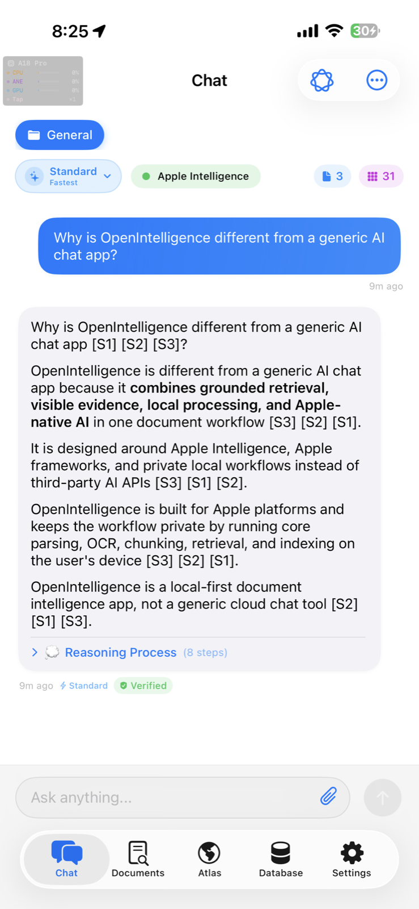
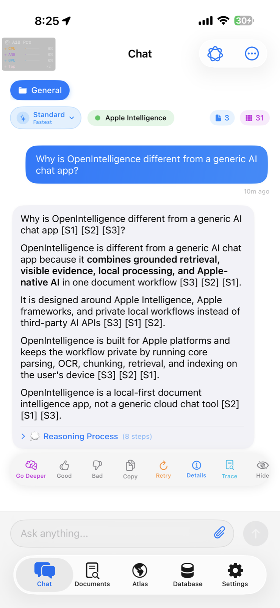
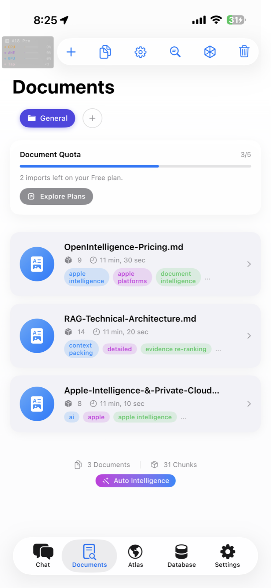

<p align="center">
   
</p>

<h1 align="center">OpenIntelligence</h1>

<p align="center">
   <strong>Ask your own documents anything. Every answer cites the page it came from.</strong>
</p>

<p align="center">
   <a href="https://apps.apple.com/app/apple-store/id6756559175?pt=127101782&ct=GitHub_Repo&mt=8"></a>
   <a href="Docs/HOW_IT_WORKS.md"></a>
   <a href="Docs/OPENINTELLIGENCE_ARCHITECTURE_ATLAS.md"></a>
   <a href="https://gunzino.notion.site/OpenIntelligence-Public-Roadmap-e4446012bb8940e6b78a745aee688075"></a>
</p>

---

Drop in PDFs, Office files, code, images, audio, or video. OpenIntelligence reads them, builds a private
searchable index, and answers questions about them with citations you can tap and check.

**It runs on your device.** Ingestion, indexing, retrieval, ranking, and verification are all local. Nothing is
uploaded to make search work. There is no account, no server of mine, and no third-party AI service anywhere in
the path. On iOS and macOS 27, you can optionally let Apple **Private Cloud Compute** write the final answer, but
only after you have seen how much would be sent and why. Every answer carries a badge showing where it actually
ran, read from an execution receipt rather than from what was requested.

<p align="center">
  
  
  
  
</p>

## Why it exists

Most document AI asks you to upload your files somewhere first. If those files are medical, legal, financial, or
simply yours, that is the whole problem. This is a bet that a genuinely good retrieval engine fits on an iPhone,
and that an answer is more trustworthy when you can see what it was built from.

## What it does

| | |
| :-- | :-- |
| **Reads real documents** | PDFs with tables and figures, Office files, code, plain text, JSON and JSON Lines (as records), images, audio, and video. A PDF of any size imports. Vision handles OCR when a PDF's text layer is unreliable. Pages, Numbers and Keynote files must be exported first. |
| **Searches two ways at once** | Meaning-based vector search and keyword BM25 run together, then fuse and re-rank, so hunting a part number and asking a conceptual question both work. |
| **Shows its work** | A live pipeline view names each stage as it runs. A citation opens its passage highlighted in the document for every kind of file and says whether it was found word for word (for Word, Excel and the like, that is the text the app read, not the original page). |
| **Explains its own vocabulary** | Every figure defines itself where it sits, in a plain register and a technical one. Tapping `38 TOPS` says what the number is, and that it is a per-chip rating rather than a measurement. |
| **Answers offline** | Airplane mode included. |
| **Works with Siri, Shortcuts and Spotlight** | Shortcuts actions ask a library in any answer mode and hand the answer and its sources on; others find passages, check a claim, add a file, link or text, and manage libraries. A Siri question that needs Private Cloud Compute brings the app forward to ask first. Spotlight and Visual Intelligence find the documents that match. |
| **Keeps up with a folder** | On Pro and Lifetime, a library can watch a folder: new files import by themselves and a changed file replaces the version it imported. |
| **Follows you between devices** | An interrupted import picks up where it was, Handoff carries what's open, conversations in an iCloud library sync with it, and the Mac has a menu bar item, Services menu entries and keyboard shortcuts. |

### Quality modes

| Mode | What it does | Measured accuracy |
|---|---|---|
| **Standard** | One retrieval pass and one answer, for lookups and direct questions. | 0.410 exact match across 83 cases from 40 research papers (QASPER), local only. |
| **Deep Think** | A chain of evidence sessions over rotating context windows, then a synthesis; research rounds can follow. | 9 of 25 against Standard's 10 of 25 in its largest paired run on the same QASPER pack. 25 cases cannot resolve less than about a four-case swing, so this does not separate the two modes. |
| **Maximum** | Lifts the session ceiling for questions that span a whole library. | No valid figure yet. |

The figures, their runs and an earlier figure that was withdrawn are in [Limitations](Docs/LIMITATIONS.md) and
`BenchmarkRuns/LEDGER.md`.

## How it works

```
Import    →  extract → chunk → embed → index (vectors + full-text)

Question  →  expand → hybrid search → fuse → re-rank → diversify
          →  expand to parent sections → pack context → answer → verify
```

Dense vector similarity and BM25 keyword matching run in parallel, merge through Reciprocal Rank Fusion, get
re-ranked by a cross-encoder, then pass through MMR so the context is diverse rather than five phrasings of one
paragraph. The answer streams into the chat as it is written; verification gates then check the finished answer
against the retrieved text and label it Verified or Unverified, and under the rule in
[How OpenIntelligence Works, section 04](Docs/HOW_IT_WORKS.md) they replace it with a refusal.

Measured on a physical A18 Pro: **27 tokens/sec on-device**, **86 tokens/sec on Private Cloud Compute**, time to
first token 2.2 to 3.2 s.

**Routing is a policy, not a hint.** On-Device never uses Private Cloud Compute, not for planning and not for
synthesis. PCC requests it, with a declared local fallback when an entitlement, availability, quota, network or
consent gate blocks the route. Hybrid decides per question from the evidence actually retrieved. Consent is asked
only for a real, finalised evidence envelope, never at launch. Retrieval and verification stay local whichever
model writes the answer. There is no selectable "3B" or "20B" on-device model, because the public SDK has no such
selector; from iOS and macOS 27 an app can read which model it has (`SystemLanguageModel.variant`).

## How it's proven

The claims above are checked, not asserted:

- **Every doc claim carries its evidence**: source-read, build-checked, test-covered, or confirmed on a physical
  device, and says so where something is unproven.
- **Golden recorders pin exact behavior.** `StandardPipelineGoldenTests` (35 Standard questions; every passage,
  score bit pattern and prompt), `ImportGoldenTests` (every passage, vector and index row of a fresh import),
  `StructuredParsingGoldenTests` (the PDF parser's output and checkpoints) and `DeepThinkRetrievalGoldenTests`
  (760 Deep Think searches). Each records twice per run and fails if the two passes differ.
- **Refactors are moves, proven by those recorders.** In November 2026 the three largest functions (the Standard
  pipeline, document import and the PDF parser, about 8,500 lines) were cut into about 120 named steps and their
  files split by stage. Every step built for the Simulator, a device and macOS and recorded identically before
  and after, and four independent reviews found no behavior change. The record is in the
  [Atlas, section 22](Docs/OPENINTELLIGENCE_ARCHITECTURE_ATLAS.md).
- **The release gate checks the binary.** Every archive is checked with `nm -u` for Private Cloud Compute
  symbols against a live `SystemLanguageModel` count as a control, so a build cannot silently contradict this page.

## Documentation

- **Start here:** [How OpenIntelligence Works](Docs/HOW_IT_WORKS.md), every stage of both pipelines in order,
  in plain English and technical side by side.
- **Everything else:** the [documentation map](Docs/README.md).
- **Honest limits:** [Limitations](Docs/LIMITATIONS.md) and [Hard Limits](Docs/Engineering/HARD_LIMITS.md).
- **History:** [Changelog](CHANGELOG.md), [what's new for users](Docs/USER_CHANGELOG.md), the
  [roadmap](Docs/ROADMAP.md).

## Codebase map

| Module | Core files | Responsibility |
| :--- | :--- | :--- |
| **Ingestion** | `DocumentProcessor.swift`, `LayoutAwareExtractor.swift` | Content extraction, Vision OCR fallback, structure recovery |
| **Chunking** | `SemanticChunker.swift`, `ContentTaggingService.swift` | Context-aware chunking, entity resolution, metadata |
| **Indexing** | `SQLiteFullTextService.swift`, `BNNSVectorDatabase.swift` | SQLite FTS5 and BNNS-accelerated vector storage |
| **Retrieval** | `HybridSearchService.swift`, `ContextPackingService.swift` | Hybrid merge, parent-chunk reconstruction, token packing |
| **Orchestration** | `RAGService.swift` and its `RAGService+*.swift` files, `RAGEngine.swift`, `AgenticOrchestrator.swift` | The pipelines, re-ranking, MMR, agentic reasoning |
| **Foundation Models** | `LLMService.swift`, `FoundationModelRoutePolicy.swift` | On-device execution, PCC escalation, routing receipts |
| **Evidence Threads** | `EvidenceThread.swift`, `EvidenceThreadStore.swift` | Local persistence of conversations and verification state |
| **Storage & Sync** | `SettingsStore.swift`, `WorkspaceSyncService.swift` | Feature gates, StoreKit 2 quotas, iCloud workspace sync |
| **Interface** | `ChatScreen.swift`, `DocumentLibraryView.swift` | Chat and library surfaces |
| **Vocabulary** | `Glossary.swift`, `GlossaryViews.swift` | One definition per term in two registers, attached in place via `.definedTerm(_:)` |
| **Shortcuts** | `RAGAppIntents.swift`, `SearchPassagesIntent.swift`, `AddToLibraryIntent.swift`, `LibraryIntents.swift`, `OpenItemIntents.swift`, `ScreenAwarenessIntents.swift`, `VisualIntelligenceIntents.swift` | Siri and App Intents, resolving in-process |

Which file of a split type holds what is in [the file map](Docs/ai/FILE_MAP.md); the
[codemap](Docs/ai/codemap/INDEX.md) names, for each feature, the code to read first.

## Building

Xcode 27 (Swift 6.4) on an Apple silicon Mac; the deployment target is iOS 26.0. The iOS and macOS 27 paths,
Core AI embeddings and native Private Cloud Compute, compile out below that SDK.

```bash
./scripts/build_simulator_smoke.sh
```

```bash
./scripts/check_icloud_conflicts.sh
```

Builds need a `-derivedDataPath` outside the repository, because the maintainer's copy lives in iCloud Drive.
The full procedure, tests and benchmarks are in the [runbook](Docs/ai/RUNBOOK.md).

## Large documents

A PDF over 10 MB imports through a streamed, batched pipeline, 15 pages a batch with a checkpoint per page, so a
long import survives memory pressure and app restarts instead of starting over. A text, Markdown or JSON Lines
file over 8 MB imports the same way in pieces of about 2 MB, and a `.json` file over 64 MB is imported in pieces
too. An 88.5 MB JSON Lines file finished on an iPhone 16 Pro Max as 144,247 passages on 2026-10-10.

## Status

Shipping on the App Store for iPhone, iPad, and Mac. **5.7 is live on both platforms** (released 2026-10-22,
build 487) and **5.8 is in development**. Private Cloud Compute shipped in 5.2 and execution is confirmed on a
physical device; its edge cases (quota exhaustion, mid-stream network changes, background consent) are tracked as
open items. Releases are built by Xcode Cloud on Apple's released images, never on the maintainer's Mac. Work is
planned on a [public roadmap](https://gunzino.notion.site/OpenIntelligence-Public-Roadmap-e4446012bb8940e6b78a745aee688075)
synced from the same database it is planned in.

## License

MIT. See [LICENSE](LICENSE).
